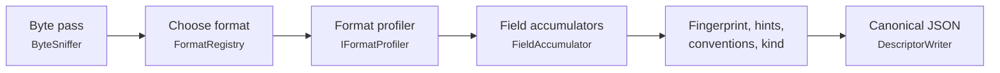

# squalify design

Status: design settled by the owner on 2026-10-13 (spec interview), amended the same day after the [sample-data review](reviews/sample-data-review.md). Code lands slice by slice (`slicer list`). For the diagrams, see [how-it-works.md](how-it-works.md). For the descriptor schema, see [descriptor.md](descriptor.md).

## Purpose

squalify reads one data file and writes a descriptor. Consumers use the descriptor to classify the file, choose a transform or draft a file type. A consumer should be able to make those decisions from the descriptor alone, without opening the file again.

## Settled decisions

| Decision | Choice |
|---|---|
| Scope | One tool. It outputs a descriptor only. No config proposal, no conversion, no matching against a user library of known types. |
| Kind label | A generic `kind` label from a fixed, built-in rule set, with evidence (sq-15). |
| Stack | .NET 10, standalone. No reference to DataBall. |
| Names | Namespace `squalor.squalify`, CLI `squalify`, slicer ids `sq-NN`. |
| v1 formats | Delimited text (with preambles, units rows and repeated blocks), Parquet, Touchstone, whole-file key=value/INI documents, binary (STDF V4 walk plus a generic byte profile). |
| Compressed and archive files | Described as binary with a named magic. No decompression in v1. |
| Read depth | A full streaming scan with bounded memory. |
| Values | Opt-in through `--include-values`. See [Values tier](#values-tier). |
| Dependencies | DuckDB.NET.Data.Full 1.5.5 (Parquet) and System.CommandLine 2.0.11 (CLI). Tests: Microsoft.NET.Test.Sdk 17.14.1, xunit 2.9.3, xunit.runner.visualstudio 3.1.5. |
| Determinism | The same bytes and the same tool version give a byte-identical descriptor on every OS and CPU. No ML, LLM or network. |
| Exit codes | 0 for success; 1 for any error (the same as DataBall's CLI). |

## Pipeline

### Source

`IProfileSource { string Name; long Length; Stream Open(); }`. `FileSource` wraps a path; a directory or a missing file raises `SqualifyException` when the source is created. Tests use synthetic sources that generate bytes on the fly. Every pass reopens the source. A path never reaches the descriptor; only `Name` (the file name) does, and `Profiler` enforces it: a `Name` that is empty or contains `/` or `\` raises `SqualifyException`, so a host's own source cannot smuggle a path into `file.name` or `hints.fileNameShape`. `Profiler.Profile(IProfileSource, ProfileOptions)` and `Profiler.Profile(string path, ProfileOptions)` (`src/squalify/Profiler.cs`) run the pipeline.

### Passes

Each pass streams the file once with bounded memory.

- **Pass 0, the byte pass (every file).** Computes:
  - SHA-256 of the content;
  - the 256-bin byte histogram;
  - NUL counts at even and odd offsets;
  - the count of control bytes (0x00–0x08, 0x0E–0x1F, 0x7F);
  - strict UTF-8 validity, using `System.Text.Unicode.Utf8` and carrying incomplete sequences across buffer boundaries;
  - the BOM;
  - magic matches.

  Text, binary and empty are decided from these whole-file counts:
  1. A zero-length file is empty.
  2. A binary magic means binary.
  3. A UTF-16/32 BOM means text.
  4. A NUL-parity pattern means UTF-16 without a BOM. The pattern is: at least 90% of NULs at odd offsets, or at least 90% at even ones, with NULs at least 30% of all bytes.
  5. Any other NUL, or control bytes above 5%, means binary.
  6. Otherwise the file is text. The charset is `ascii`, else `utf-8` if valid, else `latin-1`. If bytes 0x80–0x9F occur, the evidence notes "possibly windows-1252".
  7. Stray invalid UTF-8 sequences within `limits.charsetTolerance` (at most 8, and at most 1 per 64 KiB) keep the `ascii` or `utf-8` charset. They decode to U+FFFD and are reported as `invalidUtf8` issues with offsets. Beyond the tolerance, rule 6's `latin-1` applies. The number allowed is `min(8, ceil(size / 65536))`, so a file shorter than 64 KiB tolerates one.

  The sniffer reads 64 KiB buffers and keeps up to 3 trailing bytes of an incomplete UTF-8 sequence for the next buffer, so a character that straddles a buffer boundary is not counted as invalid. It also keeps the first 512 and last 16 bytes for the magic table. `SniffResult` (`src/squalify/Sniff/SniffResult.cs`) holds the counted facts and applies the rules; `MagicTable` (`src/squalify/Sniff/MagicTable.cs`) is the ordered table of named magics, which [descriptor.md](descriptor.md#encoding) lists. A UTF-8 BOM is valid UTF-8, so a BOM plus ASCII text is `utf-8` with `bom: "utf-8"`.
- **Pass 1, structure (text profilers).** Tokenizes and classifies records and lines, keeping only bounded summaries. The delimited profiler runs this pass while it scores the file (see [Choosing a format](#choosing-a-format)), so a file is not scanned twice for the choice.
- **Pass 2, fields (text profilers).** Parses the chosen data region and feeds the field accumulators. For delimited text it re-reads the whole file with the chosen dialect, builds the regions and the header, and counts type votes for every data record (the full statistics come with sq-05).
- Parquet reads its metadata and then streams rows. STDF walks record headers in one pass.

### Choosing a format

Each `IFormatProfiler` scores the file between 0 and 1. The highest score wins. Ties break by registry order: `parquet`, `stdf`, `touchstone`, `keyValue`, `delimited`, `text`, `binary`. Every registered profiler's score and reason goes into the evidence trail (stage `format`, topic `family`), with the candidates in registry order. `FormatRegistry` (`src/squalify/Formats/FormatRegistry.cs`) sorts whatever it is given into that order, and rejects an unknown or repeated family. A zero-length file is `empty` by rule 1, before any score counts: no profiler claims it, `format.score` is 1, and every candidate scores 0. The `delimited`, `text` and `binary` profilers are registered so far; each later format slice registers its own.

- **The interface.** `Score(IProfileSource source, SniffResult sniff, ProfileContext context)` returns a `FormatScore`: the score, the reason, and optionally an opaque `State`, `NotChosenIssues` and `NotChosenEvidence`. Scoring gets the source because the byte-pass result keeps no file head, and a delimited table can only be scored by reading the whole file (a whole-file tokenizer pass; see [Delimited text](#delimited-text)). `Profile(source, sniff, context, score)` receives the winner's own `FormatScore`, so the structure that scoring found (`State`) is not computed again. The text and binary profilers score from the sniff result alone and ignore the source.
- **The fallback.** A profiler may decline a file that looks a little like its family and say why. The delimited profiler scores 0 when no candidate delimiter is viable; when at least one candidate was disqualified (a runaway quote, or too many field-count runs), it also returns the issue `tooIrregular` and the dialect evidence in `NotChosenIssues` and `NotChosenEvidence`. `FormatRegistry.Detect` carries these from every profiler that did not win into the `FormatChoice`, and `Profiler` writes them to the descriptor. The generic text profile then describes the file, and `tooIrregular` records why it is not a table. A winner's own `NotChosenIssues` are never written.
- **Line counting.** `GenericTextProfiler` decodes the text with `TextDecoder` (`src/squalify/Text/TextDecoder.cs`, which maps every character to the byte offset where it starts, for the regions of later profilers) and reports line endings, blank lines, the longest line and one `unknown` region. The counting itself is the shared `LineCounter` (`src/squalify/Text/LineCounter.cs`), which the delimited profiler uses too, so both report the same line endings, the same `mixedLineEndings` issue and the same `layout.maxLineLength`. `GenericBinaryProfiler` reports the histogram, the byte-class counts and the entropy of `ByteEntropy`.

| Profiler | Score |
|---|---|
| parquet, stdf | 1.0 when the magic is confirmed |
| touchstone | 0.9 for extension plus content; 0.7 for content only |
| keyValue | up to 0.6 |
| delimited | 0.3 + 0.4 × the best candidate's score (at most 0.7); 0 when no candidate is viable |
| text | 0.1 |
| binary | 0.1, or 0.2 with a named magic (gzip, zip, …) |

## Delimited text

The profiler is `DelimitedProfiler` (`src/squalify/Delimited/DelimitedProfiler.cs`). Pass 1 runs while the file is scored; pass 2 runs only when the profiler wins.

- **Candidates.** The delimiter candidates are `,`, `\t`, `;`, `|` and whitespace runs, in that candidate order. `TextScanner` (`Delimited/TextScanner.cs`) decodes the file once, finds the physical lines (CRLF, LF, CR) and feeds one `RecordTokenizer` per candidate, all at the same time, plus the shared `LineCounter`. The whitespace-run candidate splits on runs of the characters in `ValueClassifier.TrimChars` and trims leading and trailing white space. The descriptor writes `whitespace` as its delimiter.
  - **Quoting** follows RFC 4180 with `"`: a quote opens a quoted field only at the start of a field, `""` inside a quoted field is an escape, and line breaks are allowed inside quotes. A lone `"` inside a quoted field that is followed by neither another `"`, nor the delimiter, nor the end of the line is literal text (owner decision 2026-10-27: an ATE export's writer quotes a field that holds a comma but does not escape quotes inside it). A closing quote followed by spaces or tabs and then the delimiter, or the end of the line, closes the field (padded quoted cells; owner decision 2026-10-27): the tokenizer holds the white space after a quote and decides when the next character arrives. A quote followed by white space and then anything else stays literal. Each candidate counts the literal quotes, and its evidence reason reports them.
  - A **blank line** (only spaces and tabs; for the tab candidate only spaces, for the whitespace candidate any trimmed white space) is not a record, so blank lines never break a run.
  - A **runaway quote** (an open quoted field longer than 65,536 characters, `limits.runawayQuote`) disqualifies that candidate, and the evidence records the line where the quote opened.
  - Each candidate keeps run-length-encoded field counts (`FieldCountRle`): runs of `(fieldCount, records, firstLine, firstByte)`, plus the last line and end byte and the token counts that the clean share needs. More than 100,000 runs (`limits.fieldCountRuns`) disqualifies the candidate as too irregular, which also bounds its memory.
  - If no candidate is viable and at least one was disqualified, the profiler declines and the generic text profile is used, with the issue `tooIrregular` (see [Choosing a format](#choosing-a-format)).
- **Dialect and data run** (`DialectSelector`).
  - k is the modal field count among records with at least two fields. A tie goes to the larger k.
  - The data run starts at the first record that, together with the next min(5, remaining) records, has k fields. On the run-length encoding that is the first record of the first k-run that has at least six records or reaches the end of the file. It ends at the last record with k fields.
  - The score is the number of records in the data run with k fields, divided by the number of non-blank records, times the **clean share**: the share of tokens in the run that do not contain another candidate's delimiter character (`,`, `;` or `|` other than its own) anywhere (owner decisions 2026-10-27). For the comma, semicolon and pipe candidates, a tab inside a trimmed token also makes it unclean (a TSV cell is not a token of those candidates); a tab at either end is trimmed away, and spaces never count. A quoted token is clean, and a comma inside a comma-decimal number such as `1,5` (`ValueClassifier.IsCommaDecimalLike`) is not counted, so a semicolon file with decimal commas keeps its own tokens clean while the comma candidate's tokens (`5;2`) are not. Without the clean share, whitespace runs nearly tie with the real delimiter on right-padded tables. The highest score wins. Ties break by higher k, then by candidate order, with one exception: tab beats the whitespace candidate on a tie whatever k is, because whitespace's split always contains tab's (owner decision 9).
  - These thresholds are specified behavior (owner decision 2026-10-27). A candidate is **viable** when its run has at least two records and its score is at least 0.5; a whitespace run needs six records, because prose splits into words too (a two-line text file must stay text). The profiler score is 0.3 + 0.4 × the chosen candidate's score; with no viable candidate it is 0.
  - The evidence (stage `dialect`, topic `delimiter`) lists every candidate in candidate order with the reason `k={k}; {inRun}/{total} records; clean={c}; run lines {a}-{b}`, followed by `; {n} quoted fields` (always) and `; {n} literal quotes` (when there are any). A candidate with no run says `k={k}; no run` (with the same suffixes); a disqualified one says `disqualified: runaway quote opened at line {n}` or `disqualified: too irregular, ...`.
  - **Known limitation.** A header-less comma CSV with a multi-word first column and an integer last column, such as rows like `Site North,3`, can still be called whitespace: the whitespace split gives the same field count on every row, every token is clean, and its k is larger than comma's. A header row or any comma-bearing cell usually breaks the tie; squalify does not special-case it.
- **Padding and decimal separator.** The dialect reports `padding {trim, paddedShare, constantLineLength, lineLength}` over the data run. `paddedShare` is the share of non-empty cells (non-empty after trimming) whose raw text starts or ends with a trim-set character; `trim` is true when any cell was padded; `lineLength` is set only when every non-blank physical line of the run has the same byte length. Cells are always trimmed before typing. Fixed-width tables are described, not parsed by offset. The decimal separator is `,` only when the delimiter is not `,` and comma-decimal cells outnumber dot-decimal cells in the header sample; the evidence (stage `dialect`, topic `decimalSeparator`) records both counts. The two shapes are defined together in `ValueClassifier` (`IsCommaDecimalLike`, `IsDotDecimalLike`), so the vote compares counts under one rule.
- **Line kinds** (preamble and footer), tested in order:
  - `blank`;
  - `comment`: the trimmed line starts with `#`, `!` or `//`;
  - `keyValue`: `key=value` or `key: value` with a non-numeric key of 1 to 64 characters, or two fields whose first ends in `:` or `=` (the `key:,value` form); an Excel-style `key:,value,,,` line gives its value without the leading and trailing delimiters;
  - `keyDelimValue`: two fields, the first non-blank and non-numeric;
  - `text`.
  `LineClassifier` uses only fixed character sets and the ASCII-only `ValueClassifier`. Numeric means `int` or `float` under either decimal separator.
- **Header, annotation and units rows** (`HeaderDetector`). Pass 2 buffers up to 1,000 records from the start of the data run (`limits.headerSample`) and classifies every cell with `ValueClassifier`. Some exports put several column-aligned rows (limits, units, line references) above the header, with the table's field count, so the header is not always the run's first record.
  - Every record in the header sample is a header candidate; there is no separate cap. The column types below a candidate are the strict join of the votes of the records after it (an all-null record, a comment line and a record with another field count are skipped; a units row directly after the candidate is left out). A candidate is eligible if its fields are all non-blank and pairwise distinct under ASCII case folding, and in some column whose type is neither empty nor `string` its value fails that type (a null cell fits any type).
  - Score = nonEmpty × nonNumeric × unique × (0.5 + 0.5 × contrast), where nonEmpty, nonNumeric and unique are shares of the fields, and contrast is the share of typed columns whose type the candidate fails. The highest eligible score wins; ties go to the earliest. The evidence (stage `header`, topic `candidates`) lists every eligible candidate with its sub-scores, the winner (which may be a relaxed or assumed one, and is not always eligible), ordered by line with the 1-based line as `value`, and then one `summary` entry. The summary reason counts only: `sampled={n}; eligible={e}; ineligible={i} (comment line={a}, field count={b}, blank or repeated names={c}, fits every typed column={d})`. All of it is value-free numbers.
  - If no record is eligible, a **relaxed** pass takes the best record that fails a typed column and has no numeric field although a name is blank or repeated; the header is then written with the issues `emptyHeaderName` and `duplicateHeader`, and the evidence says `relaxed`.
  - If there is still no header and no column below the first record has a type other than `string`, record 0 is the header when its fields are non-blank and distinct. The evidence then says `assumed: all-string table`.
  - Otherwise the table has no header (`hasHeader: false`): every record is data and field names are null.
  - A comment line (`#`, `!` or `//`) inside the run is free text: it is never a header candidate, an annotation row, a label or a cell value, wherever it sits. It is counted under `commentInData`.
  - Records between the run start and the header form one `annotation` region. Each row reports a label (its normalized first field, when that is non-numeric; the label cell is then left out of the counts), blank fields, null tokens, type votes and the joined type. Labels are always included; cell text is values tier.
  - **Units row** (owner decision 2026-10-27). The record after the header is a units row when every non-null field fails its column's type, is at most 16 characters and sits in a column whose type is not `string`, and at least one field is non-null. Null cells (blank, or a token of the null vocabulary) are neutral, so a unitless column may be blank; an all-null record (an ATE separator row) is never a units row. The units region is always detected; the unit text (`fields[].unit`) is values tier.
- **Keys and labels** are normalized: trimmed, with a trailing `:` or `=` removed. A field name containing U+FFFD also carries `nameHex`, the hex of the bytes of the field as written (trimmed, quotes included), read from the source once after the scan.
- **Regions.** Regions tile the file: a region starts at the first record of its kind and ends on the line before the next region starts; a blank line belongs to the region before it (leading blank lines to the preamble, trailing ones to the last region). The first region starts at byte 0, a BOM included, and the last ends at the end of the file. Byte ranges are byte offsets in the file's own charset. `lineKinds` counts records (a record with a quoted line break counts once). Footer: the non-blank records after the run.
- **Type votes.** For this slice every data record with the header's field count is classified, and each field gets `typeVotes`, `type` (the strict join), `dominant`, `count`, `nulls` and `nullsExcludingAllNullRows`. The other statistics are sq-05's, and `nameParts` is sq-14's: they are written as `null` until those slices compute them (see [descriptor.md](descriptor.md#interim-members)). Ragged records are counted but not typed.
- **No record-length cap.** Every record is profiled, however long. `layout.maxLineLength` reports the longest line in characters (UTF-16 code units, as for the text profile). Memory stays bounded by the per-field runaway-quote limit and the field accumulators' caps.
- **Repeated blocks** (sq-13). Two or more data runs with the same k, each at least 5 records long, are profiled as blocks. If every block's header is identical, the fields are aggregated across blocks. Otherwise only the first block is profiled and the issue `heterogeneousBlocks` is recorded. Until then `format.dialect.blocks` is 1.
- **Row classes** (sq-17). Data records are grouped by which fields are non-null. Some exports interleave measurement, setup, error and all-null separator rows, switching thousands of times, which contiguous regions cannot express. `table.rowClasses` reports each class (count, field ranges, first and last line, a stable ID), the number of class transitions and the all-null record count. Each field also reports its nulls excluding all-null records.
- **Problems are described, not rejected.** squalify records issues and still writes a descriptor: `raggedRows` (a record in the data run with another field count than k), `commentInData` (a comment line inside the run; it is not a data row and not ragged), `duplicateHeader`, `emptyHeaderName`, `tooIrregular`, `invalidUtf8`, `mixedLineEndings`.

## Touchstone

Rules follow common practice as implemented in scikit-rf, and are checked against the IBIS Touchstone 2.0/2.1 text in sq-09.

- **Option line.** `# <freq unit> <parameter> <format> R <ohms>` is positional, case-insensitive, and defaults to `GHz S MA R 50`. Every defaulted value gets an evidence entry.
- **Port count.** It comes from the extension `.[ghsyz]<N>p` or from `[Number of Ports]`. A mismatch between the two is an issue.
- **Data.** Network data is a flat token stream. Each block holds 1 + 2N² values (N(N+1) for Lower/Upper matrices), whatever the line breaks. `!` starts a comment, and inline comments are stripped.
- **2-port order.** v1 2-port data uses the order S11 S21 S12 S22. In v2, `[Two-Port Data Order]` sets it.
- **Noise.** In v1 2-port files, noise data starts where the frequency decreases. In v2 it is marked by `[Noise Data]`.
- **Fields.** The data is exposed as synthesized numeric fields: `freq`, then `Sij.<a|b>`, with suffixes by format (`mag/ang`, `db/ang`, `re/im`), in file order.

## Key=value / INI documents

These are whole files of `key=value` or `key: value` lines, with optional `[section]` headers. Section names and keys are always included. Values appear only with `--include-values`, but each key's value type vote is always included. Key=value lines above a table are not this family; they are the delimited profiler's preamble.

## Binary and STDF

- **Any binary file.** The byte histogram and whole-file entropy exist from sq-03; block entropy and segments come with sq-10.
  - The byte histogram, whole-file Shannon entropy, and the entropy of 4 KiB blocks: count, min, max and mean.
  - A fixed 16-segment entropy profile.
  - All computed with `DetMath.Log2`.
- **STDF V4** (layouts from pystdf; the 2007 additions are checked against the primary spec in sq-10).
  - Each record header is REC_LEN U2 (payload only) + REC_TYP U1 + REC_SUB U1.
  - FAR is (0, 10), and its CPU_TYPE sets endianness: 2 = little, 1 = big, 0 = VAX (an issue).
  - squalify walks every record header and reports:
    - record-type counts;
    - the first-occurrence order;
    - whether FAR is first and MRR last;
    - truncation.
  - **Test catalog.** For each test, squalify records TEST_NUM, the kind (P, M or F) and the first non-empty TEST_TXT or TEST_NAM, taken from PTR, MPR, FTR and TSR. Test names behave like column headers, so they are always included, up to `limits.stdfTests` (10,000).
  - Result values are never decoded.

## Parquet

DuckDB.NET runs on an in-memory connection with `threads=1` and `preserve_insertion_order=true`.

- **Metadata.** squalify reads `parquet_file_metadata`, `parquet_schema`, `parquet_metadata` (aggregated in row-group order) and `parquet_kv_metadata`. KV keys are always included; KV values only with `--include-values`.
- **Rows.** Rows stream into the same field accumulators as text, so the statistics match the text profile.
- **Nested columns.** These report only count, nulls and `sourceType`.

## Fields

### Value classification and types

`ValueClassifier` (sq-16, `Values/ValueClassifier.cs`) is a pure function: `Classify(value, decimalSeparator)`. It uses the invariant culture and ASCII rules only, so the result does not depend on the current culture, the clock or the machine. It takes the dialect's decimal separator (`.` or `,`), and it never assumes a locale. It trims the value (see **Trim set** below), then returns a `ValueClass`: the vote, the pattern, the date orders, the clock, the flags and, for a null, the matched vocabulary entry.

- **Trim set.** Before anything else the value is trimmed at both ends of exactly these characters: U+0009 to U+000D (tab, line feed, vertical tab, form feed, carriage return), U+0020 (space) and U+00A0 (no-break space). The set is a fixed constant (`ValueClassifier.TrimChars`, applied by `ValueClassifier.Trim`), not `char.IsWhiteSpace`, because that follows the runtime's Unicode tables and the output must not depend on the runtime. Other space characters (U+2028, U+3000 and so on) are not trimmed, so `"\u3000NA"` is a `string`. The field accumulator (sq-05) trims with the same method.
- **Null tokens, vocabulary 1:** `""`, `NA`, `NA.`, `N/A`, `null`, `NaN`, `-`. They are matched ASCII case-insensitively after trimming with the trim set above. The vocabulary is fixed and versioned (`limits.nullTokens`, from `ValueClassifier.NullVocabularyVersion`), never learned from the data: learning it would make one column's type depend on the others.
  - **Matched entry.** A null value also reports which vocabulary entry matched, in the vocabulary's spelling (`na.` reports `NA.`, `nan` reports `NaN`, white space reports `""`). A consumer can then choose which tokens it treats as null; for example, one that reads `NaN` as a number in a unit column can do so. Counting nulls per token, in the spelling found in the file, is the field accumulator's job (sq-05), not the classifier's.
- **Types** (checked in this order, so the first match wins):
  - `bool`: `true`, `false`, `yes`, `no`, ASCII case-insensitive. Numeric booleans (`0`/`1`) and `y`/`n`, `on`/`off` are not booleans.
  - `int`: `^[+-]?[0-9]+$` (ASCII digits) and fits Int64. A longer run of digits is a `float`.
  - `float`: `double.TryParse` with `NumberStyles.Float` and a finite result, on values made only of digits, signs, `e`/`E` and the decimal separator. With `,` as the decimal separator the value is parsed with `,` as the decimal point and no group separator, so `1.5` is then a `string`. Words such as `Infinity` and out-of-range exponents (`1e999`) are `string`.
  - `date`: three numeric parts separated by the same `/`, `-` or `.`, with a 4-digit year (first or last) and 1–2 digit day and month. The value reports every **order** (`YMD`, `MDY`, `DMY`) under which it is a valid calendar date (year 1 and up, leap years by the Gregorian rule). A 4-digit first part allows only `YMD`. squalify never picks a locale. Two-digit years (`6/5/26`) stay `string`, because the century would have to be guessed.
    - At field level (sq-05), a field's orders are the intersection over its values. More than one left means `ambiguous`; none left joins the field to `string`, with evidence.
  - `datetime`: a date, then `T` or one space, then a time. `T` is only for the ISO date `yyyy-MM-dd`, with a 2-digit hour. A zone offset (`Z`, `+hh`, `+hhmm`, `+hh:mm`, or the same with `-`) is only allowed after the ISO date. An `AM`/`PM` marker is allowed only after a space, never after `T`: `2026-03-17T10:00 PM` is a `string`. The orders are the date's.
  - `time`: `H:mm[:ss[.f+]]`. Minutes and seconds have two digits and the fraction needs seconds. An optional ASCII `AM`/`PM` marker (case-insensitive, with or without one space before it) makes the **clock** `12h` and limits the hour to 1–12 (hour 0 or an hour above 12 with a marker is a `string`, and so is a date followed by such a time). Without a marker the clock is `24h` and the hour is 0–23.
  - `string`: anything else, including a date with a non-ASCII day-period marker.
- **Pattern.** A `date`, `datetime` or `time` vote also carries a pattern, the layout that `patterns` counts. It is order-neutral: the pattern of `6/5/2026` is `n/n/yyyy` whichever of `MDY` and `DMY` it is. Tokens: `yyyy` for the year and `nn` or `n` for a 1–2 digit day or month (the separator is kept); `HH`/`H` or `hh`/`h` for the hour (24-hour or 12-hour), `:mm`, `:ss`, `.f+` for a fraction of any length, `tt` for the marker (with a space before it when the value has one); `Z`, `zz` (`+hh`), `zzzz` (`+hhmm`) and `zzz` (`+hh:mm`) for the offset; and the literal `T` or space between date and time. For example `nn/n/yyyy hh:mm:ss tt` and `yyyy-nn-nnTHH:mm:ssZ`.
- **Flags:** `leadingZero` (an `int` or `float` whose integer part starts with `0` followed by another digit, such as `007` or `-00.5`) and `commaDecimalLike` (`^[+-]?[0-9]+,[0-9]+$`, whatever the separator and the vote: `1,5` is a `string` under `.` and a `float` under `,`, and has the flag in both).

The type lattice:

- `empty` < `bool`
- `empty` < `int` < `float`
- `empty` < `date` < `datetime`
- `empty` < `time`
- Any other join is `string`.

A field's `type` is the join over all its non-null votes (the strict rule). Votes are always reported, together with the dominant type and its share. A plurality tie goes to the narrower type.

### Statistics

- **Numeric:** min and max (integers for `int`); mean and sample stddev by Welford in input order; quantiles p01, p05, p25, p50, p75, p95 and p99 by lower nearest rank.
- **Temporal:** `orders`, `ambiguous` and `clock`; min and max as ISO 8601, and quantiles over ticks. When the order is ambiguous, min, max, quantiles and monotonicity are written as `null`, because any value would assume a locale.
- **Constant fields:** when every non-null value of a field is equal (including a sparse field with one value), its numeric or temporal statistics are that value. They are withheld (`statsWithheld: "constant"`) unless values are opted in for the field.
- **All fields:** lengths, padded values, null tokens, monotonicity (numeric and temporal only), constant, and unique.
- **Shape masks** (value-free, so always included):
  - each character maps to a class: `9` for a digit, `A` for upper case, `a` for lower case;
  - ASCII punctuation and space are kept literally; other characters become `?`;
  - runs of two or more are written as `c{n}`;
  - a mask longer than 64 tokens is truncated with `+`;
  - a field keeps at most 64 masks, and the rest are counted as `other`.

### Bounded memory and sketches

| Accumulator | Exact up to | Beyond the cap |
|---|---|---|
| Distinct values per field | 10,000 | HyperLogLog, p=14, over `XxHash64` (seed 0), with linear counting below 2.5m |
| Quantiles per field | 100,000 values | Greenwald-Khanna, ε = 0.001, compressing every ⌊1/(2ε)⌋ inserts |
| Top-k values (`--include-values`) | while the distinct set is exact | Space-Saving, 1,000 counters; k = 10 |
| Shapes per field | 64 masks | counted as `other` |
| Regions | 1,000 | truncated, with a count |
| Runaway quote (delimited) | 65,536 characters in an open quoted field (`limits.runawayQuote`) | that delimiter candidate is disqualified |
| Field-count runs (delimited) | 100,000 runs per candidate (`limits.fieldCountRuns`) | that candidate is disqualified as too irregular |
| Header sample (delimited) | 1,000 records (`limits.headerSample`) | later records are not header candidates; they are still typed |
| STDF test catalog | 10,000 tests | counted |
| Row classes per table | 64 (first seen kept, exact counts) | counted in `truncated` |

- **Crossing a cap.** The exact buffer is fed to the sketch in input order and then freed. The output is marked `approximate: true` and carries `errorBound`.
- **Global budget.** A global budget of 10M exact quantile values and 2M exact distinct values caps each field at min(cap, budget ÷ field count). The effective caps are written to `limits`.
- **Memory ceiling.** Peak working set stays at or below `MemoryBudget.CeilingBytes`: the sum of the accumulators' estimated bytes plus a fixed allowance for the runtime and I/O buffers. sq-11 sets the allowance (owner to confirm) and tests it on generated streams; sq-19 benchmarks against it.

## Values tier

| Always included | Only with `--include-values` |
|---|---|
| Header names, preamble keys, annotation labels, section names and keys, Parquet column names and KV keys, STDF test names | Preamble values, annotation-row cells, key=value values, Parquet KV values, comment text |
| Counts, nulls, types, votes, shapes, lengths | Top-k values, lexical (string) min/max |
| Numeric and temporal min/max/mean/stddev/quantiles, except for constant fields | Units-row text (field `unit` from a units row); statistics of constant fields |
| Header-unit convention and units parsed from header names | Value-bearing `stableLines` regexes (comment and text lines) |

`--include-values` opts in every value. `--include-values-for <name>` (repeatable) opts in only the values of the named preamble keys, annotation labels, key=value keys and fields, matched case-folded; identity often lives in one or two of them. A name that matches several members opts in all of them; a name that matches nothing gives the issue `includeValuesForUnmatched`. `options.includeValuesFor` records the names.

`ValuesPolicy` lists every value-bearing descriptor member in one place, including annotation cells and the statistics of constant fields. Canary tests prove that nothing leaks without the flag or an allow-list entry.

## Header-unit conventions

Each header name is parsed against a fixed set of conventions:

| Convention | Example |
|---|---|
| `nameParenUnit` | `I_Total(A)` |
| `nameBracketUnit` | `Pout[dBm]` |
| `nameUnderscoreUnit` | `VCC_V`. Only when the suffix is a known unit, so `I_Total` stays a plain name. |
| `unitsRow` | a units row under the header |
| `none` | |

The unit table is fixed and versioned (`limits.unitTable`). It contains these base units, combined with the SI prefixes f, p, n, u/µ, m, k, M and G:

- V, A, W
- Hz, s
- Ohm/Ω, F, H
- dB, dBm, dBc
- %, C/degC/°C, K

This matches DataBall's `HeaderParser` patterns, so a consumer can map conventions directly.

## Structural fingerprint

There are four SHA-256 hashes, each written as `sha256:<hex>`. Each is computed over a compact canonical JSON projection that contains no values.

- **`structure`.** No names at all: the family, the dialect (delimiter, quote, hasHeader, unitsRow, decimal separator, constant line length), the charset family, the region kinds in order, and the dominant preamble line kind.

- **`layout`.** The projection holds:
  - the family and the dialect (delimiter, quote, hasHeader, unitsRow);
  - the charset family (`unicode` or `latin1`);
  - the region kinds, in order;
  - the preamble keys (normalized);
  - the dominant header-unit convention;
  - the ordered, case-folded field names (`#<index>` when unnamed);
  - each family's own contribution.
- **`typed`.** `layout` plus the field types.
- **`names`.** The sorted, unique, case-folded field names.

A name with a control character or U+FFFD is hashed as `#<index>` (fields) or left out (keys), with the issue `nameExcludedFromFingerprint`. Such bytes may vary per file and would otherwise make every sibling unique.

**Fingerprint equality is not a family test.** Column sets often vary by recipe, unit or bench, so `layout`, `typed` and `names` can be unique per file, and every plain header-plus-rows CSV shares one `structure`. Family recognition needs more evidence, such as name containment and hints. Consumers comparing `typed` should treat `empty` as matching any type and `int` as within `float`.

Family contributions:

- **Parquet:** column names with repetition. The typed hash adds the physical and logical types.
- **Touchstone:** version, ports, parameter, format, matrix and noise.
- **keyValue:** sections and keys.
- **STDF:**
  - layout: the record-type set and the endianness;
  - typed: the catalog's `(testNum, kind)` pairs;
  - names: the test names.

`fingerprint.version` changes whenever a projection changes.

## Detect-rule hints

Hints are neutral facts that a consumer can turn into match rules:

- `extension`.
- `magic`.
- `stableLines`: each entry has a 0-based `line` and an anchored, portable regex. For example, a header line becomes `^<escaped header>$` at any length, the header prefix becomes a padding-tolerant regex over the first 5 names (all when there are fewer), and a preamble key becomes `^\s*<key>\s*[=:]`.
- `headerFields`, `headerPrefix` and `nonNullFields` (fields with no nulls in this file: an observation, not a requirement of the type).
- `fileNameShape`: the shape mask of the file name.
- `fieldCount`, `dataStartLine`, `delimiter`.
- `headerConvention`.
- `parquetColumns`.
- `stdf { cpuType, version }`.

## Kind label

A fixed, ordered rule table runs over the finished descriptor only, never the file, and the first match wins. Every rule's matched or missed reason goes into the evidence.

The labels are:

- `stdfTestLog`, `touchstoneNetwork`, `parquetTable`, `keyValueDocument`
- `labSweepTable`, `measurementTable`, `genericTable`
- `textLog`, `text`
- `archive`, `binary`, `empty`

The owner confirms the rule details at the start of sq-15.

## Evidence trail

Every inference adds `{ stage, topic, chosen, candidates[{ value, score, reason }] }`. Entries are ordered by pipeline stage, then by topic. Candidates are never in insertion order: each topic documents its own key (a fixed table, or a sort key), as listed in [descriptor.md](descriptor.md#evidence). Reasons are fixed templates filled with value-free numbers. Unanimous field-type inferences are grouped into one entry per type that lists field indexes (sq-20), so wide files stay compact.

## Determinism rules

- **No environment input.** Output never depends on the time, environment, absolute path, mtime, machine or user.
- **Culture and sorting.** Use `CultureInfo.InvariantCulture` everywhere. Case-fold with `ToLowerInvariant` and sort ordinally (UTF-16 code unit order); `Ordinal` (`src/squalify/Determinism/Ordinal.cs`) holds the helpers. Tests run under `de-DE` and `tr-TR`.
- **No runtime Unicode tables in structure detection.** The delimited profiler never calls `char.IsWhiteSpace`, `char.IsUpper`, `ToLower` or a culture-sensitive comparison: white space is the fixed set `ValueClassifier.TrimChars`, blank lines are spaces and tabs, header names are compared after ASCII-only folding, and null tokens and types come from `ValueClassifier`.
- **Collections.** Sort every map and set before writing. The descriptor model (`src/squalify/Descriptor/`) does not sort lists: producers build every collection sorted by its documented key (`CountMap` sorts its own keys at construction), and the writer never sorts.
- **Single thread.** Accumulation runs in a single thread, in input order. Greenwald-Khanna summaries do not merge exactly across shards, so parallel profiling would need fixed shard boundaries and a mergeable sketch first. sq-19 measures throughput before any such change.
- **Writer.** `DescriptorWriter` (`src/squalify/Json/DescriptorWriter.cs`) writes each model type with an explicit key order, the order in [descriptor.md](descriptor.md#canonical-form), which is normative. It uses `Utf8JsonWriter` with `Indented`, `IndentSize` 2, `NewLine` `"\n"` (the platform default is CRLF on Windows) and `JavaScriptEncoder.UnsafeRelaxedJsonEscaping`. Output is UTF-8 with no BOM and a trailing LF. A failed write surfaces as `SqualifyException`. The encoder escapes BMP code points that the .NET runtime's Unicode tables leave unassigned, so a runtime major upgrade can change the output for the same input. That is an output-affecting change and bumps `tool.version` like any other (a test pins one such code point).
- **Numbers.** `CanonicalNumber` (`src/squalify/Json/CanonicalNumber.cs`): doubles use the shortest round-trip form with the invariant culture, `-0` is written as `0`, and NaN/±Infinity are written as strings.
- **Floating-point math.** Output-affecting math uses only IEEE `+ - * /` and `Math.Sqrt`, which are exact on every platform. Logarithms use the in-repo `DetMath` (`src/squalify/Determinism/DetMath.cs`), and powers of two use `Math.ScaleB`. No `Math.Log`, `Exp` or `Pow` is allowed in output paths.
  - `DetMath.Log2` splits the value into exponent and mantissa (`Math.ILogB`, `Math.ScaleB`, both exact), then sums the atanh series in double-double arithmetic built from error-free `+ - * /` steps. The documented maximum relative error is 1e-12. The series is summed far more precisely than that, and every one of the 600 or so reference inputs comes out as the correctly rounded logarithm.
  - Powers of two are exact. `Ln(x)` is `Log2(x) * Ln2`.
  - `tests/squalify.Tests/fixtures/detmath-log2.tsv` holds inputs and expected bit patterns generated once with mpmath (the header records how). The test requires an exact bit match, which CI checks on each OS.
- **Hashing.** Sketches use the in-repo `XxHash64` (`src/squalify/Determinism/XxHash64.cs`) with seed 0, never `string.GetHashCode`. Its tests use published vectors.
- **Visibility.** `DetMath`, `XxHash64`, `Ordinal` and `CanonicalNumber` are internal to the library; the test project sees them through `InternalsVisibleTo`. The descriptor model, `DescriptorWriter` and `SqualifyException` are public.
- **Version.** `tool.version` comes from `AssemblyInformationalVersion`, with `IncludeSourceRevisionInInformationalVersion=false`. A behavior change that alters output for the same input bumps the version.
- **CI.** The same golden files are compared on Windows, macOS and Linux. `Golden.Verify` (`tests/squalify.Tests/Golden.cs`) compares the written bytes with `<fixture>.squalify.json` and fails with a unified diff; `SQUALIFY_UPDATE_GOLDEN=1` rewrites a golden, and the change is reviewed in git before it is committed. The private-corpus check (`scripts/corpus-check.sh`, sq-18) repeats the determinism and golden checks on real files outside the repository; it runs by hand, not in CI.

## Errors

- An unreadable path, a permission error or an I/O failure raises `SqualifyException`, and the CLI exits 1 with the message on stderr. A directory input is an error in v1.
- Malformed content is described, not rejected. Problems are counted and listed in `issues[]`, and the descriptor is still written.

## Non-goals

- Proposing DataBall configs or file types.
- Classifying against a user library of known types. The built-in `kind` label is in scope.
- ML, LLM or network use.
- Editing, repairing or converting files.
- A dependency on DataBall.
- In v1: directory or multi-file input, decompression, STDF result values, and MIR text fields.
