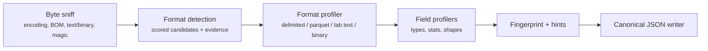

# squalify design

Status: draft. Sections marked **(proposed)** are open for the owner's review and are not settled decisions.

## Purpose

squalify reads one data file and writes a descriptor (see [descriptor.md](descriptor.md)). Consumers use the descriptor to classify the file, choose a transform or draft a file type. A consumer should be able to make those decisions from the descriptor alone, without opening the file again.

## Settled decisions

| Decision | Choice |
|---|---|
| Scope | One tool. It outputs a descriptor only. No classification, no config proposal, no conversion. |
| Stack | .NET 10, standalone. No reference to DataBall. |
| Names | Namespace `squalor.squalify`, CLI `squalify`, slicer ids `sq-NN`. |
| v1 formats | Delimited text (with lab preambles), Parquet, lab text formats (Touchstone, key=value header blocks), binary (STDF first). |
| Read depth | A full streaming scan with bounded memory. |
| Values | Opt-in through `--include-values`. Header names are always included. |
| Parquet | DuckDB.NET.Data.Full 1.5.5 (MIT), the same pin as DataBall. |
| Matching aids | Structural fingerprint, layout regions, evidence trail, detect-rule hints. |
| Determinism | The same bytes and the same tool version give a byte-identical descriptor. No ML, LLM or network. |

## Pipeline

1. **Byte sniff.** Reads the head and the tail. It records the BOM, the encoding candidates (UTF-8 validity, UTF-16/32 BOMs, Latin-1 fallback), the text/binary verdict (NUL and control-byte ratios), line-ending style and magic bytes matched against an in-repo table. The file-level hashes (SHA-256 of the whole content) are computed during the main streaming pass.
2. **Format detection.** Every format profiler scores the sniff result. Scores and reasons go into the evidence trail. The highest score wins, and ties break by a fixed profiler order. A file that no profiler claims gets the generic `binary` or `text` profile.
3. **Format profiler.** Streams the file once and does three jobs:
   - It splits the file into **regions** (preamble/metadata, header, data, footer, repeated blocks), each with byte and line ranges.
   - It parses the data region into records.
   - It feeds each field's values to the field profilers.
4. **Field profilers.** One accumulator per field. Each one tracks counts, nulls, type votes, numeric and lexical ranges, lengths, shape masks and distinct values/quantiles. Accumulators have bounded memory (see below).
5. **Fingerprint and hints.** These are derived only from the finished, value-free structural parts of the descriptor (see below).
6. **Writer.** Serializes to canonical JSON.

## Delimited text

- Delimiter candidates are `,`, `;`, `\t`, `|` and whitespace runs. Each is scored on the consistency of its field count across the data region. Quote character and escape style are detected, and every candidate's score is recorded as evidence. This is similar in spirit to DataBall's `FileProbe.SniffDelimiter`, but squalify scans the whole file, not only the first 20 lines.
- **Preamble detection:** the data region starts at the first run of lines whose field counts stay consistent. Lines before it form the preamble. squalify classifies preamble lines as `key=value`, `key: value`, `key<delim>value`, comment (`#`, `!`, `;`) or free text.
- **Header row:** the line just before the data region, when its field types differ from the data rows (for example, all strings over numeric columns).

## Lab text formats

- **Touchstone:** the `#` option line (frequency unit, parameter, format, reference impedance), `!` comments, the port count inferred from the extension and the data width, and the numeric block shape.
- **key=value header blocks:** a block of metadata pairs followed by tabular data. squalify reports the keys (always) and the values (only with `--include-values`).

## Binary

- Byte-value histogram, entropy per fixed-size block, magic and signature matches.
- **STDF:** walks the record headers (`REC_LEN`, `REC_TYP`, `REC_SUB`). It reports CPU type and endianness from the FAR record, the counts of each record type, the record sequence shape and any truncation. It does not decode field values unless `--include-values` is set (proposed: v1 does not decode them at all).

## Parquet

DuckDB reads the schema, the row-group metadata and the column chunk statistics. squalify maps them to the same field-profile shape as text formats. Statistics that DuckDB provides only per row group are aggregated deterministically, in row-group order.

## Bounded memory (proposed caps)

| Accumulator | Exact up to | Beyond the cap |
|---|---|---|
| Distinct values per field | 10,000 distinct | A deterministic HyperLogLog with a fixed seed and hash; marked `approximate: true` |
| Quantiles | 100,000 numeric values | A deterministic KLL-style sketch with fixed compaction (no randomness); marked approximate |
| Top-k values (with `--include-values`) | Exact while distinct ≤ cap | Space-saving counter with fixed k; ties break by ordinal value |
| Shape masks per field | 64 distinct masks | Further masks counted as `other` |
| Region list | 1,000 regions | Truncated with a `truncated` count |

The cap values are proposals. Whatever the caps are, they are part of the tool version's behavior and are recorded in the descriptor (`limits`).

## Type inference (proposed vocabulary)

`empty`, `bool`, `int`, `float`, `decimal`, `date`, `datetime`, `time`, `duration`, `hex`, `string`.

Every non-null value votes for the narrowest type it parses as. squalify uses invariant-culture parsing plus an explicit list of accepted date/number patterns, and records the matched pattern. The field type is the narrowest type that covers at least the configured share of non-null values (proposed: 100% for the declared type; the per-type vote counts are always reported). The **null tokens** (`""`, `NA`, `N/A`, `null`, `NaN`, `-`) are a fixed list, and the descriptor reports which tokens actually occurred.

## Shape masks

A value maps to a mask by character class: `9` for digit, `A` for uppercase, `a` for lowercase, and punctuation kept literally. Runs are compressed with counts (for example, `A{2}-9{4}`). The masks are value-free and are always included.

## Structural fingerprint

`fingerprint.structure` is the SHA-256 of a canonical JSON projection of the descriptor that contains only structural facts:

- format family and dialect (delimiter, quote, encoding family, line ending)
- region kinds in order (not their sizes)
- preamble keys in order (not their values)
- ordered field names, case-folded, with their inferred types
- for binary formats, the record-type set (not the counts)

Files of the same type and layout share this hash. A second, looser hash, `fingerprint.fields`, covers only the sorted, case-folded field names. The fingerprint projection is versioned (`fingerprint.version`) independently of the schema.

## Detect-rule hints

The hints are neutral facts that a consumer can turn into match rules. They are not DataBall syntax:

- the extension
- stable header lines (line index and an anchored regex built from the line's shape)
- the exact header field list, and the required-field subset (fields that are never null)
- the field-count range
- magic bytes and their offset
- for Parquet, the column names

## Evidence trail

Every inference adds one entry: `{ "topic": "delimiter", "chosen": ",", "candidates": [{ "value": ",", "score": 1.0, "reason": "..." }, ...] }`. Entries are ordered by pipeline stage and then by topic. Reason strings are fixed templates filled with deterministic values, never free-form text.

## Determinism rules

- Do not use `DateTime.Now`, the environment, the absolute path, mtime, the machine name or the user name.
- Use `CultureInfo.InvariantCulture` everywhere. Format doubles with the shortest round-trip format (`"R"`/default .NET Core formatting), and write non-finite values as strings (`"NaN"`, `"Infinity"`).
- Sort every map and set by an ordinal key before writing. Do not iterate `Dictionary`/`HashSet` in output paths without sorting first.
- No parallelism that affects the order of results. Parallel accumulation is allowed only when the merge is order-independent and exact.
- Sketches use fixed seeds and a fixed hash function (no `string.GetHashCode`, which is randomized per process).
- JSON output: UTF-8 without BOM, LF line endings, two-space indent, keys in schema order, trailing newline.
- The descriptor records `toolVersion`. A behavior change that alters output for the same input requires a version bump.

## Errors

- An unreadable file, a permission error or I/O failure raises `SqualifyException` and the CLI exits non-zero (proposed: exit code 2 for I/O errors, 1 for usage errors).
- Malformed content is described, not rejected. Ragged rows, bad encoding bytes and truncated records are counted and reported in `issues[]`, and a descriptor is still written.

## Non-goals

- Proposing DataBall configs or file types, or classifying against a library of known types.
- ML, LLM or network use.
- Editing, repairing or converting files.
- A dependency on DataBall.
- Directory or multi-file profiling in v1 (proposed: later).
