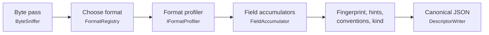

# squalify design

Status: design settled by the owner on 2026-10-13 (spec interview), amended the same day after the [sample-data review](reviews/sample-data-review.md). Code lands slice by slice (`slicer list`). For the diagrams, see [how-it-works.md](how-it-works.md). For the descriptor schema, see [descriptor.md](descriptor.md).

## Purpose

squalify reads one data file and writes a descriptor. Consumers use the descriptor to classify the file, choose a transform or draft a file type. A consumer should be able to make those decisions from the descriptor alone, without opening the file again.

## Settled decisions

| Decision | Choice |
|---|---|
| Scope | One tool. It outputs a descriptor only. No config proposal, no conversion, no matching against a user library of known types. |
| Kind label | A generic `kind` label from a fixed, built-in rule set, with evidence (sq-15). |
| Stack | .NET 10, standalone. No reference to DataBall. |
| Names | Namespace `squalor.squalify`, CLI `squalify`, slicer ids `sq-NN`. |
| v1 formats | Delimited text (with preambles, units rows and repeated blocks), Touchstone, whole-file key=value/INI documents, binary (STDF V4 walk plus a generic byte profile). Parquet is not in v1 (owner decision, 2026-10-27): a Parquet file is profiled as binary, with the `parquet` magic hint. It can be added later if a consumer needs it. |
| Compressed and archive files | Described as binary with a named magic. No decompression in v1. |
| Read depth | A full streaming scan with bounded memory. |
| Values | Opt-in through `--include-values`. See [Values tier](#values-tier). |
| Dependencies | System.CommandLine 2.0.11 (CLI) only. Tests: Microsoft.NET.Test.Sdk 17.14.1, xunit 2.9.3, xunit.runner.visualstudio 3.1.5. |
| Determinism | The same bytes and the same tool version give a byte-identical descriptor on every OS and CPU. No ML, LLM or network. |
| Exit codes | 0 for success; 1 for any error (the same as DataBall's CLI). |

## Pipeline

### Source

`IProfileSource { string Name; long Length; Stream Open(); }`. `FileSource` wraps a path; a directory or a missing file raises `SqualifyException` when the source is created. Tests use synthetic sources that generate bytes on the fly. Every pass reopens the source. A path never reaches the descriptor; only `Name` (the file name) does, and `Profiler` enforces it: a `Name` that is empty or contains `/` or `\` raises `SqualifyException`, so a host's own source cannot smuggle a path into `file.name` or `hints.fileNameShape`. `Profiler.Profile(IProfileSource, ProfileOptions)` and `Profiler.Profile(string path, ProfileOptions)` (`src/squalify/Profiler.cs`) run the pipeline.

### Passes

Each pass streams the file once with bounded memory.

- **Pass 0, the byte pass (every file).** Computes:
  - SHA-256 of the content;
  - the 256-bin byte histogram;
  - NUL counts at even and odd offsets;
  - the count of control bytes (0x00–0x08, 0x0E–0x1F, 0x7F);
  - strict UTF-8 validity, using `System.Text.Unicode.Utf8` and carrying incomplete sequences across buffer boundaries;
  - the BOM;
  - magic matches.

  Text, binary and empty are decided from these whole-file counts:
  1. A zero-length file is empty.
  2. A binary magic means binary.
  3. A UTF-16/32 BOM means text.
  4. A NUL-parity pattern means UTF-16 without a BOM. The pattern is: at least 90% of NULs at odd offsets, or at least 90% at even ones, with NULs at least 30% of all bytes.
  5. Any other NUL, or control bytes above 5%, means binary.
  6. Otherwise the file is text. The charset is `ascii`, else `utf-8` if valid, else `latin-1`. If bytes 0x80–0x9F occur, the evidence notes "possibly windows-1252".
  7. Stray invalid UTF-8 sequences within `limits.charsetTolerance` (at most 8, and at most 1 per 64 KiB) keep the `ascii` or `utf-8` charset. They decode to U+FFFD and are reported as `invalidUtf8` issues with offsets. Beyond the tolerance, rule 6's `latin-1` applies. The number allowed is `min(8, ceil(size / 65536))`, so a file shorter than 64 KiB tolerates one.

  The sniffer reads 64 KiB buffers and keeps up to 3 trailing bytes of an incomplete UTF-8 sequence for the next buffer, so a character that straddles a buffer boundary is not counted as invalid. It also keeps the first 512 and last 16 bytes for the magic table. `SniffResult` (`src/squalify/Sniff/SniffResult.cs`) holds the counted facts and applies the rules; `MagicTable` (`src/squalify/Sniff/MagicTable.cs`) is the ordered table of named magics, which [descriptor.md](descriptor.md#encoding) lists. A UTF-8 BOM is valid UTF-8, so a BOM plus ASCII text is `utf-8` with `bom: "utf-8"`.
- **Pass 1, structure (text profilers).** Tokenizes and classifies records and lines, keeping only bounded summaries. The delimited profiler runs this pass while it scores the file (see [Choosing a format](#choosing-a-format)), so a file is not scanned twice for the choice.
- **Pass 2, fields (text profilers).** Parses the chosen data region and feeds the field accumulators. For delimited text it re-reads the whole file with the chosen dialect, builds the regions and the header, and feeds every data record to the field accumulators (see [Field profiling](#field-profiling)).
- STDF walks record headers in one pass.

### Choosing a format

Each `IFormatProfiler` scores the file between 0 and 1. The highest score wins. Ties break by registry order: `stdf`, `touchstone`, `keyValue`, `delimited`, `text`, `binary`. Every registered profiler's score and reason goes into the evidence trail (stage `format`, topic `family`), with the candidates in registry order. `FormatRegistry` (`src/squalify/Formats/FormatRegistry.cs`) sorts whatever it is given into that order, and rejects an unknown or repeated family. A zero-length file is `empty` by rule 1, before any score counts: no profiler claims it, `format.score` is 1, and every candidate scores 0. The `delimited`, `text` and `binary` profilers are registered so far; each later format slice registers its own.

- **The interface.** `Score(IProfileSource source, SniffResult sniff, ProfileContext context)` returns a `FormatScore`: the score, the reason, and optionally an opaque `State`, `NotChosenIssues` and `NotChosenEvidence`. Scoring gets the source because the byte-pass result keeps no file head, and a delimited table can only be scored by reading the whole file (a whole-file tokenizer pass; see [Delimited text](#delimited-text)). `Profile(source, sniff, context, score)` receives the winner's own `FormatScore`, so the structure that scoring found (`State`) is not computed again. The text and binary profilers score from the sniff result alone and ignore the source.
- **The fallback.** A profiler may decline a file that looks a little like its family and say why. The delimited profiler scores 0 when no candidate delimiter is viable; when at least one candidate was disqualified (a runaway quote, or too many field-count runs), it also returns the issue `tooIrregular` and the dialect evidence in `NotChosenIssues` and `NotChosenEvidence`. `FormatRegistry.Detect` carries these from every profiler that did not win into the `FormatChoice`, and `Profiler` writes them to the descriptor. The generic text profile then describes the file, and `tooIrregular` records why it is not a table. A winner's own `NotChosenIssues` are never written.
- **Line counting.** `GenericTextProfiler` decodes the text with `TextDecoder` (`src/squalify/Text/TextDecoder.cs`, which maps every character to the byte offset where it starts, for the regions of later profilers) and reports line endings, blank lines, the longest line and one `unknown` region. The counting itself is the shared `LineCounter` (`src/squalify/Text/LineCounter.cs`), which the delimited profiler uses too, so both report the same line endings, the same `mixedLineEndings` issue and the same `layout.maxLineLength`. `GenericBinaryProfiler` reports the histogram, the byte-class counts and the entropy of `ByteEntropy`.

| Profiler | Score |
|---|---|
| stdf | 1.0 when the magic is confirmed |
| touchstone | 0.9 for extension plus content; 0.7 for content only |
| keyValue | up to 0.6 |
| delimited | 0.3 + 0.4 × the best candidate's score (at most 0.7); 0 when no candidate is viable |
| text | 0.1 |
| binary | 0.1, or 0.2 with a named magic (gzip, zip, …) |

## Delimited text

The profiler is `DelimitedProfiler` (`src/squalify/Delimited/DelimitedProfiler.cs`). Pass 1 runs while the file is scored; pass 2 runs only when the profiler wins.

- **Candidates.** The delimiter candidates are `,`, `\t`, `;`, `|` and whitespace runs, in that candidate order. `TextScanner` (`Delimited/TextScanner.cs`) decodes the file once, finds the physical lines (CRLF, LF, CR) and feeds one `RecordTokenizer` per candidate, all at the same time, plus the shared `LineCounter`. The whitespace-run candidate splits on runs of the characters in `ValueClassifier.TrimChars` and trims leading and trailing white space. The descriptor writes `whitespace` as its delimiter.
  - **Quoting** follows RFC 4180 with `"`: a quote opens a quoted field only at the start of a field, `""` inside a quoted field is an escape, and line breaks are allowed inside quotes. A lone `"` inside a quoted field that is followed by neither another `"`, nor the delimiter, nor the end of the line is literal text (owner decision 2026-10-27: an ATE export's writer quotes a field that holds a comma but does not escape quotes inside it). A closing quote followed by spaces or tabs and then the delimiter, or the end of the line, closes the field (padded quoted cells; owner decision 2026-10-27): the tokenizer holds the white space after a quote and decides when the next character arrives. A quote followed by white space and then anything else stays literal. Each candidate counts the literal quotes, and its evidence reason reports them.
  - A **blank line** (only spaces and tabs; for the tab candidate only spaces, for the whitespace candidate any trimmed white space) is not a record, so blank lines never break a run.
  - A **runaway quote** (an open quoted field longer than 65,536 characters, `limits.runawayQuote`) disqualifies that candidate, and the evidence records the line where the quote opened.
  - Each candidate keeps run-length-encoded field counts (`FieldCountRle`): runs of `(fieldCount, records, firstLine, firstByte)`, plus the last line and end byte and the token counts that the clean share needs. More than 100,000 runs (`limits.fieldCountRuns`) disqualifies the candidate as too irregular, which also bounds its memory.
  - If no candidate is viable and at least one was disqualified, the profiler declines and the generic text profile is used, with the issue `tooIrregular` (see [Choosing a format](#choosing-a-format)).
- **Dialect and data run** (`DialectSelector`).
  - k is the modal field count among records with at least two fields. A tie goes to the larger k.
  - The data run starts at the first record of a k-run whose window holds. The window is the next min(5, remaining) records with k fields; records with another field count (ragged records, and comment lines, which count as non-k records) met on the way are skipped, up to `DialectSelector.RunStartRaggedTolerance` (2), and a third one fails the window. A window may skip ragged records only when the start's own k-run has at least `RunStartMinLeadRecords` (3) records, so two k-field preamble lines followed by a key=value line stay preamble. A window that skips nothing needs, on the run-length encoding, a k-run of at least six records or one that reaches the end of the file. Skipped ragged records stay in the run and are counted in `raggedRows` (comment lines are not ragged: they are counted in `commentInData`, but they use up the allowance and appear in the evidence suffix); a ragged record from the third data record on therefore keeps the header, while one among the first two data records still moves the start past it (the lead rule). The run ends at the last record with k fields. Two consequences are accepted. A preamble of three or more k-field lines followed by at most two non-k lines is absorbed into the run as annotation rows instead of preamble (the header is still detected). A short table that ends with up to two non-k lines, such as a header, four rows and a `Total=4` line, is now delimited (header, data and footer regions) where it used to fall back to text, because no k-run had six records.
  - The score is the number of records in the data run with k fields, divided by the number of non-blank records, times the **clean share**: the share of tokens in the run that do not contain another candidate's delimiter character (`,`, `;` or `|` other than its own) anywhere (owner decisions 2026-10-27). For the comma, semicolon and pipe candidates, a tab inside a trimmed token also makes it unclean (a TSV cell is not a token of those candidates); a tab at either end is trimmed away, and spaces never count. A quoted token is clean, and a comma inside a comma-decimal number such as `1,5` (`ValueClassifier.IsCommaDecimalLike`) is not counted, so a semicolon file with decimal commas keeps its own tokens clean while the comma candidate's tokens (`5;2`) are not. Without the clean share, whitespace runs nearly tie with the real delimiter on right-padded tables. The highest score wins. Ties break by higher k, then by candidate order, with one exception: tab beats the whitespace candidate on a tie whatever k is, because whitespace's split always contains tab's (owner decision 9).
  - These thresholds are specified behavior (owner decision 2026-10-27). A candidate is **viable** when its run has at least two records and its score is at least 0.5; a whitespace run needs six records, because prose splits into words too (a two-line text file must stay text). The profiler score is 0.3 + 0.4 × the chosen candidate's score; with no viable candidate it is 0.
  - The evidence (stage `dialect`, topic `delimiter`) lists every candidate in candidate order with the reason `k={k}; {inRun}/{total} records; clean={c}; run lines {a}-{b}`, followed by `; {n} non-k records skipped in the start window` (when the start window skipped any; comment lines count), `; {n} quoted fields` (always) and `; {n} literal quotes` (when there are any). A candidate with no run says `k={k}; no run` (with the same suffixes); a disqualified one says `disqualified: runaway quote opened at line {n}` or `disqualified: too irregular, ...`.
  - **Known limitation.** A header-less comma CSV with a multi-word first column and an integer last column, such as rows like `Site North,3`, can still be called whitespace: the whitespace split gives the same field count on every row, every token is clean, and its k is larger than comma's. A header row or any comma-bearing cell usually breaks the tie; squalify does not special-case it.
- **Padding and decimal separator.** The dialect reports `padding {trim, paddedShare, constantLineLength, lineLength}` over the data run. `paddedShare` is the share of non-empty cells (non-empty after trimming) whose raw text starts or ends with a trim-set character; `trim` is true when any cell was padded; `lineLength` is set only when every non-blank physical line of the run has the same byte length. Cells are always trimmed before typing. Fixed-width tables are described, not parsed by offset. The decimal separator is `,` only when the delimiter is not `,` and comma-decimal cells outnumber dot-decimal cells in the header sample; the evidence (stage `dialect`, topic `decimalSeparator`) records both counts. The two shapes are defined together in `ValueClassifier` (`IsCommaDecimalLike`, `IsDotDecimalLike`), so the vote compares counts under one rule.
- **Line kinds** (preamble and footer), tested in order:
  - `blank`;
  - `comment`: the trimmed line starts with `#`, `!` or `//`;
  - `keyValue`: `key=value` or `key: value` with a non-numeric key of 1 to 64 characters, or two fields whose first ends in `:` or `=` (the `key:,value` form); an Excel-style `key:,value,,,` line gives its value without the leading and trailing delimiters;
  - `keyDelimValue`: two fields, the first non-blank and non-numeric;
  - `text`.
  `LineClassifier` uses only fixed character sets and the ASCII-only `ValueClassifier`. Numeric means `int` or `float` under either decimal separator.
- **Header, annotation and units rows** (`HeaderDetector`). Pass 2 buffers up to 1,000 records from the start of the data run (`limits.headerSample`) and classifies every cell with `ValueClassifier`. Some exports put several column-aligned rows (limits, units, line references) above the header, with the table's field count, so the header is not always the run's first record.
  - Every record in the header sample is a header candidate; there is no separate cap. The column types below a candidate are the strict join of the votes of the records after it (an all-null record, a comment line and a record with another field count are skipped; a units row directly after the candidate is left out). A candidate is eligible if its fields are all non-blank and pairwise distinct under ASCII case folding, and in some column whose type is neither empty nor `string` its value fails that type (a null cell fits any type).
  - Score = nonEmpty × nonNumeric × unique × (0.5 + 0.5 × contrast), where nonEmpty, nonNumeric and unique are shares of the fields, and contrast is the share of typed columns whose type the candidate fails. The highest eligible score wins; ties go to the earliest. The evidence (stage `header`, topic `candidates`) lists every eligible candidate with its sub-scores, the winner (which may be a relaxed or assumed one, and is not always eligible), ordered by line with the 1-based line as `value`, and then one `summary` entry. The summary reason counts only: `sampled={n}; eligible={e}; ineligible={i} (comment line={a}, field count={b}, blank or repeated names={c}, fits every typed column={d})`. All of it is value-free numbers.
  - If no record is eligible, a **relaxed** pass takes the best record that fails a typed column and has no numeric field although a name is blank or repeated; the header is then written with the issues `emptyHeaderName` and `duplicateHeader`, and the evidence says `relaxed`.
  - If there is still no header and no column below the first record has a type other than `string`, record 0 is the header when its fields are non-blank and distinct. The evidence then says `assumed: all-string table`.
  - Otherwise the table has no header (`hasHeader: false`): every record is data and field names are null.
  - A comment line (`#`, `!` or `//`) inside the run is free text: it is never a header candidate, an annotation row, a label or a cell value, wherever it sits. It is counted under `commentInData`.
  - Records between the run start and the header form one `annotation` region. Each row reports a label (its normalized first field, when that is non-numeric; the label cell is then left out of the counts), blank fields, null tokens, type votes and the joined type. Labels are always included; cell text is values tier.
  - **Units row** (owner decision 2026-10-27). The record after the header is a units row when every non-null field fails its column's type, is at most 16 characters and sits in a column whose type is not `string`, and at least one field is non-null. Null cells (blank, or a token of the null vocabulary) are neutral, so a unitless column may be blank; an all-null record (an ATE separator row) is never a units row. The units region is always detected; the unit text (`fields[].unit`) is values tier.
- **Keys and labels** are normalized: trimmed, with a trailing `:` or `=` removed. A field name containing U+FFFD also carries `nameHex`, the hex of the bytes of the field as written (trimmed, quotes included), read from the source once after the scan.
- **Regions.** Regions tile the file: a region starts at the first record of its kind and ends on the line before the next region starts; a blank line belongs to the region before it (leading blank lines to the preamble, trailing ones to the last region). The first region starts at byte 0, a BOM included, and the last ends at the end of the file. Byte ranges are byte offsets in the file's own charset. `lineKinds` counts records (a record with a quoted line break counts once). Footer: the non-blank records after the run.
- **Field profiles.** Every data record with the header's field count is fed to the field accumulators (`DelimitedPass.ProcessData`, in file order; see [Field profiling](#field-profiling)), so each field gets its type, votes, statistics and shapes. The decimal separator is decided from the header sample before any accumulator exists, and is always `.` or `,`. The records of the header sample are fed after the decision, then the rest stream straight in. `nameParts` comes from the header names, not from the accumulator (see [Header-unit conventions](#header-unit-conventions)). Ragged records are counted but not typed, and the header, units and annotation rows are never fed to an accumulator.
- **No record-length cap.** Every record is profiled, however long. `layout.maxLineLength` reports the longest line in characters (UTF-16 code units, as for the text profile). Memory stays bounded by the per-field runaway-quote limit and the field accumulators' caps.
- **Repeated blocks** (sq-13). Two or more data runs with the same k, each at least 5 records long, are profiled as blocks. If every block's header is identical, the fields are aggregated across blocks. Otherwise only the first block is profiled and the issue `heterogeneousBlocks` is recorded. Until then `format.dialect.blocks` is 1.
- **Row classes** (sq-17). Data records are grouped by which fields are non-null. Some exports interleave measurement, setup, error and all-null separator rows, switching thousands of times, which contiguous regions cannot express. `table.rowClasses` reports each class (count, field ranges, first and last line, a stable ID), the number of class transitions and the all-null record count. Each field also reports its nulls excluding all-null records. See [Row classes](#row-classes) under Field profiling.
- **Problems are described, not rejected.** squalify records issues and still writes a descriptor: `raggedRows` (a record in the data run with another field count than k), `commentInData` (a comment line inside the run; it is not a data row and not ragged), `duplicateHeader`, `emptyHeaderName`, `tooIrregular`, `invalidUtf8`, `mixedLineEndings`.

## Touchstone

Rules follow common practice as implemented in scikit-rf, and are checked against the IBIS Touchstone 2.0/2.1 text in sq-09.

- **Option line.** `# <freq unit> <parameter> <format> R <ohms>` is positional, case-insensitive, and defaults to `GHz S MA R 50`. Every defaulted value gets an evidence entry.
- **Port count.** It comes from the extension `.[ghsyz]<N>p` or from `[Number of Ports]`. A mismatch between the two is an issue.
- **Data.** Network data is a flat token stream. Each block holds 1 + 2N² values (N(N+1) for Lower/Upper matrices), whatever the line breaks. `!` starts a comment, and inline comments are stripped.
- **2-port order.** v1 2-port data uses the order S11 S21 S12 S22. In v2, `[Two-Port Data Order]` sets it.
- **Noise.** In v1 2-port files, noise data starts where the frequency decreases. In v2 it is marked by `[Noise Data]`.
- **Fields.** The data is exposed as synthesized numeric fields: `freq`, then `Sij.<a|b>`, with suffixes by format (`mag/ang`, `db/ang`, `re/im`), in file order.

## Key=value / INI documents

These are whole files of `key=value` or `key: value` lines, with optional `[section]` headers. Section names and keys are always included. Values appear only with `--include-values`, but each key's value type vote is always included. Key=value lines above a table are not this family; they are the delimited profiler's preamble.

## Binary and STDF

- **Any binary file.** The byte histogram and whole-file entropy exist from sq-03; block entropy and segments come with sq-10.
  - The byte histogram, whole-file Shannon entropy, and the entropy of 4 KiB blocks: count, min, max and mean.
  - A fixed 16-segment entropy profile.
  - All computed with `DetMath.Log2`.
- **STDF V4** (layouts from pystdf; the 2007 additions are checked against the primary spec in sq-10).
  - Each record header is REC_LEN U2 (payload only) + REC_TYP U1 + REC_SUB U1.
  - FAR is (0, 10), and its CPU_TYPE sets endianness: 2 = little, 1 = big, 0 = VAX (an issue).
  - squalify walks every record header and reports:
    - record-type counts;
    - the first-occurrence order;
    - whether FAR is first and MRR last;
    - truncation.
  - **Test catalog.** For each test, squalify records TEST_NUM, the kind (P, M or F) and the first non-empty TEST_TXT or TEST_NAM, taken from PTR, MPR, FTR and TSR. Test names behave like column headers, so they are always included, up to `limits.stdfTests` (10,000).
  - Result values are never decoded.

## Fields

### Value classification and types

`ValueClassifier` (sq-16, `Values/ValueClassifier.cs`) is a pure function: `Classify(value, decimalSeparator)`. It uses the invariant culture and ASCII rules only, so the result does not depend on the current culture, the clock or the machine. It takes the dialect's decimal separator (`.` or `,`), and it never assumes a locale. It trims the value (see **Trim set** below), then returns a `ValueClass`: the vote, the pattern, the date orders, the clock, the flags and, for a null, the matched vocabulary entry. It also carries what it parsed, so no later stage parses the text again (and the number and date rules exist once): the `long` of an `int`, the `double` of an `int` or `float`, and for a date, datetime or time the `TemporalParts` (the year, the two other date groups in text order, and the time of day in 100 ns ticks, a 12-hour value already on a 24-hour day, a zone offset ignored).

- **Trim set.** Before anything else the value is trimmed at both ends of exactly these characters: U+0009 to U+000D (tab, line feed, vertical tab, form feed, carriage return), U+0020 (space) and U+00A0 (no-break space). The set is a fixed constant (`ValueClassifier.TrimChars`, applied by `ValueClassifier.Trim`), not `char.IsWhiteSpace`, because that follows the runtime's Unicode tables and the output must not depend on the runtime. Other space characters (U+2028, U+3000 and so on) are not trimmed, so `"\u3000NA"` is a `string`. The field accumulator (sq-05) trims with the same method.
- **Null tokens, vocabulary 1:** `""`, `NA`, `NA.`, `N/A`, `null`, `NaN`, `-`. They are matched ASCII case-insensitively after trimming with the trim set above. The vocabulary is fixed and versioned (`limits.nullTokens`, from `ValueClassifier.NullVocabularyVersion`), never learned from the data: learning it would make one column's type depend on the others.
  - **Matched entry.** A null value also reports which vocabulary entry matched, in the vocabulary's spelling (`na.` reports `NA.`, `nan` reports `NaN`, white space reports `""`). A consumer can then choose which tokens it treats as null; for example, one that reads `NaN` as a number in a unit column can do so. Counting nulls per token is the field accumulator's job (sq-05), and it counts by vocabulary entry, not by the spelling found in the file (owner decision 2026-10-27): `NULL`, `Null` and `null` are all counted under `null`.
- **Types** (checked in this order, so the first match wins):
  - `bool`: `true`, `false`, `yes`, `no`, ASCII case-insensitive. Numeric booleans (`0`/`1`) and `y`/`n`, `on`/`off` are not booleans.
  - `int`: `^[+-]?[0-9]+$` (ASCII digits) and fits Int64. A longer run of digits is a `float`.
  - `float`: `double.TryParse` with `NumberStyles.Float` and a finite result, on values made only of digits, signs, `e`/`E` and the decimal separator. With `,` as the decimal separator the value is parsed with `,` as the decimal point and no group separator, so `1.5` is then a `string`. Words such as `Infinity` and out-of-range exponents (`1e999`) are `string`.
  - `date`: three numeric parts separated by the same `/`, `-` or `.`, with a 4-digit year (first or last) and 1–2 digit day and month. The value reports every **order** (`YMD`, `MDY`, `DMY`) under which it is a valid calendar date (year 1 and up, leap years by the Gregorian rule). A 4-digit first part allows only `YMD`. squalify never picks a locale. Two-digit years (`6/5/26`) stay `string`, because the century would have to be guessed.
    - At field level (sq-05), a field's orders are the intersection over its values. More than one left means `ambiguous`; none left joins the field to `string`, with evidence (see **Dates and times** under [Field profiling](#field-profiling)).
  - `datetime`: a date, then `T` or one space, then a time. `T` is only for the ISO date `yyyy-MM-dd`, with a 2-digit hour. A zone offset (`Z`, `+hh`, `+hhmm`, `+hh:mm`, or the same with `-`) is only allowed after the ISO date. An `AM`/`PM` marker is allowed only after a space, never after `T`: `2026-03-17T10:00 PM` is a `string`. The orders are the date's.
  - `time`: `H:mm[:ss[.f+]]`. Minutes and seconds have two digits and the fraction needs seconds. An optional ASCII `AM`/`PM` marker (case-insensitive, with or without one space before it) makes the **clock** `12h` and limits the hour to 1–12 (hour 0 or an hour above 12 with a marker is a `string`, and so is a date followed by such a time). Without a marker the clock is `24h` and the hour is 0–23.
  - `string`: anything else, including a date with a non-ASCII day-period marker.
- **Pattern.** A `date`, `datetime` or `time` vote also carries a pattern, the layout that `patterns` counts. It is order-neutral: the pattern of `6/5/2026` is `n/n/yyyy` whichever of `MDY` and `DMY` it is. Tokens: `yyyy` for the year and `nn` or `n` for a 1–2 digit day or month (the separator is kept); `HH`/`H` or `hh`/`h` for the hour (24-hour or 12-hour), `:mm`, `:ss`, `.f+` for a fraction of any length, `tt` for the marker (with a space before it when the value has one); `Z`, `zz` (`+hh`), `zzzz` (`+hhmm`) and `zzz` (`+hh:mm`) for the offset; and the literal `T` or space between date and time. For example `nn/n/yyyy hh:mm:ss tt` and `yyyy-nn-nnTHH:mm:ssZ`.
- **Flags:** `leadingZero` (an `int` or `float` whose integer part starts with `0` followed by another digit, such as `007` or `-00.5`) and `commaDecimalLike` (`^[+-]?[0-9]+,[0-9]+$`, whatever the separator and the vote: `1,5` is a `string` under `.` and a `float` under `,`, and has the flag in both).

The type lattice:

- `empty` < `bool`
- `empty` < `int` < `float`
- `empty` < `date` < `datetime`
- `empty` < `time`
- Any other join is `string`.

A field's `type` is the join over all its non-null votes (the strict rule), with one addition: date values with no date order in common join the field to `string` (see [Field profiling](#field-profiling)). The lattice and the join live in `Fields/TypeLattice.cs` (`TypeLattice.Join`, `TypeLattice.TypeName`), apart from any format, because they belong to no one format (the delimited layer uses them through `FieldAccumulator`); `TypeLattice.VotesMap` builds the `typeVotes` map for the field accumulators and for the annotation rows. Votes are always reported, together with the dominant type and its share. A plurality tie goes to the earlier type in the order `bool`, `int`, `float`, `date`, `datetime`, `time`, `string` (see [Field profiling](#field-profiling)).

### Field profiling

`FieldAccumulator` (`src/squalify/Fields/FieldAccumulator.cs`, sq-05) profiles one field. It receives the field's values in file order and keeps bounded summaries; the delimited pass owns one per column and feeds it every data record's cells (`DelimitedPass.ProcessData`). It is format-agnostic: `AddText` takes raw text and classifies it with `ValueClassifier`, and `AddInt64`, `AddDouble`, `AddBool`, `AddTemporal` and `AddNull` take typed values, so a profiler of another format can reuse it and the statistics match the text profile. A typed value is turned into the same `ValueClass` and text that the classifier would have produced, so every path ends in one `AddValue`. The header and the units row are not fed to it.

What it computes for a field, over the trimmed non-null values unless said otherwise:

- **Type, votes and nulls.** `type` is the lattice join of the votes (plus the date-order rule below). `dominant {type, share}` is the plurality vote. A tie goes to the earlier type in the order `bool`, `int`, `float`, `date`, `datetime`, `time`, `string` (so `int` beats `float` and `date` beats `datetime`, the narrower of a comparable pair, and the order also settles pairs that are not comparable: `bool` beats `int`, `int` beats `date`, `date` beats `time`); `typeVotes` counts the non-null votes, and `patterns` counts the date and time patterns (null when there are none). A null value adds to `nulls` and to `nullTokens`, a map from vocabulary entry (`""`, `NA`, `NA.`, `N/A`, `null`, `NaN`, `-`) to count, always written (`{}` when there are no nulls). `count` is the non-null values plus the nulls. `nullsExcludingAllNullRows` is not counted here: a field accumulator sees values, not rows, so the row-level owner, `RowClassAccumulator` (see [Row classes](#row-classes)), counts it and `FieldAccumulator.Build` takes it as a parameter. It has one source, and the all-null decision is made once.
- **Numeric.** For `int` and `float`: `min` and `max` (integers for `int`, doubles for `float`), `mean` and sample `stddev` (null for fewer than two values) by Welford in input order. For values near the limits of a double the running mean or sum of squares can overflow; a non-finite result is written as `null` (the mean and the stddev are decided separately), never as a string, and the quantiles p01, p05, p25, p50, p75, p95 and p99 by lower nearest rank: the value at zero-based index `ceil(p * n) - 1` of the sorted values, with no interpolation. The percentages are integers, so the rank is exact integer arithmetic (`(pct * n + 99) / 100`). Values are kept as `long` while every vote is an `int`, so integer statistics stay exact beyond 2^53. Past the quantile cap the quantiles come from a Greenwald-Khanna summary and are marked approximate (see "Bounded memory and sketches").
- **Dates and times.** For `date`, `datetime` and `time`: `orders`, `ambiguous`, `clock`, `min`, `max` and the quantiles as ISO 8601 (`yyyy-MM-dd`, `yyyy-MM-ddTHH:mm:ss`, `HH:mm:ss`, plus a fraction of a second only when it is not zero). A field's `orders` are the intersection of the orders each value allows. One left: the field has that order, and the statistics are written. More than one left (`ambiguous`): `min`, `max`, the quantiles and `monotonic` are `null`, because any value would assume a locale. None left (`3/17/2026` and `17/3/2026` in one field): the field joins to `string`, `temporal` and `monotonic` are `null`, the votes stay as they were, and the evidence entry `type` / `dateOrderConflict` lists the field with the number of date values that allow each order. `clock` is `24h` or `12h` over the values that carry a time of day, `null` for a date or for a mix of both clocks. Every value is held as its parsed parts and read under the order only once the field's order is known; `min`, `max` and `monotonic` are tracked for each still-possible order, so they survive the quantile cap; past it the quantiles come from one Greenwald-Khanna summary per still-possible order. A zone offset is ignored: temporal statistics are over the wall-clock fields as written.
- **Length.** `length {min, max, mean}` in UTF-16 code units of the trimmed value; null when there is no non-null value.
- **Flags.** `leadingZero` and `commaDecimalLike` count the values the classifier flagged. `padded` counts the non-empty values whose raw text starts or ends with a trim-set character, null tokens included (the same definition as `padding.paddedShare`).
- **Shape masks.** See the next list.
- **Monotonic.** For numeric and temporal fields with at least two non-null values, in file order: `increasing` (strictly), `decreasing`, `nonDecreasing`, `nonIncreasing` or `none`. A run of equal values is `nonDecreasing`. It is null for other types and for an ambiguous or conflicting date field.
- **Distinct.** `distinct {value, approximate: false}` counts the distinct non-null values exactly, up to the per-field cap. Past it, a HyperLogLog estimate with `approximate: true` and `errorBound` (see "Bounded memory and sketches").
- **Constant and unique.** `constant` is true when every non-null value is equal (a sparse field with one value among nulls is constant), and also for a field of only nulls, which has one value; it is false for a field with no values at all. For an `int`, `float`, `date`, `datetime` or `time` field the values are compared **as parsed** (owner decision 2026-10-27): `1`, `1.0` and `01` are one value, `0`, `-0` and `0.0` are one value, and a float equals an integer only when it is exactly that integer. Dates compare their parsed parts, so `6/5/2026` and `06/05/2026` are one value whichever order the field has (equality does not depend on the order), and a date equals a datetime at midnight. For every other field, including one whose type ended as `string` after some numbers, values are compared as trimmed text. Either way the accumulator keeps only the first value to compare with, so memory is constant. `unique` and `distinct` always compare the trimmed text, so `1` and `1.0` are two distinct values even in a constant field. `unique` is true when every non-null value is distinct; false once any value repeats, for a field with no non-null value, and (null) only when the distinct set overflowed before a repeat was seen.
- **Withheld statistics.** When `constant` is true and values are not opted in for the field (`--include-values`, or the field's name in `--include-values-for`), `numeric` and `temporal` are `null` and `statsWithheld` is `"constant"`; shapes, lengths, flags and `distinct` stay. A field with no numeric or temporal statistics to withhold has `statsWithheld: null`.

**Shape masks** (one implementation, `Fields/ShapeMask.cs`, also used for `hints.fileNameShape`; value-free, so always included):

- Each UTF-16 code unit maps to a class by plain ASCII ranges, never by the runtime's Unicode tables: `9` for `0`-`9`, `A` for `A`-`Z`, `a` for `a`-`z`; ASCII punctuation and space are kept literally, except `{` and `}`, which become `?` because they would collide with the run count (`1{2}` is `9?9?`, not the mask `9{9}` of nine digits; owner decision 2026-10-27); every other code unit (a letter such as `é`, a control character, either half of a surrogate pair) becomes `?`, so a character outside the BMP is `?{2}`.
- A run of two or more of the same symbol is written `c{n}`.
- A mask of more than 64 tokens (a token is a symbol with its optional `{n}`) is cut after 64 and ends with `+`.
- A field keeps at most 64 distinct masks, and at most its share of the shape-character budget (`limits.budget.shapeChars` divided by the field count): the first masks in file order get a slot while both limits hold, and every value with another mask is counted in one `{mask: "other", count}` entry, written last. The other masks are sorted by count descending, then ordinally. The counts add up to the non-null values.

**How values are compared.** Distinct counting, `unique`, and the text comparison of `constant` use the XxHash64 (seed 0) of the UTF-8 bytes of the trimmed value, not the text, so memory is 8 bytes per distinct value however long the values are; two different values share a hash with probability 2^-64. The hash is never written.

### Row classes

`RowClassAccumulator` (`src/squalify/Fields/RowClassAccumulator.cs`, sq-17) groups data records by which fields are non-null. It is format-agnostic: a profiler calls `Add(mask, line)` once per record in file order with a null mask (a `ReadOnlySpan<bool>`, true for a null field), so a profiler of another format can feed it too. The delimited pass builds the mask from the field accumulators' own null decision (`AddText` returns the vote; a null vote is a null), reuses one mask array, and skips ragged records, which have no mask.

- **Class id.** `rc:` plus the 16 lowercase hex digits of `XxHash64` (seed 0) over the UTF-8 decimal ascending non-null indexes joined by commas (`1,10`; empty for an all-null record). The line, the record order and the file are not inputs, so the id is stable under reordering; it depends on column order. Classes are keyed by the 64-bit hash (collision probability 2^-64), so memory per class does not depend on the field count beyond its range list.
- **No per-record allocation.** A record whose mask equals the previous one is counted after one vectorized comparison and no hashing. A record of another mask is encoded into a buffer that is allocated once (11 bytes per field), then hashed and looked up in a dictionary; only a new class allocates. A test checks 30,000 records of 2,000 fields allocate under 1 KiB.
- **The cap.** `limits.rowClasses` = 64. The first 64 classes seen keep exact counts for the whole file; records of any later class are counted in `truncated`, so memory is bounded by 64 range lists whatever the file holds. Transitions use the hash, so a switch to or between truncated classes is still counted.
- **All-null records.** A record with every field null is a class with no fields, and is also counted in `allNullRows`. `RowClassAccumulator` also counts, per field, the nulls outside all-null records (`NullsExcludingAllNullRows(field)`, one increment per null field of a record that is not all-null).
- **Sort and output.** Classes are sorted by count descending, then id ordinally; `fields` are ascending inclusive ranges; `firstLine` and `lastLine` are the 1-based lines on which the first and last record of the class start. No dictionary enumeration order reaches the output.

### Bounded memory and sketches

| Accumulator | Exact up to | Beyond the cap |
|---|---|---|
| Distinct values per field | 10,000 | HyperLogLog, p=14, over `XxHash64` (seed 0), with linear counting up to 2.5m (`Sketches/HyperLogLog.cs`); `distinct.approximate: true` and `errorBound` |
| Quantiles per field | 100,000 values | Greenwald-Khanna, ε = 0.001, merging every ⌊1/(2ε)⌋ = 500 values (`Sketches/GreenwaldKhanna.cs`); `approximate: true` and `errorBound` |
| Top-k values (values tier; `TopK`, `Fields/TopK.cs`) | while the field has at most `limits.distinctPerField` distinct values; the counters hold the value text, so only an opted-in field pays for it | Space-Saving, 1,000 counters seeded with the heaviest exact counts, keyed by `XxHash64`; k = 10; `top.maxError` |
| Shapes per field | 64 masks and the field's share of `limits.budget.shapeChars` | counted as `other` |
| Regions | 1,000 | truncated, with a count |
| Runaway quote (delimited) | 65,536 characters in an open quoted field (`limits.runawayQuote`) | that delimiter candidate is disqualified |
| Field-count runs (delimited) | 100,000 runs per candidate (`limits.fieldCountRuns`) | that candidate is disqualified as too irregular |
| Header sample (delimited) | 1,000 records (`limits.headerSample`) | later records are not header candidates; they are still typed |
| STDF test catalog | 10,000 tests | counted |
| Row classes per table | 64 (`limits.rowClasses`; the first seen are kept with exact counts, memory is 64 range lists plus an 11-bytes-per-field encode buffer and three per-field arrays) | records of later classes are counted in `truncated`; transitions still count |

- **Crossing a cap.** The exact buffer is fed to the sketch in input order and then freed. The output is marked `approximate: true` and carries `errorBound`. Exactly at the cap a field is still exact: the sketch starts with the value after it (distinct: the (cap + 1)th distinct value; quantiles: the (cap + 1)th numeric or temporal value).
- **Global budget.** A global budget of 10M exact quantile values, 2M exact distinct values and 16M characters of shape mask text caps each field at min(cap, budget ÷ field count), in integer arithmetic (`MemoryBudget.Effective`, `src/squalify/Fields/MemoryBudget.cs`): 100 fields or fewer keep the full caps, 2,000 fields get 5,000 quantile values, 1,000 distinct values and 8,000 characters of masks each. The effective caps are written to `limits.distinctPerField` and `limits.quantilePerField`; `limits.shapesPerField` and `limits.budget` are written as set. `ProfileLimits` (`Fields/ProfileLimits.cs`) holds the tunable caps (distinct, quantile, shapes and row classes, and the budget) and is internal, so tests inject small ones; it cannot set `limits.nullTokens`, which is always `ValueClassifier.NullVocabularyVersion`.
- **Shape masks are budgeted by characters, not by count.** A mask is at most 833 characters (64 tokens of a symbol and a ten-digit run count), so 64 masks per field and 2,000 fields could hold about 200 MB of mask text, outside every other budget. The options were to divide `shapesPerField` by the field count or to cut masks shorter. Dividing the count would reserve the worst case for every wide table (a count of 8 for 2,000 fields although typical masks are a few characters), and a shorter mask would change what the descriptor says about every file. A character budget divided by the field count, like the two value budgets, changes nothing for a table of up to about 250 fields (160,000 characters each, more than 64 maximal masks) and in practice for any real one, and only adversarial values reach it. The text of the masks a field holds is counted in its `EstimatedBytes`.
- **Past the cap.** The exact distinct set and the exact quantile buffers are freed; a sketch takes over and the output is marked approximate. Everything that streams in constant memory is unaffected: counts, `min`, `max`, `mean`, `stddev`, lengths, shapes (their own cap), flags, monotonicity and `constant`. `unique` stays `null` for a field that crossed the distinct cap before any value repeated, because the sketch cannot say whether a value repeated.
- **HyperLogLog.** 16,384 one-byte registers (16 KiB), allocated at the crossing. The exact set of 64-bit hashes is read into the registers (each keeps the largest rank, so the order of the set does not matter, and neither does the order of later values or how often one repeats), then every further hash goes straight in. The estimate is the raw harmonic mean, or linear counting `m * DetMath.Ln(m / V)` while the raw estimate is at most 2.5m and a register is empty, rounded half to even; every operation is an IEEE `+ - * /`, a power of two from `Math.ScaleB`, or `DetMath`. `errorBound` is `1.04 / sqrt(m)`, 0.008125, the relative standard error: it describes the raw estimate at large counts and not the bias between about 41,000 and 80,000 distinct values, where the raw estimate runs a few percent high (the empirical correction of HyperLogLog++ is deliberately not implemented).
- **Greenwald-Khanna.** A summary of tuples `(value, g, delta)` over `long` keys. Values are buffered, then sorted and merged into the summary in one pass every 500 values, after which the summary is compressed from the largest value down (a tuple folds into the next when `g + g' + delta' < ⌊2εn⌋`; the smallest and the largest are kept, so `p01` and `p99` of a small stream are exact). A value that equals stored ones goes after them; one below or above everything stored gets `delta = 0`; any other gets `⌊2εn⌋`. A query returns the stored value whose rank interval `[sum of g, sum of g + delta]` is nearest the wanted rank `ceil(p * n)`, the first on a tie. Everything is integer arithmetic on keys: an integer is its own key, a double is the order-preserving bit pattern of its value (`GreenwaldKhanna.KeyOfDouble`), and a date or time is its ticks under one order. There is no randomness and no dependence on hash codes, so the same keys in the same order give the same summary on every platform. The summary of a 10M-value stream holds about 700 tuples.
- **Numeric sketch.** Keys are the integers themselves while every value is an integer. When a float arrives after the cap, the stored keys are replaced by the keys of the same numbers as doubles (`GreenwaldKhanna.MapKeys`; the map is non-decreasing, so the summary stays sorted), which is what the exact path does when it converts its integers to doubles.
- **Temporal sketches.** The code kept for the exact values (year, the two groups, the time of day) orders like ticks under year-month-day and month-day-year but not under day-month-year, so a sketch over the code would be wrong for one of the three. At the crossing, one summary is made for each date order that is still possible, over the ticks of the value under that order, and fed the exact codes in input order; a time has one. While the day-month-year and month-day-year readings both fit there are two summaries (a few tens of kilobytes together); when a later value rules an order out, its summary is dropped. The field's final order picks the summary that is written.
- **Memory ceiling.** `MemoryBudget.CeilingBytes(estimatedBytes)` is the peak of the accumulators' estimated bytes plus `MemoryBudget.AllowanceBytes`, a fixed 64 MiB (owner decision, 2026-10-27: it covers the process baseline of a .NET 10 console program, roughly 30 to 50 MB, plus read buffers, with some headroom, and is tight enough to catch a leak). The ceiling is a check on the accounting and not a limit the profiler enforces; a profile never stops or degrades because of it. `FieldAccumulator.EstimatedBytes` adds up what a field holds: the exact-value buffers by their chunks, the distinct set at 60 bytes an entry (it holds the old and new table while it grows), the shape masks, the top-k counters and their text, the lexical bounds, the HyperLogLog registers and the summaries' arrays, plus a fixed share for the object. `RowClassAccumulator.EstimatedBytes` and the header sample (`DelimitedPass`) are added, and the pass samples the sum every 1,024 rows (and when the header sample is decided and when the pass ends) into a `MemoryTrace`, keeping the peak. The exact-value buffers are `ChunkedBuffer<T>`, fixed 4,096-element chunks, not `List<T>`: a doubling list of 100,000 values allocates about twice its final size on the way, in arrays on the large object heap that stay until a full collection, so its footprint cannot be estimated; chunks hold exactly what they need.
- **How the ceiling is tested.** `MemoryAccounting_UnderBudget_256MbStream` (in CI) and `Memory_4GbStream_PeakWorkingSetBounded` (`Category=Large`, manual; the CI filters exclude it) profile a generated stream (`SyntheticCsvSource`: 12 columns of eight kinds, a seeded xorshift generator, fixed-width cells, nothing on disk) in a child process, because the peak working set of a process cannot be reset and the test host holds memory of its own. The child is the test assembly run as `dotnet squalify.Tests.dll --memory-probe BYTES COLUMNS`; it prints its peak working set (`Process.PeakWorkingSet64`, or `getrusage` on macOS, where that is 0), the peak estimate and the ceiling, and the test asserts peak <= ceiling. The child runs with `DOTNET_TieredCompilation=0`.
- **Measured allowance (macOS, arm64, .NET 10.0.403, 12 columns).** A .NET console program that does nothing peaks at 40 MB. A profile of 100 KB peaks at 64.6 MB with the accumulators at about 1 MB: the pipeline itself (loaded assemblies, JIT code, the 64 KiB read buffers, the GC's committed-but-empty regions of about 9 MB) is another 24 MB. With the default runtime settings, a stream of 64 MB to 256 MB peaks at 78.5 to 79.3 MB against a ceiling of 76.5 MB (the peak estimate is 9.35 MB; at 91,000 rows, when it was 8.7 MB, the live heap after a forced compacting collection was 9.9 MB), so 64 MiB is about 3 MB short on that machine; with tiered compilation off it peaks at 69.5 MB on the 256 MB stream (the CI test) and at 71.0 MB on the 4 GB stream (the manual test, 10 minutes 36 seconds), with a ceiling of 76.5 MB in both. The probe therefore runs without tiering, and the owner decides whether the allowance should be larger for the default runtime.
- **Not counted.** The scoring pass's field-count runs (up to 100,000 per candidate delimiter, for an irregular file), the read buffers and the runtime itself are not in the estimate; they are what the allowance is for.

## Values tier

| Always included | Only with `--include-values` |
|---|---|
| Header names, preamble keys, annotation labels, section names and keys, STDF test names | Preamble values, annotation-row cells, key=value values, comment text |
| Counts, nulls, types, votes, shapes, lengths | Top-k values, lexical (string) min/max |
| Numeric and temporal min/max/mean/stddev/quantiles, except for constant fields | Units-row text (field `unit` from a units row); statistics of constant fields |
| Header-unit convention and units parsed from header names | Value-bearing `stableLines` regexes (comment and text lines) |

`--include-values` opts in every value. `--include-values-for <name>` (repeatable) opts in only the values of the named preamble keys, annotation labels, key=value keys and fields; identity often lives in one or two of them. The name is compared whole, with ASCII case folding (`Ordinal.AsciiFold`, no Unicode tables). A name that matches several members opts in all of them; a name that matches nothing gives the issue `includeValuesForUnmatched`, which lists the names sorted ordinally (they come from the command line, so they are not values). `options.includeValuesFor` records the names.

`ValuesPolicy` (`src/squalify/ValuesPolicy.cs`) lists every value-bearing descriptor member in one place, including annotation cells and the numeric and temporal statistics of constant fields, and does two jobs with that list:

- **The gate.** `ValuesGate.Allows(member, owner)` decides before a value is collected. The delimited pass asks it for each preamble value, annotation row, units cell and field, and hands each field accumulator a `FieldValueAccess` (top, text, constant statistics) at construction. A value that may not be written is therefore never held. A field's top-k counters and its lexical min and max are collected only when the field's access allows them, which is why the opt-in is known when the accumulator is built.
- **The guard.** `DescriptorWriter.ToBytes` calls `ValuesPolicy.Verify` first. A descriptor with a value-bearing member whose owner is not opted in makes it throw `InvalidOperationException` (a bug in the producer, never a user error), naming the member's path and no value.

A member that is not in the list is neither gated nor checked, so a model member that can carry values must be marked `[ValueBearing]` and listed; a reflection test compares the two. Canary tests prove that nothing literal leaks without the flag or an allow-list entry (`tests/squalify.Tests/fixtures/canary/`; a numeric canary covers the statistics of a constant field). Each later format slice adds a canary fixture to the same theory.

**Top-k and text.** `FieldAccumulator` computes one `XxHash64` per value (`FieldAccumulator.Hash`), shared by the distinct set and `TopK`, and the text of a value is copied only when a counter or the lexical minimum or maximum moves. `TopK` keeps a value-to-count map keyed by the hash. Past the cap it keeps the heaviest 1,000 exact counters and evicts the counter with the lowest count, ties by lowest ordinal value, so the result never depends on dictionary order. Memory for an opted-in field is the value text of up to `limits.distinctPerField` distinct values in the exact phase, and then of up to 1,000 counters, even when the budget shrinks the distinct cap below 1,000. `TopK.EstimatedBytes` counts both (a fixed share per counter plus the UTF-16 text of its value, kept as counters are created and evicted), so they are part of the memory ceiling.

## Header-unit conventions

Each header name is parsed against a fixed set of conventions, in this order, and the first match wins:

| Convention | Example |
|---|---|
| `nameParenUnit` | `I_Total(A)` |
| `nameBracketUnit` | `Pout[dBm]` |
| `nameUnderscoreUnit` | `VCC_V`. Only when the suffix is a known unit, so `I_Total` stays a plain name. |
| `unitsRow` | a units row under the header |
| `none` | |

`HeaderConventionParser` (`src/squalify/Units/`) does this, and `UnitTable` holds the known units. Each field gets `nameParts { base, unit, convention, unknownUnit }`, and the file gets `layout.headerConvention { dominant, share, counts }`, the `headerConvention` hint and the evidence entry `unit` / `headerConvention`. They come from header names, so they are always included. A table with no header has no names, so its fields have `nameParts: null` and the file has no convention.

- **Patterns mirror DataBall's `HeaderParser`.** The parenthesis form and the underscore form are DataBall's: the last `(` and the final `)`, or the last `_`, with the name part and the unit trimmed and not empty. The underscore form applies only when the suffix is a known unit; DataBall's rule. The bracket form is squalify's own and has the same shape as the parenthesis form.
- **Parenthesis and bracket accept any unit text.** As in DataBall, `Date(date)` is split. The one exception is bracket text of only ASCII digits, such as `Trace[0]` or `S21[1]`: that is an array index, not a unit, so the name falls through to the underscore and `none` rules. A name such as `Pout(dBm)[1]` therefore ends in a digit-only bracket and is `none`, with the whole name as its base. squalify adds the flag `unknownUnit` when the unit text is not in the table, so a consumer can tell `Pout(dBm)` from `Date(date)` or `RowID(id)` and keep its own meaning for the latter. The unit text is kept as written.
- **A units row** gives the convention `unitsRow` to every name that has no unit of its own, but only when that column's units cell has a value; an empty or null cell leaves the name `none`. The units text is a value: it is `fields[].unit` (values tier) and never appears in `nameParts`.
- **The dominant convention** is the one with the most names. A tie goes to the earlier one in the order above, so `none` loses every tie. `share` is its count over the number of names. With no names at all, the dominant is `none` and the share is 0.
- **Determinism.** The table is matched ordinally. The matching never uses the Unicode tables (no `char.IsLetter`, no case mapping) or the culture; the aliases are matched with ASCII letters folded.

### The unit table, version 1

The table is fixed and versioned (`limits.unitTable`). It contains these base units, combined with the SI prefixes f, p, n, u (also U+00B5 and U+03BC), m, k, M and G where the unit takes a prefix:

- V, A, W (take prefixes)
- Hz, s (take prefixes)
- Ohm, the omega sign U+03A9 and the ohm sign U+2126, F, H (take prefixes)
- dB, dBm, dBc (no prefix)
- %, C (also degree-sign C), K (no prefix)
- the angle units degree sign U+00B0 alone, and `deg` (no prefix)

Matching is case-sensitive, apart from an alias list matched with ASCII letters folded: `amp`, `amps`, `ampere`, `amperes`, `volt`, `volts`, `sec`, `second`, `seconds`, `degC`, `celsius`, `ohm` (which takes a prefix), `ohms`, `watt`, `watts`, `pct` and `percent`. When an alias folds case, the SI prefix stays case-sensitive, so `mohm` is milli-ohm and `Mohm` is mega-ohm. Only `ohm` takes a prefix; `ohms` is an alias without one, so `kohms` is not a unit. The full list is in [descriptor.md](descriptor.md#layoutheaderconvention).

### Differences from DataBall

The table is not DataBall's table, and squalify does not read DataBall's configuration:

- DataBall matches units case-insensitively (`ICC_a` and `X_HZ` split there); squalify is case-sensitive, because `m` and `M` are different prefixes.
- DataBall knows `id` and `ID` as a unit (an integer type); squalify does not, so `RowID(id)` carries `unknownUnit` and `Row_id` stays a plain name.
- squalify has the prefixes, dBc, K, F and H, which DataBall's built-in table lacks (DataBall lists kHz, MHz, GHz and ms by name).
- DataBall trims all Unicode white space around the name and the unit; squalify trims U+0009 to U+000D, U+0020 and U+00A0, as the value classifier does.
- DataBall's patterns come from its configuration; squalify's are fixed.

## Structural fingerprint

*Source: `Fingerprint/Projection.cs`, `Fingerprint/ProjectionJson.cs`, `Fingerprint/IFingerprintContributor.cs`, `Fingerprint/DelimitedFingerprint.cs`.*

There are four SHA-256 hashes, each written as `sha256:<hex>`. Each is computed over a compact canonical JSON projection that contains no values, so the hashes are the same with and without `--include-values`. The member lists and the exact text are in [descriptor.md](descriptor.md#fingerprint); this section gives the reasons.

- **`structure`.** No names at all: the family, the family's own members (for delimited text the whole dialect: delimiter, quote, hasHeader, unitsRow, decimal separator, constant line length; and the dominant preamble line kind), the charset family and the region kinds in order. A file with an annotation or units row hashes differently from one without, because `unitsRow` and the region kinds are part of it.
- **`layout`.** The same kind of projection, with a smaller dialect (delimiter, quote, hasHeader, unitsRow), and in addition:
  - the preamble keys (normalized, case-folded, in file order);
  - the dominant header-unit convention;
  - the ordered, case-folded field names (`#<index>` when unnamed).
- **`typed`.** `layout` plus the field types.
- **`names`.** The sorted, unique, case-folded field names.

**Case folding is ASCII only** (`A` to `Z`). It never uses `ToLowerInvariant`, the runtime's Unicode tables or the culture, so a hash is the same on every runtime and machine. The projection is written by `ProjectionJson`, not by the descriptor writer, for the same reason: the descriptor writer escapes the code points that the runtime's tables leave unassigned, and a runtime upgrade must not change a hash.

**The header convention.** `layout` carries `layout.headerConvention.dominant`. When the object is absent (no header, or a file that is not a table) the projection writes JSON `null`, which cannot be confused with the convention `none`. Indexed groups such as `Trace[0]` to `Trace[n]` are not collapsed: the owner's trace files are long form, so arrays of columns are not a real case today, and collapsing them would have made two files with different column counts look the same. If wide trace files appear, a later version of the projection can collapse them.

**Names that are left out.** A name with a control character or U+FFFD is projected as `#<index>` (fields) or left out (keys, and the `names` list), with the issue `nameExcludedFromFingerprint`. Such bytes may vary per file and would otherwise make every sibling unique. The placeholder can collide with a real name: an unnamed field at index `i` and a header named `#i` at index `i` share `layout` and `typed` and differ in `names`. That is accepted. A family's own names get the same exclusion, applied by the projection core, so every contributor has it.

**Fingerprint equality is not a family test.** Column sets often vary by recipe, unit or bench, so `layout`, `typed` and `names` can be unique per file, and every plain header-plus-rows CSV shares one `structure`. Family recognition needs more evidence, such as name containment and hints. Consumers comparing `typed` should treat `empty` as matching any type and `int` as within `float`: a column that is empty in a short file, or whose values happen to be whole numbers, changes `typed` without changing what the file is.

**The family seam.** Each format family adds its part through `IFingerprintContributor`. A contributor returns a `FingerprintContribution`: members for the `structure` projection, members for `layout` (which `typed` includes), further members for `typed` only, names for the `names` list, and the count of names it left out. The projection writes these members right after `family`. `FingerprintContributors` lists the contributors; a family without one adds nothing. The delimited family exists; the other contributions come with their slices:

- **Delimited:** the dialect, the dominant preamble line kind (structure) and the preamble keys (layout). Field names and types are the same for every tabular family, so the core projection takes them from `table.fields[]`.
- **Touchstone (sq-09):** version, ports, parameter, format, matrix and noise.
- **keyValue (sq-09):** sections and keys.
- **STDF (sq-10):**
  - layout: the record-type set and the endianness;
  - typed: the catalog's `(testNum, kind)` pairs;
  - names: the test names.

`fingerprint.version` changes whenever a projection changes. It is 1 (version 0 was the interim hash of the family name alone).

## Detect-rule hints

*Source: `Hints/HintBuilder.cs`, `Hints/PortableRegex.cs`, `Hints/StableLineSource.cs`, `Text/LineReader.cs`, `Delimited/DelimitedPass.cs` (`ReadStableLines`).*

Hints are neutral facts that a consumer can turn into match rules. The members and their rules are in [descriptor.md](descriptor.md#hints):

- `extension` (ASCII-lower-cased) and `magic` (`{ name, offset, hex }`).
- `stableLines`: each entry has a 0-based `line` and an anchored, portable regex. For example, a header line becomes `^<escaped header>$` at any length, the header prefix becomes a padding-tolerant regex over the first 5 names (all when there are fewer), and a preamble key becomes `^\s*<key>\s*[=:]`. Entries are ordered by line, then regex.
- `headerFields`, `headerPrefix` and `nonNullFields` (fields with no nulls outside the all-null separator rows, and at least one value: an observation about this file, not a requirement of the type; a column that is null only in separator rows counts as non-null).
- `fileNameShape`: the shape mask of the file name, by the same rules as the field shapes.
- `fieldCount`, `dataStartLine`, `delimiter`.
- `headerConvention`, which repeats the dominant convention of the layout.
- `stdf { cpuType, version }` (sq-10).

**How a stable line is made.** The delimited pass notes the lines that may become stable lines: the header line, the preamble `keyValue` lines, and (only with `--include-values`) the preamble comment and text lines. After the pass, `LineReader` reads those physical lines from the start of the file in one streaming read that stops at the last one, and `HintBuilder` builds each regex with `PortableRegex`. Reading the physical line, rather than rebuilding it from the parsed cells, keeps quotes and padding, so the regex matches the file as written. A record that spans several lines is skipped.

**Portable regexes.** `PortableRegex` escapes only `\ . ^ $ | ? * + ( ) [ ] { }` and uses nothing else but `^`, `$`, `\s`, `*`, `+`, `?` and `[=:]`, so every regex compiles under .NET and under `RegexOptions.ECMAScript`. The one difference in meaning is `\s` (Unicode white space by default, ASCII only under the ECMAScript option). `HintBuilder` therefore keeps a regex only when it matches its own source line under both engines; a key that was trimmed of a non-ASCII space, or a quoted key, gets no entry rather than an entry that fails under one engine. Real JavaScript's `\s` is Unicode and broader than .NET's ECMAScript option, so a kept regex still matches there; the filter is conservative. A regex that contains U+FFFD or a control character other than tab (a stray byte, which may differ from file to file) is left out too, while `headerFields` still lists the names.

**Values.** Header names and preamble keys are always included, so the header regexes and the key regexes are too, and a key regex never contains the value. A comment or text line is free text, so its regex is values tier and appears only with `--include-values`.

## Kind label

A fixed, ordered rule table runs over the finished descriptor only, never the file, and the first match wins. Every rule's matched or missed reason goes into the evidence.

The labels are:

- `stdfTestLog`, `touchstoneNetwork`, `keyValueDocument`
- `labSweepTable`, `measurementTable`, `genericTable`
- `textLog`, `text`
- `archive`, `binary`, `empty`

The owner confirms the rule details at the start of sq-15.

## Evidence trail

Every inference adds `{ stage, topic, chosen, candidates[{ value, score, reason }] }`. Entries are ordered by pipeline stage, then by topic. Candidates are never in insertion order: each topic documents its own key (a fixed table, or a sort key), as listed in [descriptor.md](descriptor.md#evidence). Reasons are fixed templates filled with value-free numbers. Unanimous field-type inferences are grouped into one entry per type that lists field indexes (sq-20), so wide files stay compact. The field accumulators add one entry, stage `type`, topic `dateOrderConflict`, when a field joined to `string` because its date values share no order; it has one candidate per such field.

## Determinism rules

- **No environment input.** Output never depends on the time, environment, absolute path, mtime, machine or user.
- **Culture and sorting.** Use `CultureInfo.InvariantCulture` everywhere. Sort ordinally (UTF-16 code unit order); `Ordinal` (`src/squalify/Determinism/Ordinal.cs`) holds the helpers. Anything that reaches a fingerprint or a hint is case-folded with `Ordinal.AsciiFold` (`A` to `Z` only), never with `ToLowerInvariant` or a Unicode table. Tests run under `de-DE` and `tr-TR`.
- **No runtime Unicode tables in structure detection.** The delimited profiler never calls `char.IsWhiteSpace`, `char.IsUpper`, `ToLower` or a culture-sensitive comparison: white space is the fixed set `ValueClassifier.TrimChars`, blank lines are spaces and tabs, header names are compared after ASCII-only folding, and null tokens and types come from `ValueClassifier`.
- **Collections.** Sort every map and set before writing. The descriptor model (`src/squalify/Descriptor/`) does not sort lists: producers build every collection sorted by its documented key (`CountMap` sorts its own keys at construction), and the writer never sorts.
- **Single thread.** Accumulation runs in a single thread, in input order. Greenwald-Khanna summaries do not merge exactly across shards, so parallel profiling would need fixed shard boundaries and a mergeable sketch first. sq-19 measures throughput before any such change.
- **Writer.** `DescriptorWriter` (`src/squalify/Json/DescriptorWriter.cs`) writes each model type with an explicit key order, the order in [descriptor.md](descriptor.md#canonical-form), which is normative. It uses `Utf8JsonWriter` with `Indented`, `IndentSize` 2, `NewLine` `"\n"` (the platform default is CRLF on Windows) and `JavaScriptEncoder.UnsafeRelaxedJsonEscaping`. Output is UTF-8 with no BOM and a trailing LF. A failed write surfaces as `SqualifyException`. The encoder escapes BMP code points that the .NET runtime's Unicode tables leave unassigned, so a runtime major upgrade can change the output for the same input. That is an output-affecting change and bumps `tool.version` like any other (a test pins one such code point).
- **Numbers.** `CanonicalNumber` (`src/squalify/Json/CanonicalNumber.cs`): doubles use the shortest round-trip form with the invariant culture, `-0` is written as `0`, and NaN/±Infinity are written as strings.
- **Floating-point math.** Output-affecting math uses only IEEE `+ - * /` and `Math.Sqrt`, which are exact on every platform. Logarithms use the in-repo `DetMath` (`src/squalify/Determinism/DetMath.cs`), and powers of two use `Math.ScaleB`. No `Math.Log`, `Exp` or `Pow` is allowed in output paths.
  - `DetMath.Log2` splits the value into exponent and mantissa (`Math.ILogB`, `Math.ScaleB`, both exact), then sums the atanh series in double-double arithmetic built from error-free `+ - * /` steps. The documented maximum relative error is 1e-12. The series is summed far more precisely than that, and every one of the 600 or so reference inputs comes out as the correctly rounded logarithm.
  - Powers of two are exact. `Ln(x)` is `Log2(x) * Ln2`.
  - `tests/squalify.Tests/fixtures/detmath-log2.tsv` holds inputs and expected bit patterns generated once with mpmath (the header records how). The test requires an exact bit match, which CI checks on each OS.
- **Field statistics.** Mean and stddev run in input order with only IEEE `+ - * /` and `Math.Sqrt`. Quantile ranks use integer percentages. Dates are compared as integer ticks computed by `TemporalMath` (a days-from-civil algorithm), never through `DateTime` parsing, and ISO text is formatted by hand with the invariant culture. Shape masks are plain ASCII ranges, so `char.IsUpper` and `char.IsLower` stay out of them as they stay out of structure detection. Distinct counting hashes with `XxHash64` and never enumerates a hash set for output.
- **Hashing.** The fingerprint hashes are the BCL's SHA-256 over the UTF-8 bytes of a projection that `ProjectionJson` writes with its own fixed escaping (see "Structural fingerprint"). Sketches use the in-repo `XxHash64` (`src/squalify/Determinism/XxHash64.cs`) with seed 0, never `string.GetHashCode`. Its tests use published vectors.
- **Visibility.** `DetMath`, `XxHash64`, `Ordinal` and `CanonicalNumber` are internal to the library; the test project sees them through `InternalsVisibleTo`. The descriptor model, `DescriptorWriter` and `SqualifyException` are public.
- **Version.** `tool.version` comes from `AssemblyInformationalVersion`, with `IncludeSourceRevisionInInformationalVersion=false`. A behavior change that alters output for the same input bumps the version.
- **CI.** The same golden files are compared on Windows, macOS and Linux. `Golden.Verify` (`tests/squalify.Tests/Golden.cs`) compares the written bytes with `<fixture>.squalify.json` and fails with a unified diff; `SQUALIFY_UPDATE_GOLDEN=1` rewrites a golden, and the change is reviewed in git before it is committed. The private-corpus check (`scripts/corpus-check.sh`, sq-18) repeats the determinism and golden checks on real files outside the repository; it runs by hand, not in CI.

## Errors

- An unreadable path, a permission error or an I/O failure raises `SqualifyException`, and the CLI exits 1 with the message on stderr. A directory input is an error in v1.
- Malformed content is described, not rejected. Problems are counted and listed in `issues[]`, and the descriptor is still written.

## Non-goals

- Proposing DataBall configs or file types.
- Classifying against a user library of known types. The built-in `kind` label is in scope.
- ML, LLM or network use.
- Editing, repairing or converting files.
- A dependency on DataBall.
- In v1: directory or multi-file input, decompression, STDF result values, and MIR text fields.
