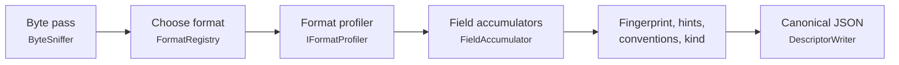

# squalify design

Status: design settled by the owner on 2026-10-13 (spec interview), amended the same day after the [sample-data review](reviews/sample-data-review.md). Code lands slice by slice (`slicer list`). For the diagrams, see [how-it-works.md](how-it-works.md). For the descriptor schema, see [descriptor.md](descriptor.md).

## Purpose

squalify reads one data file and writes a descriptor. Consumers use the descriptor to classify the file, choose a transform or draft a file type. A consumer should be able to make those decisions from the descriptor alone, without opening the file again.

## Settled decisions

| Decision | Choice |
|---|---|
| Scope | One tool. It outputs a descriptor only. No config proposal, no conversion, no matching against a user library of known types. |
| Kind label | A generic `kind` label from a fixed, built-in rule set, with evidence (sq-15). |
| Stack | .NET 10, standalone. No reference to DataBall. |
| Names | Namespace `squalor.squalify`, CLI `squalify`, slicer ids `sq-NN`. |
| v1 formats | Delimited text (with preambles, units rows and repeated blocks), Parquet, Touchstone, whole-file key=value/INI documents, binary (STDF V4 walk plus a generic byte profile). |
| Compressed and archive files | Described as binary with a named magic. No decompression in v1. |
| Read depth | A full streaming scan with bounded memory. |
| Values | Opt-in through `--include-values`. See [Values tier](#values-tier). |
| Dependencies | DuckDB.NET.Data.Full 1.5.5 (Parquet) and System.CommandLine 2.0.11 (CLI). Tests: Microsoft.NET.Test.Sdk 17.14.1, xunit 2.9.3, xunit.runner.visualstudio 3.1.5. |
| Determinism | The same bytes and the same tool version give a byte-identical descriptor on every OS and CPU. No ML, LLM or network. |
| Exit codes | 0 for success; 1 for any error (the same as DataBall's CLI). |

## Pipeline

### Source

`IProfileSource { string Name; long Length; Stream Open(); }`. `FileSource` wraps a path. Tests use synthetic sources that generate bytes on the fly. Every pass reopens the source. A path never reaches the descriptor; only `Name` (the file name) does.

### Passes

Each pass streams the file once with bounded memory.

- **Pass 0, the byte pass (every file).** Computes:
  - SHA-256 of the content;
  - the 256-bin byte histogram;
  - NUL counts at even and odd offsets;
  - the count of control bytes (0x00–0x08, 0x0E–0x1F, 0x7F);
  - strict UTF-8 validity, using `System.Text.Unicode.Utf8` and carrying incomplete sequences across buffer boundaries;
  - the BOM;
  - magic matches.

  Text, binary and empty are decided from these whole-file counts:
  1. A zero-length file is empty.
  2. A binary magic means binary.
  3. A UTF-16/32 BOM means text.
  4. A NUL-parity pattern means UTF-16 without a BOM. The pattern is: at least 90% of NULs at odd offsets, or at least 90% at even ones, with NULs at least 30% of all bytes.
  5. Any other NUL, or control bytes above 5%, means binary.
  6. Otherwise the file is text. The charset is `ascii`, else `utf-8` if valid, else `latin-1`. If bytes 0x80–0x9F occur, the evidence notes "possibly windows-1252".
  7. Stray invalid UTF-8 sequences within `limits.charsetTolerance` (at most 8, and at most 1 per 64 KiB) keep the `ascii` or `utf-8` charset. They decode to U+FFFD and are reported as `invalidUtf8` issues with offsets. Beyond the tolerance, rule 6's `latin-1` applies.
- **Pass 1, structure (text profilers).** Tokenizes and classifies records and lines, keeping only bounded summaries.
- **Pass 2, fields (text profilers).** Parses the chosen data region and feeds the field accumulators.
- Parquet reads its metadata and then streams rows. STDF walks record headers in one pass.

### Choosing a format

Each `IFormatProfiler` scores the sniff result between 0 and 1. The highest score wins. Ties break by registry order: `parquet`, `stdf`, `touchstone`, `keyValue`, `delimited`, `text`, `binary`. Every profiler's score and reason goes into the evidence trail.

| Profiler | Score |
|---|---|
| parquet, stdf | 1.0 when the magic is confirmed |
| touchstone | 0.9 for extension plus content; 0.7 for content only |
| keyValue | up to 0.6 |
| delimited | 0.3 + 0.4 × consistency (at most 0.7) |
| text | 0.1 |
| binary | 0.1, or 0.2 with a named magic (gzip, zip, …) |

## Delimited text

- **Candidates.** The delimiter candidates are `,`, `\t`, `;`, `|` and whitespace runs. Pass 1 runs one quote-aware tokenizer per candidate, all at the same time.
  - Quoting follows RFC 4180 with `"`: a quote counts only at the start of a field, `""` is an escape, and newlines are allowed inside quotes.
  - A runaway quote (an open quoted field longer than 65,536 characters) disqualifies that candidate.
  - Each candidate keeps run-length-encoded field counts. More than 100,000 runs disqualifies it as "too irregular".
  - If every candidate is disqualified, the file falls back to the text profile, with an issue.
- **Dialect and data run.**
  - k is the modal field count among records with at least two fields. A tie goes to the larger k.
  - The data run starts at the first record that, together with the next min(5, remaining) records, has k fields. It ends at the last record with k fields.
  - The score is the number of records in the data run with k fields, divided by the number of non-blank records, times the **clean share**: the share of trimmed tokens in the run that neither start nor end with another candidate's delimiter character. Without it, whitespace runs nearly tie with the real delimiter on right-padded tables. Ties break by higher k, then by candidate order.
- **Padding and decimal separator.** The dialect reports `padding {trim, paddedShare, constantLineLength, lineLength}` over the data run; cells are always trimmed before typing. Fixed-width tables are described, not parsed by offset. The decimal separator is `,` only when the delimiter is not `,` and comma-decimal cells outnumber dot-decimal cells in the header sample.
- **Line kinds** (preamble and footer):
  - `blank`;
  - `comment`: the trimmed line starts with `#`, `!` or `//`;
  - `keyValue`: `key=value` or `key: value`, with a non-numeric key of at most 64 characters;
  - `keyDelimValue`: two fields, the first non-numeric;
  - `text`.
- **Header, annotation and units rows.** Pass 2 reads up to 1,000 records from the start of the data run (`limits.headerSample`) and classifies them with `ValueClassifier`. Some exports put several column-aligned rows (limits, units, line references) above the header, with the table's field count, so the header is not always the run's first record.
  - Every record in the header sample is a header candidate; there is no separate cap. A candidate is eligible if its fields are non-empty and distinct (case-insensitive), and in some non-`string` column (typed over the records below it, skipping all-null records) its value fails the type.
  - Score = nonEmpty × nonNumeric × unique × (0.5 + 0.5 × contrast), where contrast is the share of non-string columns whose type the candidate fails. The highest score wins; ties go to the earliest. All candidates' scores go into evidence.
  - If no candidate is eligible and every column is `string`, record 0 is the header when it is non-empty and distinct. The evidence then says "assumed: all-string table".
  - Records between the run start and the header form one `annotation` region. Each row reports a label (its normalized first field, when non-numeric), blank fields, null tokens and type votes. Labels are always included; cell text is values tier.
  - The record after the header is a units row if every field fails its column type, every field is at most 16 characters, and the columns are non-string.
- **Keys and labels** are normalized: trimmed, with a trailing `:` or `=` removed. A name containing U+FFFD also carries `nameHex`, the hex of its original bytes.
- **No record-length cap.** Every record is profiled, however long. `layout.maxLineLength` reports the longest line. Memory stays bounded by the per-field runaway-quote limit and the field accumulators' caps.
- **Repeated blocks** (sq-13). Two or more data runs with the same k, each at least 5 records long, are profiled as blocks. If every block's header is identical, the fields are aggregated across blocks. Otherwise only the first block is profiled and the issue `heterogeneousBlocks` is recorded.
- **Row classes** (sq-17). Data records are grouped by which fields are non-null. Some exports interleave measurement, setup, error and all-null separator rows, switching thousands of times, which contiguous regions cannot express. `table.rowClasses` reports each class (count, field ranges, first and last line, a stable ID), the number of class transitions and the all-null record count. Each field also reports its nulls excluding all-null records.
- **Problems are described, not rejected.** squalify records issues and still writes a descriptor: `raggedRows`, `commentInData`, `duplicateHeader`, `emptyHeaderName`, `invalidUtf8`, `mixedLineEndings`.

## Touchstone

Rules follow common practice as implemented in scikit-rf, and are checked against the IBIS Touchstone 2.0/2.1 text in sq-09.

- **Option line.** `# <freq unit> <parameter> <format> R <ohms>` is positional, case-insensitive, and defaults to `GHz S MA R 50`. Every defaulted value gets an evidence entry.
- **Port count.** It comes from the extension `.[ghsyz]<N>p` or from `[Number of Ports]`. A mismatch between the two is an issue.
- **Data.** Network data is a flat token stream. Each block holds 1 + 2N² values (N(N+1) for Lower/Upper matrices), whatever the line breaks. `!` starts a comment, and inline comments are stripped.
- **2-port order.** v1 2-port data uses the order S11 S21 S12 S22. In v2, `[Two-Port Data Order]` sets it.
- **Noise.** In v1 2-port files, noise data starts where the frequency decreases. In v2 it is marked by `[Noise Data]`.
- **Fields.** The data is exposed as synthesized numeric fields: `freq`, then `Sij.<a|b>`, with suffixes by format (`mag/ang`, `db/ang`, `re/im`), in file order.

## Key=value / INI documents

These are whole files of `key=value` or `key: value` lines, with optional `[section]` headers. Section names and keys are always included. Values appear only with `--include-values`, but each key's value type vote is always included. Key=value lines above a table are not this family; they are the delimited profiler's preamble.

## Binary and STDF

- **Any binary file.**
  - The byte histogram, whole-file Shannon entropy, and the entropy of 4 KiB blocks: count, min, max and mean.
  - A fixed 16-segment entropy profile.
  - All computed with `DetMath.Log2`.
- **STDF V4** (layouts from pystdf; the 2007 additions are checked against the primary spec in sq-10).
  - Each record header is REC_LEN U2 (payload only) + REC_TYP U1 + REC_SUB U1.
  - FAR is (0, 10), and its CPU_TYPE sets endianness: 2 = little, 1 = big, 0 = VAX (an issue).
  - squalify walks every record header and reports:
    - record-type counts;
    - the first-occurrence order;
    - whether FAR is first and MRR last;
    - truncation.
  - **Test catalog.** For each test, squalify records TEST_NUM, the kind (P, M or F) and the first non-empty TEST_TXT or TEST_NAM, taken from PTR, MPR, FTR and TSR. Test names behave like column headers, so they are always included, up to `limits.stdfTests` (10,000).
  - Result values are never decoded.

## Parquet

DuckDB.NET runs on an in-memory connection with `threads=1` and `preserve_insertion_order=true`.

- **Metadata.** squalify reads `parquet_file_metadata`, `parquet_schema`, `parquet_metadata` (aggregated in row-group order) and `parquet_kv_metadata`. KV keys are always included; KV values only with `--include-values`.
- **Rows.** Rows stream into the same field accumulators as text, so the statistics match the text profile.
- **Nested columns.** These report only count, nulls and `sourceType`.

## Fields

### Value classification and types

`ValueClassifier` (sq-16) is a pure function that uses the invariant culture. It takes the dialect's decimal separator.

- **Null tokens, vocabulary 1:** `""`, `NA`, `NA.`, `N/A`, `null`, `NaN`, `-`. They are matched case-insensitively after trimming. The vocabulary is fixed and versioned (`limits.nullTokens`), never learned from the data: learning it would make one column's type depend on the others.
- **Types:**
  - `bool`: `true`, `false`, `yes`, `no`.
  - `int`: `^[+-]?\d+$` and fits Int64.
  - `float`: `NumberStyles.Float` and finite.
  - `date`: three numeric parts separated by `/`, `-` or `.`, with a 4-digit year and 1–2 digit day and month. The value reports every **order** (`YMD`, `MDY`, `DMY`) under which it is a valid date. squalify never picks a locale.
  - `datetime`: ISO 8601 (with `T` or a space, and an optional fraction and offset), or a `date` followed by a time.
  - `time`: `H:mm[:ss[.f+]]`, with an optional ASCII `AM`/`PM` (the **clock** is `12h`, else `24h`).
  - A field's orders are the intersection over its values. More than one left means `ambiguous`; none left joins the field to `string`, with evidence.
  - `string`: anything else.
- **Flags:** `leadingZero` (for example `007`) and `commaDecimalLike` (`^[+-]?\d+,\d+$`).

The type lattice:

- `empty` < `bool`
- `empty` < `int` < `float`
- `empty` < `date` < `datetime`
- `empty` < `time`
- Any other join is `string`.

A field's `type` is the join over all its non-null votes (the strict rule). Votes are always reported, together with the dominant type and its share. A plurality tie goes to the narrower type.

### Statistics

- **Numeric:** min and max (integers for `int`); mean and sample stddev by Welford in input order; quantiles p01, p05, p25, p50, p75, p95 and p99 by lower nearest rank.
- **Temporal:** `orders`, `ambiguous` and `clock`; min and max as ISO 8601, and quantiles over ticks. When the order is ambiguous, min, max, quantiles and monotonicity are written as `null`, because any value would assume a locale.
- **Constant fields:** when every non-null value of a field is equal (including a sparse field with one value), its numeric or temporal statistics are that value. They are withheld (`statsWithheld: "constant"`) unless values are opted in for the field.
- **All fields:** lengths, padded values, null tokens, monotonicity (numeric and temporal only), constant, and unique.
- **Shape masks** (value-free, so always included):
  - each character maps to a class: `9` for a digit, `A` for upper case, `a` for lower case;
  - ASCII punctuation and space are kept literally; other characters become `?`;
  - runs of two or more are written as `c{n}`;
  - a mask longer than 64 tokens is truncated with `+`;
  - a field keeps at most 64 masks, and the rest are counted as `other`.

### Bounded memory and sketches

| Accumulator | Exact up to | Beyond the cap |
|---|---|---|
| Distinct values per field | 10,000 | HyperLogLog, p=14, over `XxHash64` (seed 0), with linear counting below 2.5m |
| Quantiles per field | 100,000 values | Greenwald-Khanna, ε = 0.001, compressing every ⌊1/(2ε)⌋ inserts |
| Top-k values (`--include-values`) | while the distinct set is exact | Space-Saving, 1,000 counters; k = 10 |
| Shapes per field | 64 masks | counted as `other` |
| Regions | 1,000 | truncated, with a count |
| STDF test catalog | 10,000 tests | counted |
| Row classes per table | 64 (first seen kept, exact counts) | counted in `truncated` |

- **Crossing a cap.** The exact buffer is fed to the sketch in input order and then freed. The output is marked `approximate: true` and carries `errorBound`.
- **Global budget.** A global budget of 10M exact quantile values and 2M exact distinct values caps each field at min(cap, budget ÷ field count). The effective caps are written to `limits`.
- **Memory ceiling.** Peak working set stays at or below `MemoryBudget.CeilingBytes`: the sum of the accumulators' estimated bytes plus a fixed allowance for the runtime and I/O buffers. sq-11 sets the allowance (owner to confirm) and tests it on generated streams; sq-19 benchmarks against it.

## Values tier

| Always included | Only with `--include-values` |
|---|---|
| Header names, preamble keys, annotation labels, section names and keys, Parquet column names and KV keys, STDF test names | Preamble values, annotation-row cells, key=value values, Parquet KV values, comment text |
| Counts, nulls, types, votes, shapes, lengths | Top-k values, lexical (string) min/max |
| Numeric and temporal min/max/mean/stddev/quantiles, except for constant fields | Units-row text (field `unit` from a units row); statistics of constant fields |
| Header-unit convention and units parsed from header names | Value-bearing `stableLines` regexes (comment and text lines) |

`--include-values` opts in every value. `--include-values-for <name>` (repeatable) opts in only the values of the named preamble keys, annotation labels, key=value keys and fields, matched case-folded; identity often lives in one or two of them. A name that matches several members opts in all of them; a name that matches nothing gives the issue `includeValuesForUnmatched`. `options.includeValuesFor` records the names.

`ValuesPolicy` lists every value-bearing descriptor member in one place, including annotation cells and the statistics of constant fields. Canary tests prove that nothing leaks without the flag or an allow-list entry.

## Header-unit conventions

Each header name is parsed against a fixed set of conventions:

| Convention | Example |
|---|---|
| `nameParenUnit` | `I_Total(A)` |
| `nameBracketUnit` | `Pout[dBm]` |
| `nameUnderscoreUnit` | `VCC_V`. Only when the suffix is a known unit, so `I_Total` stays a plain name. |
| `unitsRow` | a units row under the header |
| `none` | |

The unit table is fixed and versioned (`limits.unitTable`). It contains these base units, combined with the SI prefixes f, p, n, u/µ, m, k, M and G:

- V, A, W
- Hz, s
- Ohm/Ω, F, H
- dB, dBm, dBc
- %, C/degC/°C, K

This matches DataBall's `HeaderParser` patterns, so a consumer can map conventions directly.

## Structural fingerprint

There are four SHA-256 hashes, each written as `sha256:<hex>`. Each is computed over a compact canonical JSON projection that contains no values.

- **`structure`.** No names at all: the family, the dialect (delimiter, quote, hasHeader, unitsRow, decimal separator, constant line length), the charset family, the region kinds in order, and the dominant preamble line kind.

- **`layout`.** The projection holds:
  - the family and the dialect (delimiter, quote, hasHeader, unitsRow);
  - the charset family (`unicode` or `latin1`);
  - the region kinds, in order;
  - the preamble keys (normalized);
  - the dominant header-unit convention;
  - the ordered, case-folded field names (`#<index>` when unnamed);
  - each family's own contribution.
- **`typed`.** `layout` plus the field types.
- **`names`.** The sorted, unique, case-folded field names.

A name with a control character or U+FFFD is hashed as `#<index>` (fields) or left out (keys), with the issue `nameExcludedFromFingerprint`. Such bytes may vary per file and would otherwise make every sibling unique.

**Fingerprint equality is not a family test.** Column sets often vary by recipe, unit or bench, so `layout`, `typed` and `names` can be unique per file, and every plain header-plus-rows CSV shares one `structure`. Family recognition needs more evidence, such as name containment and hints. Consumers comparing `typed` should treat `empty` as matching any type and `int` as within `float`.

Family contributions:

- **Parquet:** column names with repetition. The typed hash adds the physical and logical types.
- **Touchstone:** version, ports, parameter, format, matrix and noise.
- **keyValue:** sections and keys.
- **STDF:**
  - layout: the record-type set and the endianness;
  - typed: the catalog's `(testNum, kind)` pairs;
  - names: the test names.

`fingerprint.version` changes whenever a projection changes.

## Detect-rule hints

Hints are neutral facts that a consumer can turn into match rules:

- `extension`.
- `magic`.
- `stableLines`: each entry has a 0-based `line` and an anchored, portable regex. For example, a header line becomes `^<escaped header>$` at any length, the header prefix becomes a padding-tolerant regex over the first 5 names (all when there are fewer), and a preamble key becomes `^\s*<key>\s*[=:]`.
- `headerFields`, `headerPrefix` and `nonNullFields` (fields with no nulls in this file: an observation, not a requirement of the type).
- `fileNameShape`: the shape mask of the file name.
- `fieldCount`, `dataStartLine`, `delimiter`.
- `headerConvention`.
- `parquetColumns`.
- `stdf { cpuType, version }`.

## Kind label

A fixed, ordered rule table runs over the finished descriptor only, never the file, and the first match wins. Every rule's matched or missed reason goes into the evidence.

The labels are:

- `stdfTestLog`, `touchstoneNetwork`, `parquetTable`, `keyValueDocument`
- `labSweepTable`, `measurementTable`, `genericTable`
- `textLog`, `text`
- `archive`, `binary`, `empty`

The owner confirms the rule details at the start of sq-15.

## Evidence trail

Every inference adds `{ stage, topic, chosen, candidates[{ value, score, reason }] }`. Entries are ordered by pipeline stage, then by topic. Reasons are fixed templates filled with value-free numbers. Unanimous field-type inferences are grouped into one entry per type that lists field indexes (sq-20), so wide files stay compact.

## Determinism rules

- **No environment input.** Output never depends on the time, environment, absolute path, mtime, machine or user.
- **Culture and sorting.** Use `CultureInfo.InvariantCulture` everywhere. Case-fold with `ToLowerInvariant` and sort ordinally (UTF-16 code unit order); `Ordinal` (`src/squalify/Determinism/Ordinal.cs`) holds the helpers. Tests run under `de-DE` and `tr-TR`.
- **Collections.** Sort every map and set before writing. The descriptor model (`src/squalify/Descriptor/`) does not sort lists: producers build every collection sorted by its documented key (`CountMap` sorts its own keys at construction), and the writer never sorts.
- **Single thread.** Accumulation runs in a single thread, in input order. Greenwald-Khanna summaries do not merge exactly across shards, so parallel profiling would need fixed shard boundaries and a mergeable sketch first. sq-19 measures throughput before any such change.
- **Writer.** `DescriptorWriter` (`src/squalify/Json/DescriptorWriter.cs`) writes each model type with an explicit key order, the order in [descriptor.md](descriptor.md#canonical-form), which is normative. It uses `Utf8JsonWriter` with `Indented`, `IndentSize` 2, `NewLine` `"\n"` (the platform default is CRLF on Windows) and `JavaScriptEncoder.UnsafeRelaxedJsonEscaping`. Output is UTF-8 with no BOM and a trailing LF. A failed write surfaces as `SqualifyException`. The encoder escapes BMP code points that the .NET runtime's Unicode tables leave unassigned, so a runtime major upgrade can change the output for the same input. That is an output-affecting change and bumps `tool.version` like any other (a test pins one such code point).
- **Numbers.** `CanonicalNumber` (`src/squalify/Json/CanonicalNumber.cs`): doubles use the shortest round-trip form with the invariant culture, `-0` is written as `0`, and NaN/±Infinity are written as strings.
- **Floating-point math.** Output-affecting math uses only IEEE `+ - * /` and `Math.Sqrt`, which are exact on every platform. Logarithms use the in-repo `DetMath` (`src/squalify/Determinism/DetMath.cs`), and powers of two use `Math.ScaleB`. No `Math.Log`, `Exp` or `Pow` is allowed in output paths.
  - `DetMath.Log2` splits the value into exponent and mantissa (`Math.ILogB`, `Math.ScaleB`, both exact), then sums the atanh series in double-double arithmetic built from error-free `+ - * /` steps. The documented maximum relative error is 1e-12. The series is summed far more precisely than that, and every one of the 600 or so reference inputs comes out as the correctly rounded logarithm.
  - Powers of two are exact. `Ln(x)` is `Log2(x) * Ln2`.
  - `tests/squalify.Tests/fixtures/detmath-log2.tsv` holds inputs and expected bit patterns generated once with mpmath (the header records how). The test requires an exact bit match, which CI checks on each OS.
- **Hashing.** Sketches use the in-repo `XxHash64` (`src/squalify/Determinism/XxHash64.cs`) with seed 0, never `string.GetHashCode`. Its tests use published vectors.
- **Visibility.** `DetMath`, `XxHash64`, `Ordinal` and `CanonicalNumber` are internal to the library; the test project sees them through `InternalsVisibleTo`. The descriptor model, `DescriptorWriter` and `SqualifyException` are public.
- **Version.** `tool.version` comes from `AssemblyInformationalVersion`, with `IncludeSourceRevisionInInformationalVersion=false`. A behavior change that alters output for the same input bumps the version.
- **CI.** The same golden files are compared on Windows, macOS and Linux. `Golden.Verify` (`tests/squalify.Tests/Golden.cs`) compares the written bytes with `<fixture>.squalify.json` and fails with a unified diff; `SQUALIFY_UPDATE_GOLDEN=1` rewrites a golden, and the change is reviewed in git before it is committed.

## Errors

- An unreadable path, a permission error or an I/O failure raises `SqualifyException`, and the CLI exits 1 with the message on stderr. A directory input is an error in v1.
- Malformed content is described, not rejected. Problems are counted and listed in `issues[]`, and the descriptor is still written.

## Non-goals

- Proposing DataBall configs or file types.
- Classifying against a user library of known types. The built-in `kind` label is in scope.
- ML, LLM or network use.
- Editing, repairing or converting files.
- A dependency on DataBall.
- In v1: directory or multi-file input, decompression, STDF result values, and MIR text fields.
