# How squalify works

> **Design stage.** This page describes the agreed design (spec pass, 2026-10-13, amended after the sample-data review the same day). Five slices have landed. sq-01 added the CLI shell, `ToolInfo` and `SqualifyException`. sq-02 added the descriptor model, the canonical JSON writer and the determinism kit (`DetMath`, `XxHash64`, `Ordinal`) and the golden-file test harness. sq-03 added the byte pass, the format registry and the generic text and binary profiles, so `squalify profile` now works on any file. sq-16 added the value classifier (`ValueClassifier`), which classifies one value as empty, true/false, a number, a date or time, or text. sq-04 added the delimited-text profiler: delimiter and quoting, preamble, annotation, header, units, data and footer regions, padding, the decimal separator and per-field type votes. Every source file that does not exist yet is marked *(planned)*. When an architectural review or a slice changes how squalify works, this page and its diagrams are updated in the same change (see "Docs" in `AGENTS.md`).

squalify reads one data file and writes a **descriptor**: a JSON summary of what the file is and what is inside it. Other tools, such as DataBall, read the descriptor to decide how to handle the file. squalify never changes the file and never needs the network.

Each diagram shows one idea. Labels are in plain language, with the code name in small text. Source paths are relative to `src/squalify/`, so the CLI project is written `../squalify.Cli/`.

## 1. The pieces

The `squalify` command is a thin shell around the library. Each kind of file has its own profiler. DuckDB is used only to read Parquet. The descriptor is the only thing that leaves the tool.

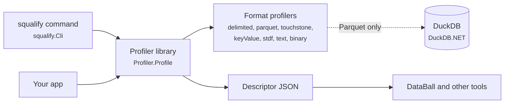

*Source: `../squalify.Cli/CommandFactory.cs`, `../squalify.Cli/CliApp.cs`, `ToolInfo.cs`, `SqualifyException.cs`, `Descriptor/`, `Json/DescriptorWriter.cs`, `Profiler.cs`, `Formats/FormatRegistry.cs`, `Formats/GenericTextProfiler.cs`, `Formats/GenericBinaryProfiler.cs`, `Delimited/DelimitedProfiler.cs`; the other profilers (Parquet, Touchstone, key=value, STDF) under `Formats/` (planned).* The CLI works today: `squalify --version` prints the tool version, and `squalify profile <file>` writes the descriptor to stdout, or to the `-o` file. The `delimited`, `text` and `binary` profilers exist so far, so every file is described as a delimited table, text, binary or empty; the other profilers in the diagram are planned. A directory is an error.

## 2. One profile run

Every file goes through the same steps. A step that reads the file reads all of it, start to end, and keeps only bounded summaries in memory. The file can be far larger than RAM.

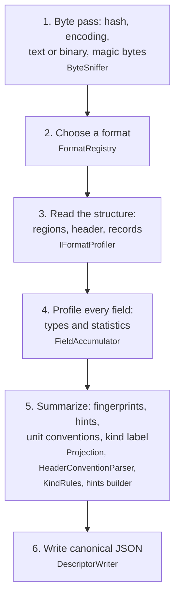

*Source: `Json/DescriptorWriter.cs`, `Profiler.cs`, `Sniff/ByteSniffer.cs`, `Formats/FormatRegistry.cs`, `Formats/IFormatProfiler.cs`, `Delimited/DelimitedProfiler.cs`; `Fields/`, `Fingerprint/`, `Units/`, `Kind/` (planned).* Steps 3 to 5 are only partly built: the delimited, generic text and generic binary profiles make up step 3 for now, step 4 is limited to the type votes that the delimited profile counts (the other field statistics come later), and the fingerprint and kind label hold fixed placeholder values until their slices land. For delimited text, step 3 is two reads of the file: one while the format is chosen (the structure pass) and one when the delimited profiler has won.

## 3. Choosing a format

Every profiler looks at the file and gives a score from 0 to 1. The highest score wins, and a tie goes to whichever profiler comes first in the registry list. Every score and its reason are kept in the descriptor's evidence, so you can see why a format was chosen. Most profilers score from the byte-pass result alone. A delimited table cannot be recognized that way, so the delimited profiler is handed the file too and reads all of it while it scores (the structure pass of section 4); if it wins, it keeps what it found, so the file is not read again for the same work.

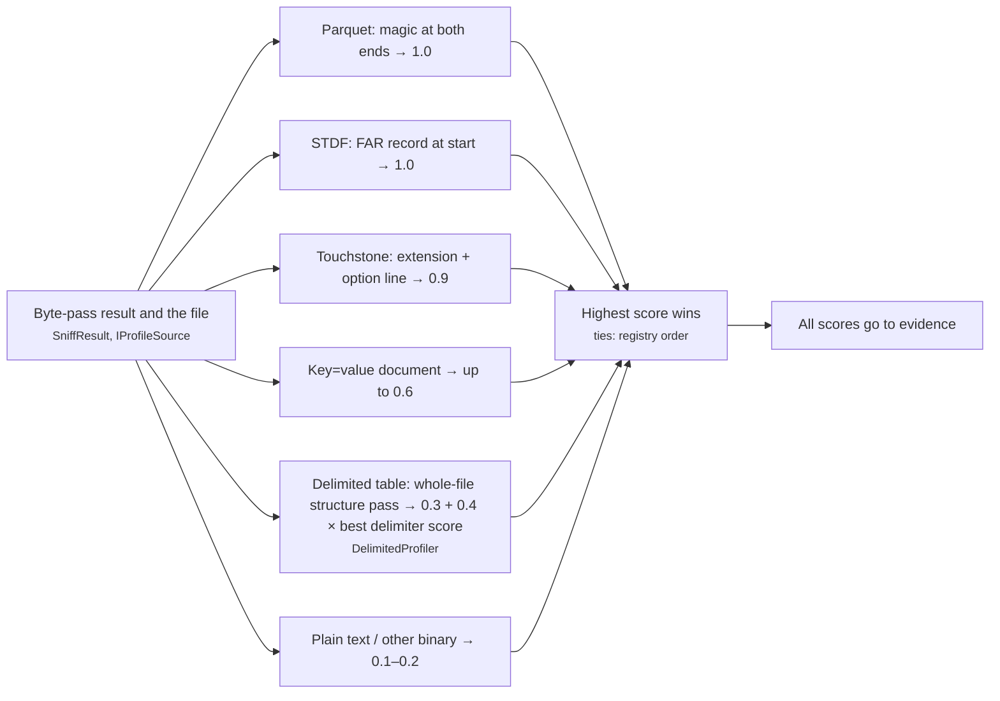

*Source: `Formats/FormatRegistry.cs`, `Formats/IFormatProfiler.cs`, `Delimited/DelimitedProfiler.cs`, `Formats/GenericTextProfiler.cs`, `Formats/GenericBinaryProfiler.cs`; the other profilers are planned.* A file with no bytes is called empty before any profiler scores it. For files that are not empty, the evidence lists the score of each profiler that is registered, in registry order; today that is delimited, text and binary.

A profiler can also decline a file and say why. When the delimited profiler finds delimiter evidence but gives up, because no delimiter is good enough and at least one candidate was disqualified, it scores 0 and hands back an issue (`tooIrregular`) and its evidence. The registry passes these on even though the profiler lost, so the plain text profile describes the file and the descriptor still explains why it is not treated as a table.

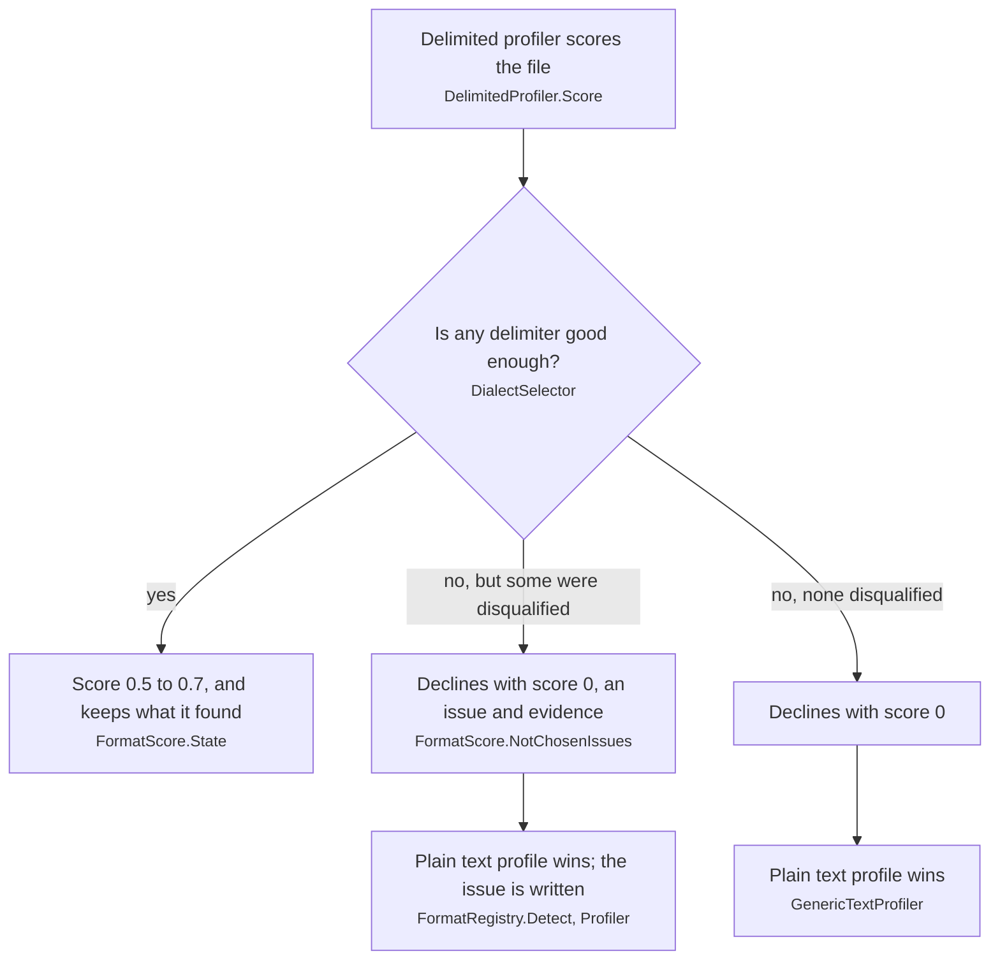

*Source: `Delimited/DelimitedProfiler.cs`, `Delimited/DialectSelector.cs`, `Formats/IFormatProfiler.cs`, `Formats/FormatRegistry.cs`, `Profiler.cs`.*

## 4. Reading a delimited file

A lab CSV is often more than a header and rows. squalify splits the file into regions. It tries every common delimiter at the same time, in one pass over the whole file. It picks the delimiter that gives the longest steady run of rows with the same field count, and whose cells split cleanly. On tables padded with spaces, splitting on spaces looks almost as steady, so cleanliness decides.

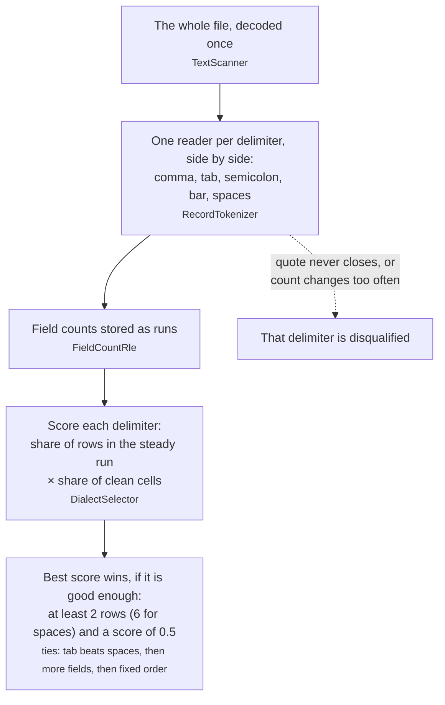

*Source: `Delimited/TextScanner.cs`, `Delimited/RecordTokenizer.cs`, `Delimited/FieldCountRle.cs`, `Delimited/DialectSelector.cs`.* Quotes follow the usual CSV rule (a doubled quote is one quote, and a quoted cell may hold a comma or a line break). A closing quote may be followed by spaces before the comma or the line end, as in padded tables. A stray quote inside a quoted cell, with no comma or line end after it, is kept as plain text, because some instruments write quotes inside a quoted cell without doubling them. A cell counts as clean when it is quoted or contains none of the characters `,` `;` `|` other than its own delimiter, and, for those three delimiters, no tab inside the cell. Spaces never make a cell unclean, and a decimal comma such as `1,5` does not count, so a semicolon file with decimal commas is told apart from a comma file. A delimiter is only chosen when it is good enough: its steady run has at least 2 rows (6 for spaces) and its score is at least 0.5. When tab and spaces tie, tab wins.

The header is not always the first row of that run. Some exports put rows of limits, units or line numbers above the header, lined up with its columns. squalify scores the first rows of the run and picks the one that looks most like names over typed data. The rows above it become **annotation** rows: their labels are kept, their cells are opt-in.

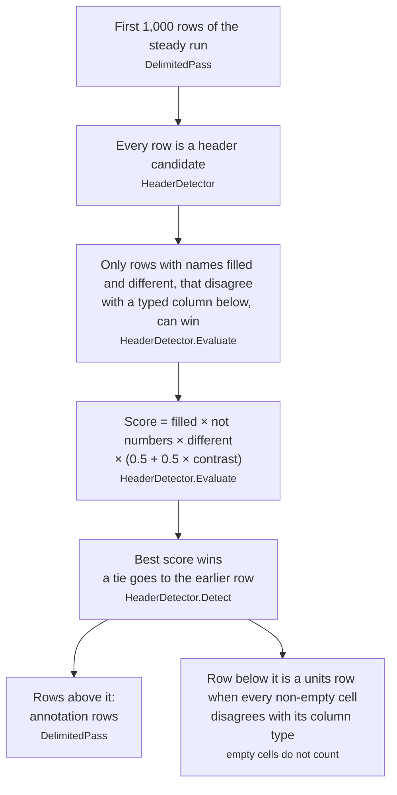

*Source: `Delimited/DelimitedPass.cs`, `Delimited/HeaderDetector.cs`.* The contrast is the share of typed columns (columns that are not text) that the candidate disagrees with, so a row of units scores below the header that sits under it. A header with a blank or repeated name is still taken when nothing else qualifies, with an issue. A table made only of text takes its first row as the header and says so in the evidence. A first data row that is all `NULL` is never taken for a units row, so the interleaved separator rows of a DangerTest export do no harm. A comment line (`#`, `!`, `//`) is free text: it is never a header, an annotation row or a label, wherever it sits. The evidence lists the eligible candidates and the winner, and one summary line that counts the rest by reason.

With the dialect and header known, the file falls into regions, each with line and byte ranges. Regions tile the file: a blank line belongs to the region before it.

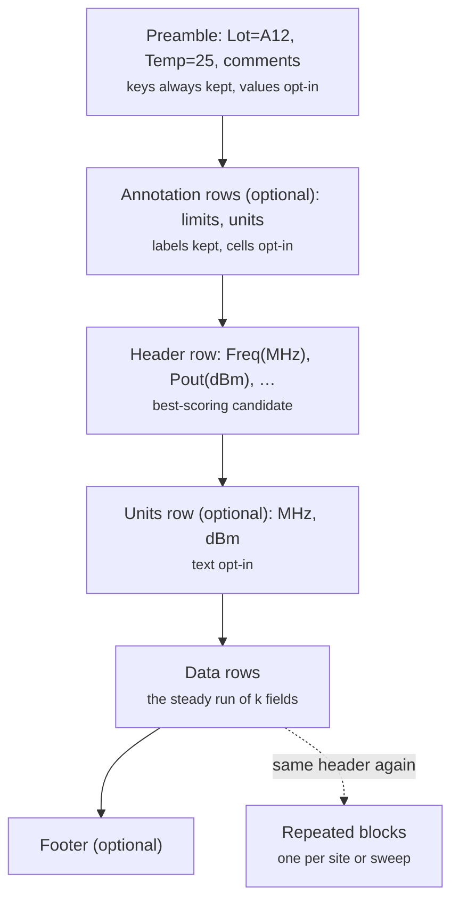

*Source: `Delimited/DelimitedPass.cs`, `Delimited/LineClassifier.cs`, `Delimited/DialectSelector.cs`, `Delimited/HeaderDetector.cs`; `Delimited/BlockDetector.cs` (planned).*

squalify also reports how the table is padded (fixed line length or not) and whether numbers use a decimal comma. It describes a fixed-width table but still reads every row through the tokenizer. Every data row is read a second time to count the type of each field, so the descriptor already says which fields are numbers; the other field statistics come later.

## 5. Profiling one field

Each value is classified on its own: empty, true/false, whole number, decimal number, date, time or text. A field's type is the narrowest type that fits **every** non-empty value. Empty markers such as `NA`, `NA.` or `-` come from a fixed, versioned list that is never learned from the data, and the classifier says which marker it matched, so a consumer can decide which markers it treats as empty. Statistics are exact up to a cap. Past the cap they switch to a fixed approximation that gives the same answer every time, and the descriptor marks them as approximate.

Dates never assume a locale. `6/5/2026` could be June 5 or May 6, so squalify reports both possible orders and marks the field ambiguous. It then leaves out the date range and whether the dates rise or fall, because both would assume one order. The same goes for the clock: a time with `AM` or `PM` is a 12-hour time, and a two-digit year such as `6/5/26` stays text, because squalify would have to guess the century.

The classifier looks at one value at a time and takes the first test that fits, in this order. Two flags ride along: *leading zero* only on whole and decimal numbers, and *looks like a decimal comma* on a decimal number or text. It only reads the value and the file's decimal separator, so it gives the same answer on every machine and in every language setting.

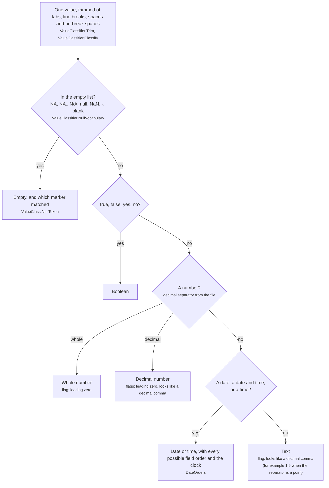

*Source: `Values/ValueClassifier.cs`, `Values/DateOrders.cs`, `Values/ValueClass.cs`.*

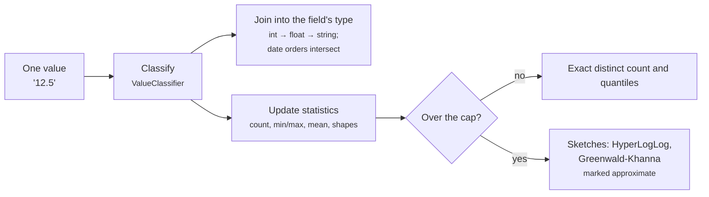

*Source: `Values/ValueClassifier.cs`, `Fields/FieldAccumulator.cs` (planned), `Sketches/` (planned).*

## 6. What is always included, and what needs `--include-values`

By default a descriptor describes the **shape** of the data and its statistics, not its contents. Literal text from the file appears only when you ask for it: all of it with `--include-values`, or only named keys and columns with `--include-values-for <name>`.

A column with one value for the whole file, such as a serial number, is a special case. Its range would just be that value, so its statistics are opt-in too.

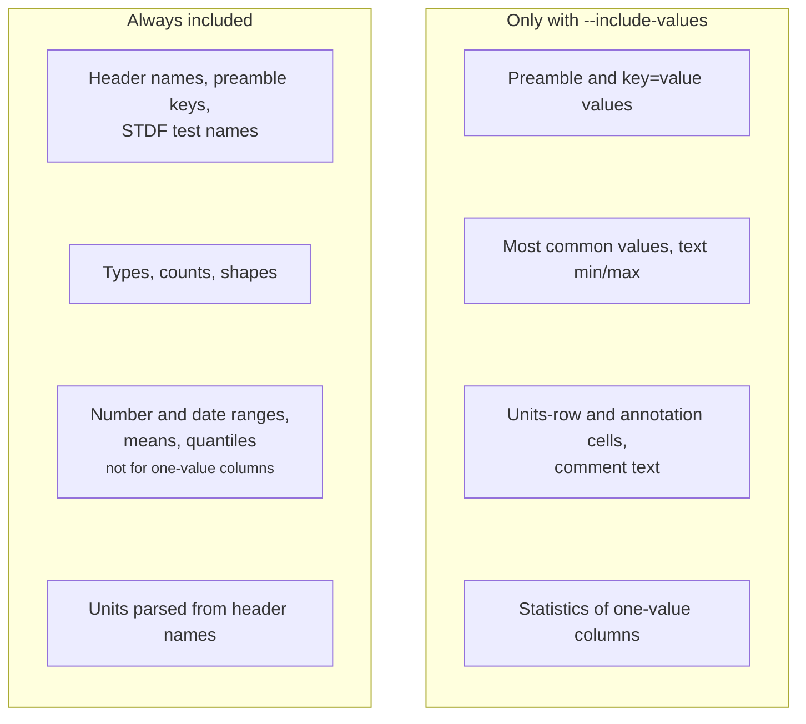

*Source: `ValuesPolicy.cs` (planned).*

## 7. Fingerprints

squalify hashes a stripped-down copy of the descriptor that contains no data values. Two files of the same type therefore get the same fingerprint, even when their data differs. There are four fingerprints at different levels of strictness. `structure` uses no column names at all, so it survives a changed column set.

A matching fingerprint does not prove two files are the same kind of file. Many unrelated CSVs share one `structure`, and files whose columns change per run get a new `layout` each time. Consumers combine fingerprints with names and hints.

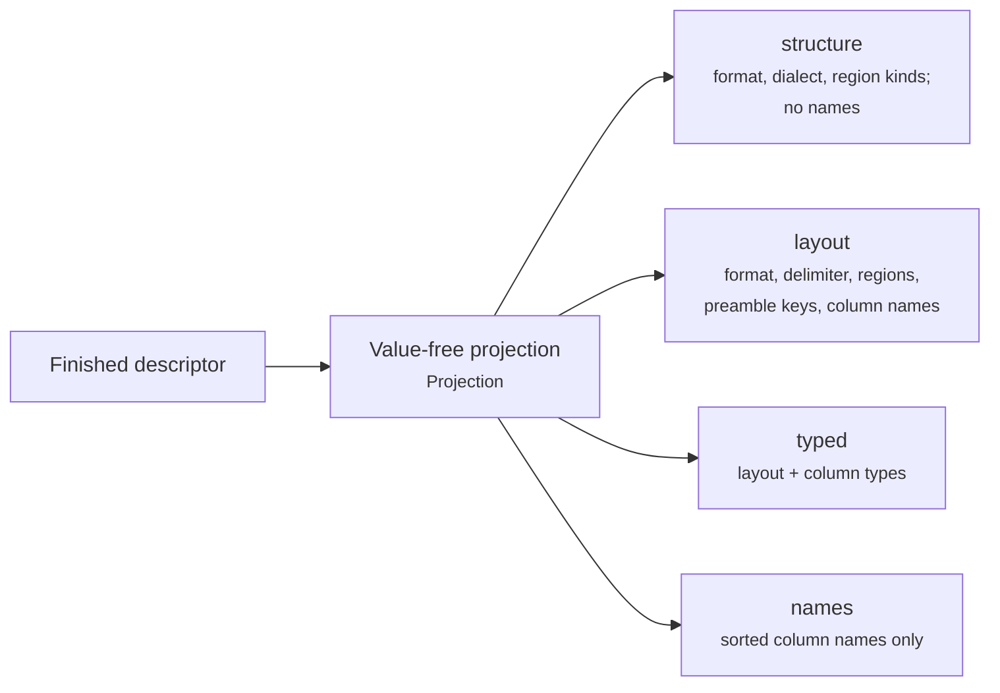

*Source: `Fingerprint/Projection.cs` (planned).*

## 8. Kind label and unit conventions

After profiling, two small rule sets read the finished descriptor. They never read the file.

- **Header-unit conventions.** Every column name is checked for how it carries a unit: `I_Total(A)`, `Pout[dBm]`, `VCC_V`, a units row, or none. The most common convention is reported.
- **Kind label.** A fixed, ordered list of rules suggests a generic label, such as `labSweepTable`, `stdfTestLog` or `touchstoneNetwork`. The first rule that matches wins, and every rule's result is kept as evidence.

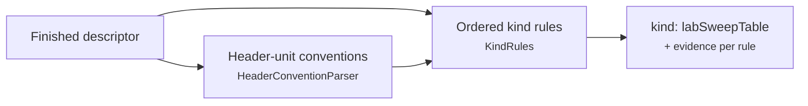

*Source: `Units/`, `Kind/` (planned).*

## 9. Why the output never changes

The same file and the same squalify version always give the same descriptor, byte for byte, on Windows, macOS and Linux. Five guardrails make that true.

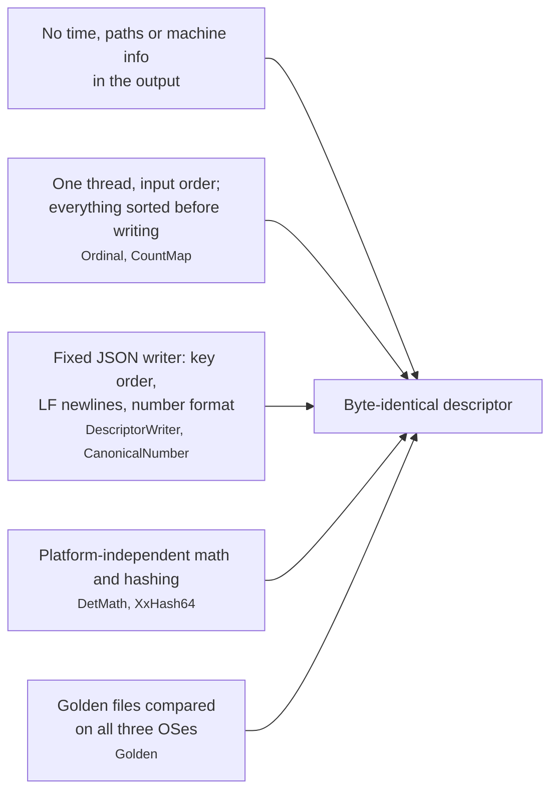

*Source: `Determinism/Ordinal.cs`, `Determinism/DetMath.cs`, `Determinism/XxHash64.cs`, `Descriptor/CountMap.cs`, `Json/DescriptorWriter.cs`, `Json/CanonicalNumber.cs`; `../../tests/squalify.Tests/Golden.cs`.*

Logarithms are the one place where platforms can disagree: the system math library may differ by one bit between operating systems. squalify therefore computes them itself, from additions, multiplications and divisions only, which every CPU rounds identically. A reference table made with an arbitrary-precision tool pins the result bit for bit. Hashing uses squalify's own copy of xxHash64, checked against published test vectors.

## 10. Row classes

Some exports mix several kinds of row in one table: measurement rows, setup rows, error rows and empty separator rows, switching kind on almost every line. squalify groups rows by which columns are filled in and reports each group, how often the kind switches, and how many rows are empty. Column null counts are also given without the empty rows, so separators do not look like missing measurements.

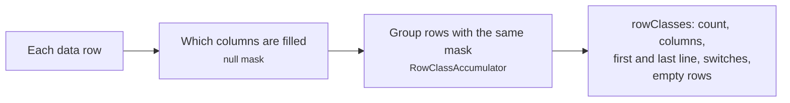

*Source: `Fields/RowClassAccumulator.cs` (planned).*

## 11. Writing the descriptor

The finished descriptor is a tree of plain model objects. The writer turns it into bytes in one fixed way: it writes each object's keys in the order the schema document lists, and it never sorts, because the model already holds every list and map in order. Numbers and text go through fixed rules, so the same model gives the same bytes on every machine.

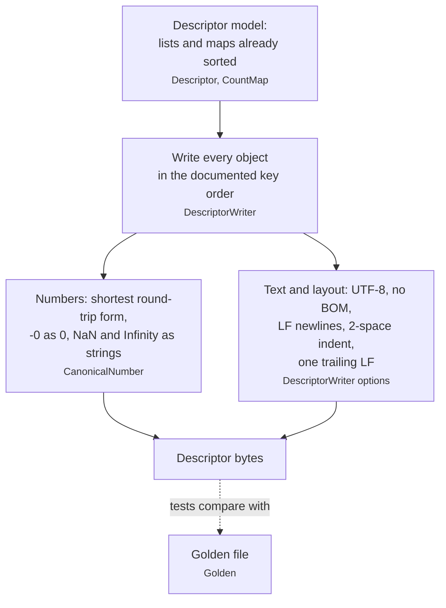

*Source: `Descriptor/`, `Json/DescriptorWriter.cs`, `Json/CanonicalNumber.cs`; `../../tests/squalify.Tests/Golden.cs`.* The key order is part of the schema: see [descriptor.md](descriptor.md#canonical-form).

## 12. Text, binary or empty?

The byte pass counts every byte of the file once and then applies seven rules, in order. The first rule that fits decides. A file is never rejected: odd bytes are counted, and invalid UTF-8 in ascii or utf-8 text is also reported as an issue. A few stray invalid bytes in an otherwise plain text file do not change its encoding, because a single bad byte in a large log should not turn it into "Latin-1" or "binary"; the allowance is at most 8 per file and at most 1 per 64 KiB.

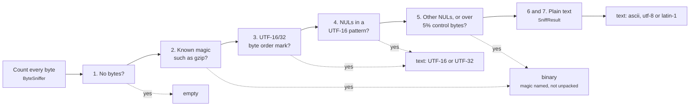

*Source: `Sniff/ByteSniffer.cs`, `Sniff/SniffResult.cs`, `Sniff/MagicTable.cs`.* The exact thresholds and the magic table are in [descriptor.md](descriptor.md#encoding).
