# How squalify works

> **Status (v0.1.x).** Built: the CLI and library shell, the descriptor model and canonical writer with its determinism kit, the byte pass, format choice, the generic text and binary profiles, the value classifier, the delimited-text profiler, field profiles, header-unit conventions, row classes, repeated blocks, fingerprints and detect-rule hints, and the values tier. Also built: sketches past the exact caps (HyperLogLog and Greenwald-Khanna), a character budget for shape masks, and memory accounting with a tested ceiling. Still to come: the Touchstone, key=value and STDF profilers and the kind label; their source files are marked *(planned)*. Parquet is not in v1: a Parquet file is profiled as binary with a `parquet` magic hint. When an architectural review or a slice changes how squalify works, this page and its diagrams are updated in the same change (see "Docs" in `AGENTS.md`).

squalify reads one data file and writes a **descriptor**: a JSON summary of what the file is and what is inside it. Other tools, such as DataBall, read the descriptor to decide how to handle the file. squalify never changes the file and never needs the network.

Each diagram shows one idea. Labels are in plain language, with the code name in small text. Source paths are relative to `src/squalify/`, so the CLI project is written `../squalify.Cli/`.

## 1. The pieces

The `squalify` command is a thin shell around the library. Each kind of file has its own profiler. The library uses only the .NET libraries; the command adds a command-line parser. The descriptor is the only thing that leaves the tool.

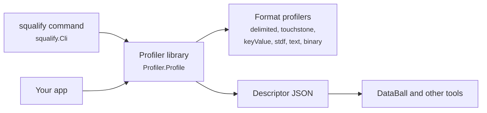

*Source: `../squalify.Cli/CommandFactory.cs`, `../squalify.Cli/CliApp.cs`, `ToolInfo.cs`, `SqualifyException.cs`, `Descriptor/`, `Json/DescriptorWriter.cs`, `Profiler.cs`, `Formats/FormatRegistry.cs`, `Formats/GenericTextProfiler.cs`, `Formats/GenericBinaryProfiler.cs`, `Delimited/DelimitedProfiler.cs`; the other profilers (Touchstone, key=value, STDF) under `Formats/` (planned).* The CLI works today: `squalify --version` prints the tool version, and `squalify profile <file>` writes the descriptor to stdout, or to the `-o` file. The `delimited`, `text` and `binary` profilers exist so far, so every file is described as a delimited table, text, binary or empty; the other profilers in the diagram are planned. A directory is an error.

## 2. One profile run

Every file goes through the same steps. A step that reads the file reads all of it, start to end (the one exception is the hint step, which re-reads only the first lines, up to the header), and keeps only bounded summaries in memory. The file can be far larger than RAM.

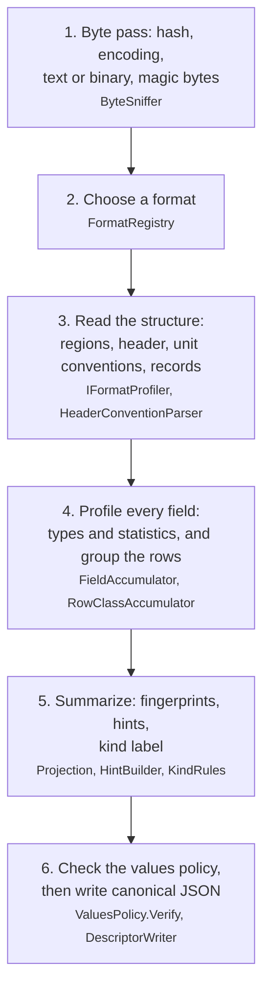

*Source: `Json/DescriptorWriter.cs`, `Profiler.cs`, `Sniff/ByteSniffer.cs`, `Formats/FormatRegistry.cs`, `Formats/IFormatProfiler.cs`, `Delimited/DelimitedProfiler.cs`, `Units/HeaderConventionParser.cs`; `Fields/FieldAccumulator.cs`, `Fields/RowClassAccumulator.cs`, `Delimited/DelimitedPass.cs`; `Fingerprint/Projection.cs`, `Hints/HintBuilder.cs`; `Kind/` (planned).* Steps 3 to 5 are only partly built: the delimited, generic text and generic binary profiles make up step 3 for now (the delimited one also parses the header-unit conventions here, section 8), step 4 is built for delimited text (the other formats will feed the same field accumulators), and step 5 builds the fingerprints and hints (section 7) but the kind label holds a fixed placeholder value until sq-15 lands (section 8). Row classes are built too (section 10). For delimited text, step 3 is two reads of the file: one while the format is chosen (the structure pass) and one when the delimited profiler has won; the hint step then makes a third, bounded read (`LineReader`) of the lines up to the header, to take the text of the header and preamble lines. A UTF-16 or UTF-32 file gets one more streaming read, right after the byte pass, that counts invalid units (section 12).

## 3. Choosing a format

Every profiler looks at the file and gives a score from 0 to 1. The highest score wins, and a tie goes to whichever profiler comes first in the registry list. Every score and its reason are kept in the descriptor's evidence, so you can see why a format was chosen. Most profilers score from the byte-pass result alone. A delimited table cannot be recognized that way, so the delimited profiler is handed the file too and reads all of it while it scores (the structure pass of section 4); if it wins, it keeps what it found, so the file is not read again for the same work.

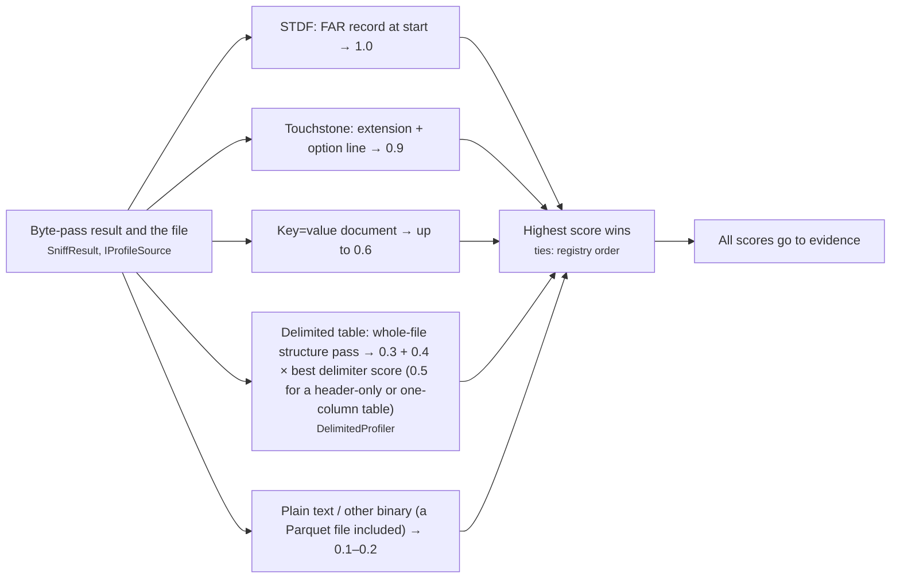

*Source: `Formats/FormatRegistry.cs`, `Formats/IFormatProfiler.cs`, `Delimited/DelimitedProfiler.cs`, `Formats/GenericTextProfiler.cs`, `Formats/GenericBinaryProfiler.cs`; the other profilers are planned.* A file with no bytes is called empty before any profiler scores it. For files that are not empty, the evidence lists the score of each profiler that is registered, in registry order; today that is delimited, text and binary.

A profiler can also decline a file and say why. When the delimited profiler finds delimiter evidence but gives up, because no delimiter is good enough and at least one candidate was disqualified, it scores 0 and hands back an issue (`tooIrregular`) and its evidence. The registry passes these on even though the profiler lost, so the plain text profile describes the file and the descriptor still explains why it is not treated as a table.

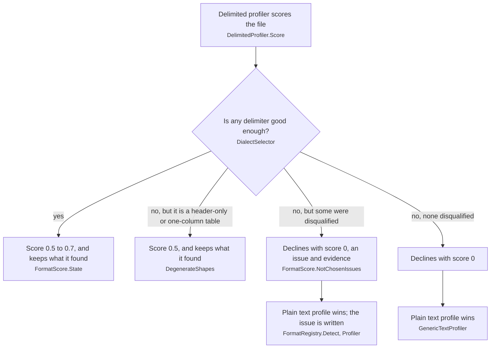

*Source: `Delimited/DelimitedProfiler.cs`, `Delimited/DialectSelector.cs`, `Delimited/DegenerateShapes.cs`, `Formats/IFormatProfiler.cs`, `Formats/FormatRegistry.cs`, `Profiler.cs`.*

## 4. Reading a delimited file

A lab CSV is often more than a header and rows. squalify splits the file into regions. It tries every common delimiter at the same time, in one pass over the whole file. It picks the delimiter that gives the longest steady run of rows with the same field count, and whose cells split cleanly. On tables padded with spaces, splitting on spaces looks almost as steady, so cleanliness decides.

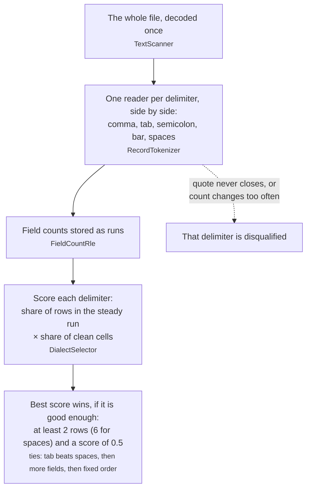

*Source: `Delimited/TextScanner.cs`, `Delimited/RecordTokenizer.cs`, `Delimited/FieldCountRle.cs`, `Delimited/DialectSelector.cs`.* Quotes follow the usual CSV rule (a doubled quote is one quote, and a quoted cell may hold a comma or a line break). A closing quote may be followed by spaces before the comma or the line end, as in padded tables. A stray quote inside a quoted cell, with no comma or line end after it, is kept as plain text, because some instruments write quotes inside a quoted cell without doubling them. A cell counts as clean when it is quoted or contains none of the characters `,` `;` `|` other than its own delimiter, and, for those three delimiters, no tab inside the cell. Spaces never make a cell unclean, and a decimal comma such as `1,5` does not count, so a semicolon file with decimal commas is told apart from a comma file. A delimiter is only chosen when it is good enough: its steady run has at least 2 rows (6 for spaces) and its score is at least 0.5. When tab and spaces tie, tab wins.

Where the run begins matters as much as which delimiter wins. A row can start the run when the next five rows have the table's field count, and the window may step over up to two stragglers on the way: rows with two or more fields but the wrong count (counted as ragged rows), comment lines, and a one-field line once the header and three rows have come before it. A one-field line earlier than that, such as a `key=value` setting or a title above the table, is not a straggler: it ends the window, so lines like that stay in the preamble. The window ends at the last row of the right width, so a footer after it, of any length, never counts. This is why a short row among the first data rows no longer costs the table its header.

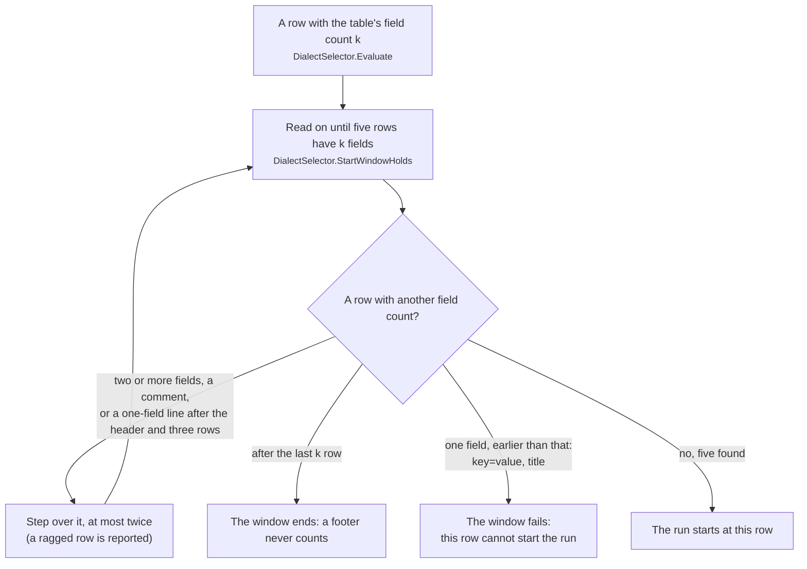

*Source: `Delimited/DialectSelector.cs`, `Delimited/FieldCountRle.cs`, `Delimited/RecordTokenizer.cs` (it flags comment lines in pass 1).*

Two tiny shapes get a second chance when no delimiter is good enough, because they are still tables. A file whose only multi-field line is its last line is a table with a header and no rows, when that line sits within the first 1,000 lines, only blank, comment or `key=value` lines come before it, and every cell reads like a single-word column name (filled, different, not a number, short, and no spaces unless quoted): `Time,Vcc(V),Icc` qualifies, `Hello, world` does not. squalify reports zero rows, every field `empty`, and the issue `noDataRows`. A file where no delimiter occurs at all is a one-column table when its first line is a header that the values below disagree with, such as a text header over numbers, and the delimiter is then written as `none`. A column of plain text, a log or prose does not qualify, so it stays text. The evidence lists both shapes and says why the other was declined.

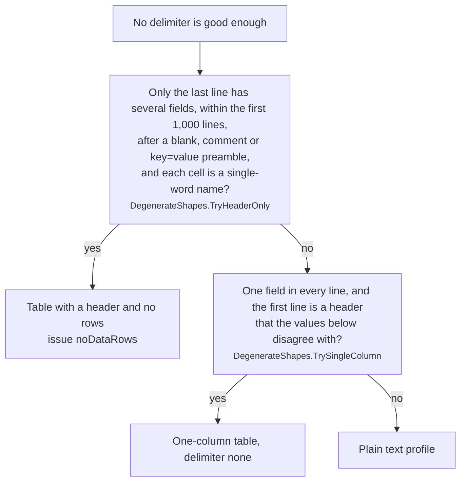

*Source: `Delimited/DegenerateShapes.cs`, `Delimited/DialectSelector.cs`.*

The header is not always the first row of that run. Some exports put rows of limits, units or line numbers above the header, lined up with its columns. squalify scores the first rows of the run and picks the one that looks most like names over typed data. The rows above it become **annotation** rows: their labels are kept, their cells are opt-in.

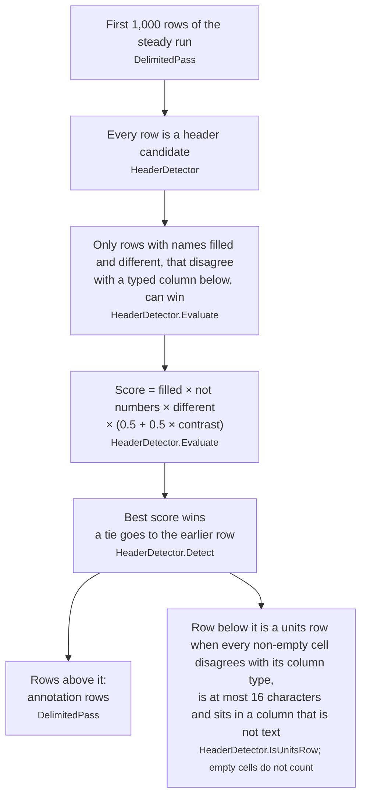

*Source: `Delimited/DelimitedPass.cs`, `Delimited/HeaderDetector.cs`.* The contrast is the share of typed columns (columns that are not text) that the candidate disagrees with, so a row of units scores below the header that sits under it. A header with a blank or repeated name is still taken when nothing else qualifies, with an issue. A table made only of text takes its first row as the header and says so in the evidence. A first data row that is all `NULL` is never taken for a units row, so the interleaved separator rows of an ATE export do no harm. A comment line (`#`, `!`, `//`) is free text: it is never a header, an annotation row or a label, wherever it sits. The evidence lists the eligible candidates and the winner, and one summary line that counts the rest by reason.

With the dialect and header known, the file falls into regions, each with line and byte ranges. Regions tile the file: a blank line belongs to the region before it.

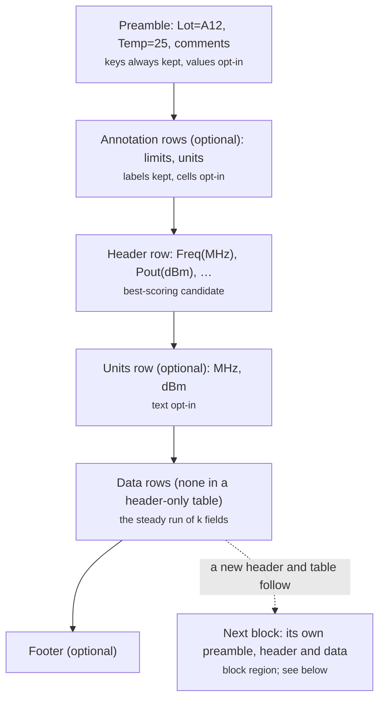

*Source: `Delimited/DelimitedPass.cs`, `Delimited/LineClassifier.cs`, `Delimited/DialectSelector.cs`, `Delimited/HeaderDetector.cs`, `Descriptor/Layout.cs`.*

Lab exports often repeat a header and a table per site, temperature or sweep. A **block** is one such header and table. The field-count runs from the structure pass show where a later run of at least 5 rows with the table's field count follows rows with another field count, and squalify takes that run for a new block in one of two cases. Either one of its first 5 rows is **exactly the first block's header**, which works whatever the types are (a table of only text too), and the rows before it become the block's annotation. Or its first row is a header: names filled and different, and its values disagree with at least half of the typed columns below it, with a note, a `key=value` line or a one-field line before it (a short two-field row does not count). Otherwise the odd rows are ragged rows of one table, so one bad row cannot split a table. The rows between the last row of a block and the next header are the next block's preamble, not ragged rows. While a run is being decided its rows are held, a bounded number of them, and are then either processed as the table's own rows or turned into the new block.

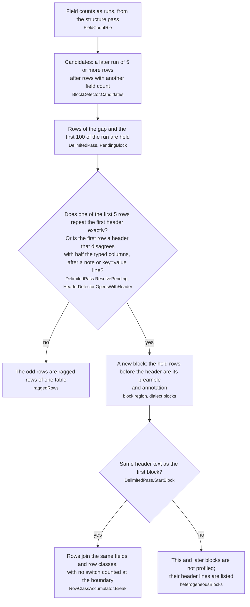

*Source: `Delimited/BlockDetector.cs`, `Delimited/DelimitedPass.cs`, `Delimited/HeaderDetector.cs`, `Delimited/FieldCountRle.cs`, `Fields/RowClassAccumulator.cs`.* The file is read once, so aggregation stops at the first block whose header differs from the first block's: the leading blocks with the same header are one table, and the block with another header and the blocks after it are not profiled, but their regions are still in the layout. The same stop applies after 1,000 blocks (the issue `blocksTruncated`). Blocks that are only separated by blank lines, with the header repeated inside one run of rows, are not recognised. With more than one block, `layout.regions` holds a `block` region per block, each with its own regions inside, and `dialect.blocks` is the count. A block region has only its index, its lines and its regions: squalify does not name a block, so a consumer reads the file for that. The fingerprint says that there are several blocks, never how many, so 3 blocks and 5 give the same hash.

squalify also reports how the table is padded (fixed line length or not) and whether numbers use a decimal comma. It describes a fixed-width table but still reads every row through the tokenizer. Every data row is read a second time and handed to the field accumulators, one per column, so the descriptor says what each field holds; section 5 shows what they keep.

## 5. Profiling one field

Each value is classified on its own: empty, true/false, whole number, decimal number, date, time or text. A field's type is the narrowest type that fits **every** non-empty value. Empty markers such as `NA`, `NA.` or `-` come from a fixed, versioned list that is never learned from the data, and the classifier says which marker it matched, so a consumer can decide which markers it treats as empty. The descriptor counts the markers by their entry in that list, so `NULL`, `Null` and `null` are all counted as `null`.

Dates never assume a locale. `6/5/2026` could be June 5 or May 6, so squalify reports both possible orders and marks the field ambiguous. It then leaves out the date range and whether the dates rise or fall, because both would assume one order. The same goes for the clock: a time with `AM` or `PM` is a 12-hour time, and a two-digit year such as `6/5/26` stays text, because squalify would have to guess the century.

The classifier looks at one value at a time and takes the first test that fits, in this order. Two flags ride along: *leading zero* only on whole and decimal numbers, and *looks like a decimal comma* on a decimal number or text. It also hands on what it parsed (the number, or the date and time parts), so nothing parses the text a second time. It only reads the value and the file's decimal separator, so it gives the same answer on every machine and in every language setting.

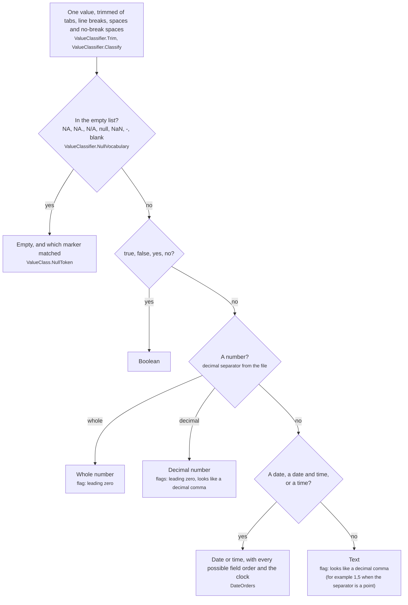

*Source: `Values/ValueClassifier.cs`, `Values/DateOrders.cs`, `Values/ValueClass.cs`.*

Every column has its own **field accumulator**. It receives the column's values in file order, in one pass, and keeps only bounded summaries, so a file can be far larger than memory. The delimited reader feeds it the text of each cell; other formats will feed it typed values through the same class, so the statistics match whatever the format.

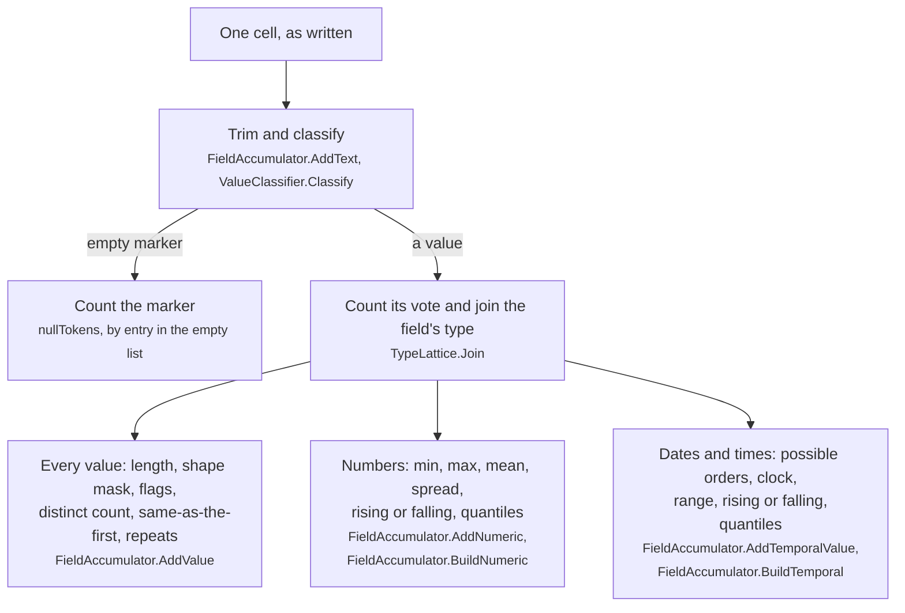

*Source: `Fields/FieldAccumulator.cs`, `Fields/TypeLattice.cs`, `Fields/TemporalMath.cs`, `Delimited/DelimitedPass.cs` (the hook is `DelimitedPass.ProcessData`).*

A field's type is the join of what its values vote for. Whole numbers join with decimal numbers, a date joins with a date and time, and any other mix is text. A value that is empty does not vote.

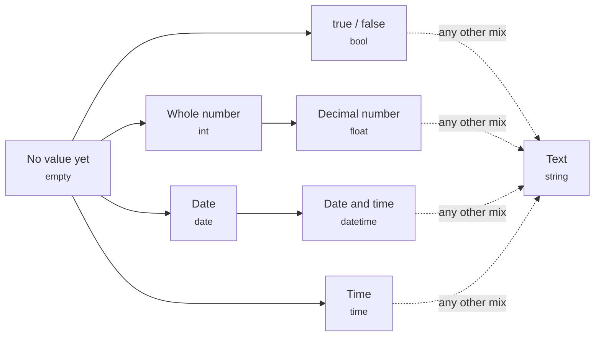

*Source: `Fields/TypeLattice.cs` (the join is `TypeLattice.Join`).*

Dates are the one place where the type can depend on more than the votes. Each date allows some field orders, and the field keeps the orders that every one of its dates allows. The votes are still reported as they were counted.

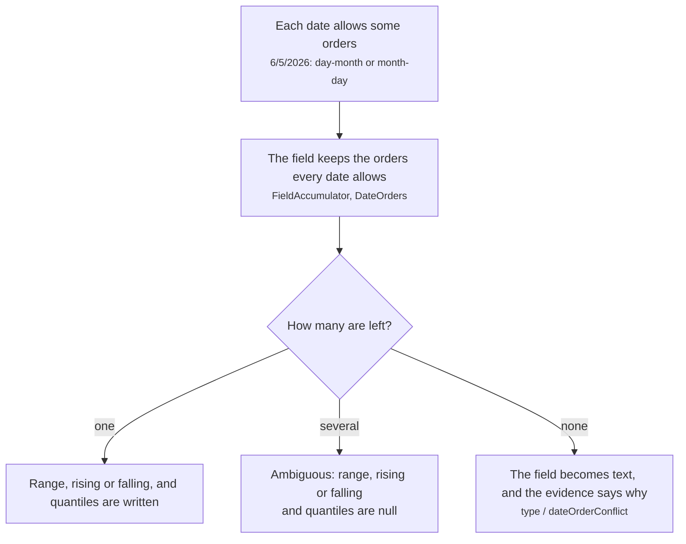

*Source: `Fields/FieldAccumulator.cs`, `Values/DateOrders.cs`, `Fields/TemporalMath.cs`.*

Every value of a field is also reduced to a **shape mask**: `9` for a digit, `A` for an upper-case letter, `a` for a lower-case letter, punctuation and spaces kept as they are, and `?` for anything that is not plain ASCII (and for curly braces, which the run counts use). A run of two or more is written with a count, so `Lot-A12` is `Aa{2}-A9{2}`. The masks show how a field is written without showing what is in it. A field keeps at most 64 masks, and at most its share of a global budget of mask text, and counts the rest as `other`. File names use the same masks.

Some facts about a field are cheap to keep exactly, and some are not. Counts, the minimum and maximum, the mean and the spread take constant memory. The distinct count and the quantiles need the values themselves, so they are exact only up to a cap (10,000 distinct values and 100,000 values per field). A global budget keeps wide files bounded: each field gets the smaller of its cap and its share of the budget, so a file of 2,000 columns gets 5,000 quantile values and 1,000 distinct values per column, and `limits` in the descriptor records the caps in effect. The budget also covers the text of the shape masks, because a few adversarial values could otherwise make 2,000 columns hold hundreds of megabytes of masks.

Past a cap a **sketch** takes over: a small, fixed-size summary that answers the same question with a known error, and the descriptor says so (`approximate: true`, with `relativeStdError` for a distinct count and `rankError` for quantiles). The distinct count becomes a HyperLogLog estimate, whose typical error is about 0.8 percent (1.4 percent at worst). The quantiles become a Greenwald-Khanna summary, whose rank error is at most 0.1 percent of the number of values. Each sketch has a fixed size, about 16 KiB for the distinct count and about 28 KB for the quantiles of a field, and a wide table pays that for every column, so the sketches are part of the memory bound. When the cap is crossed, the values already held are poured into the sketch in file order and freed. Both sketches use no randomness: HyperLogLog hashes with squalify's own xxHash64 and gives the same answer for the same set of values in any order, and Greenwald-Khanna depends only on the values and their order, so the descriptor is still the same on every machine.

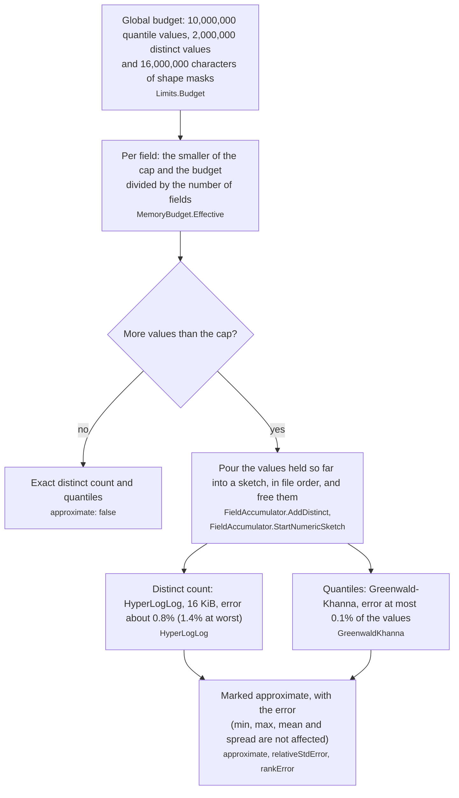

*Source: `Fields/MemoryBudget.cs`, `Fields/ProfileLimits.cs`, `Fields/FieldAccumulator.cs`, `Descriptor/Options.cs`, `Sketches/HyperLogLog.cs`, `Sketches/GreenwaldKhanna.cs`.*

Dates need one more step. A date written `3/4/2026` has not yet been read as day-month or month-day, and the two readings put the same dates in a different order. So when the cap is crossed, the field starts one summary for each reading that is still possible, over the date as read that way. When a later date rules a reading out, that summary is dropped, and the one that is left gives the quantiles.

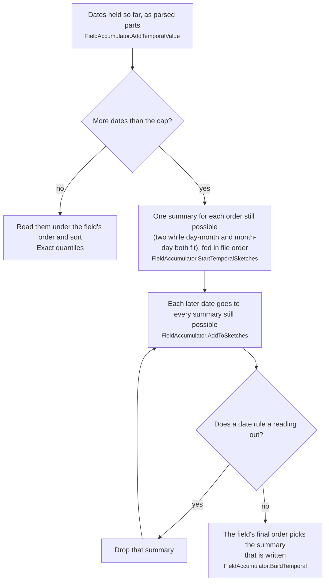

*Source: `Fields/FieldAccumulator.cs`, `Fields/TemporalMath.cs`, `Sketches/GreenwaldKhanna.cs`.*

Memory is also **accounted for**, so that a leak shows up in a test. Every field accumulator can estimate how many bytes it holds (the exact-value buffers, the distinct set, the shape masks, the top values, the sketches). While the file streams, the delimited pass adds these up every 1,024 rows, together with the row classes and the header sample, and keeps the peak. The ceiling is that peak plus a fixed 64 MiB for the read buffers and some headroom. The runtime itself is not budgeted: a test measures how much the process grows over a baseline, which is the peak of the same process after it profiled a small file. Two tests profile a generated stream in a fresh process with the default runtime settings and check that the growth never exceeds the ceiling: one on a 256 MB stream and one on a 4 GB stream, both run by hand, because the process growth depends on how much freed memory the runtime keeps, which varies by OS (on a Windows CI runner it once grew 89 MB). A third test, which runs in the normal test run, forces a collection at sampled points and checks that the live heap stays close to the estimate. The ceiling is only a check, and squalify never stops or slows down because of it.

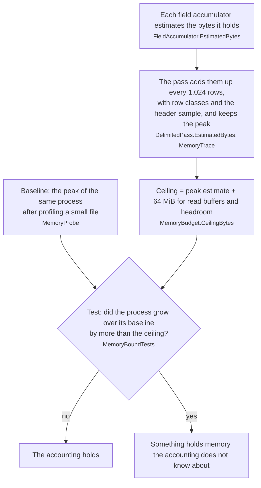

*Source: `Fields/MemoryBudget.cs`, `Fields/MemoryTrace.cs`, `Fields/FieldAccumulator.cs`, `Fields/ChunkedBuffer.cs`, `Delimited/DelimitedPass.cs`; `../../tests/squalify.Tests/MemoryBoundTests.cs`.*

## 6. What is always included, and what needs `--include-values`

By default a descriptor describes the **shape** of the data and its statistics, not its contents. Literal text from the file appears only when you ask for it: all of it with `--include-values`, or only named keys and columns with `--include-values-for <name>` (repeatable). A name is matched whole, ignoring ASCII upper and lower case, against preamble keys, annotation labels, key=value keys and column names, and it opens every one of that name: `--include-values-for lot` opens a preamble key `Lot` and a column `LOT` together. A name that matches nothing is reported as the issue `includeValuesForUnmatched`, so a typo is not silent.

A column with one value for the whole file, such as a serial number, is a special case. Its range would just be that value, so its statistics are opt-in too: the descriptor leaves them out and says `statsWithheld: "constant"`, but still reports the column's length, shapes and distinct count. A column that has one value and otherwise only empty markers counts as one-value, and for numbers and dates "one value" means the same number or date however it is written, so `1`, `1.0` and `01` are one value.

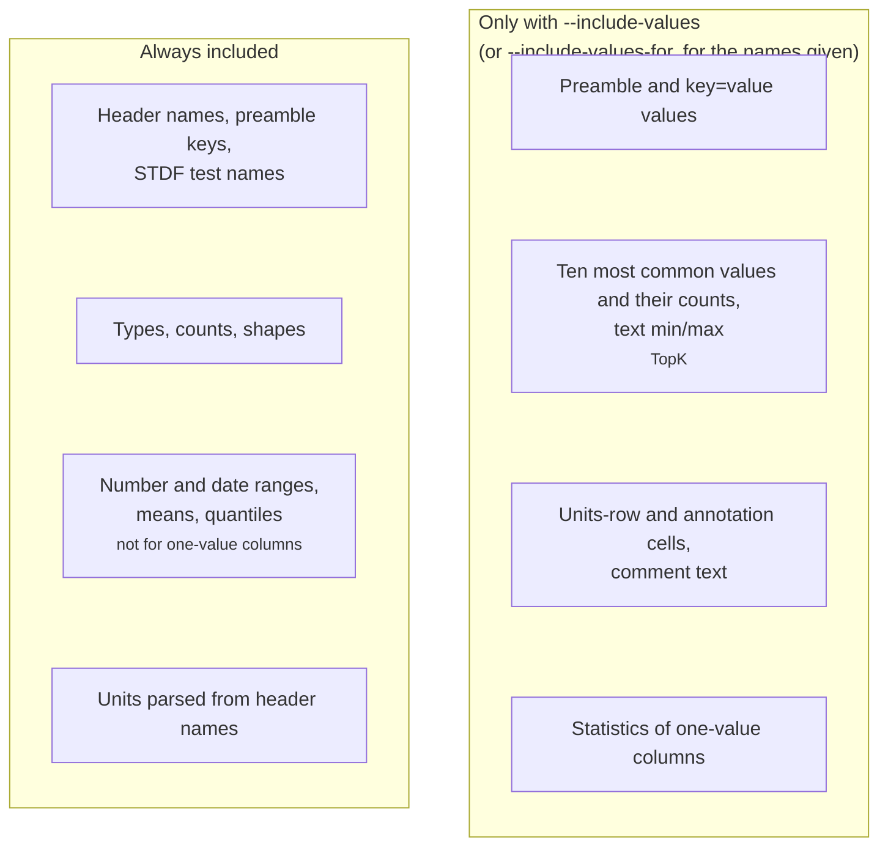

*Source: `Descriptor/Options.cs` (`ProfileOptions`), `ValuesPolicy.cs` (the list of value-bearing members), `Fields/FieldAccumulator.cs` (the one-value-column rule, top values, text min/max), `Fields/TopK.cs`.*

The most common values are exact while a column has at most 10,000 distinct values (fewer in a very wide file). Past that, a fixed set of 1,000 counters takes over, the output says `approximate: true`, and `maxError` says by how much a listed count can be too high.

Two checks keep values out. Before a profiler keeps a value (a preamble value, an annotation cell, a units cell, a column's common values), it asks the policy whether that key, label or column is opted in, so a value that may not be written is never held in memory. Then, before the writer writes anything, it checks the finished descriptor against the same list, and a value that slipped through stops the run as a bug rather than reaching the file.

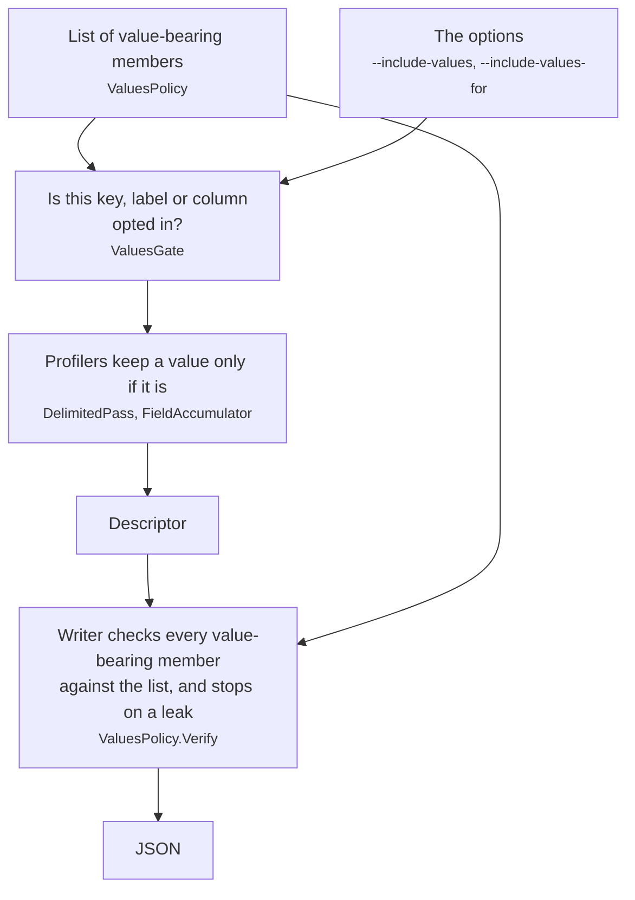

*Source: `ValuesPolicy.cs` (`ValuesPolicy`, `ValuesGate`, `Verify`), `Delimited/DelimitedPass.cs`, `Fields/FieldAccumulator.cs`, `Json/DescriptorWriter.cs`.*

## 7. Fingerprints and hints

squalify hashes a stripped-down copy of the descriptor that contains no data values. Two files of the same type therefore get the same fingerprint, even when their data differs. There are four fingerprints at different levels of strictness. `structure` uses no column names at all, so it survives a changed column set. `layout` adds the column names (upper and lower case count as the same) and the preamble keys, `typed` adds the column types, and `names` keeps only the sorted set of names, so it survives reordered columns.

A matching fingerprint does not prove two files are the same kind of file. Many unrelated CSVs share one `structure`, and files whose columns change per run get a new `layout` each time. A column that is empty in one file and filled in another changes `typed` only, so a consumer treats `empty` as matching any type and `int` as inside `float`. Consumers combine fingerprints with names and hints.

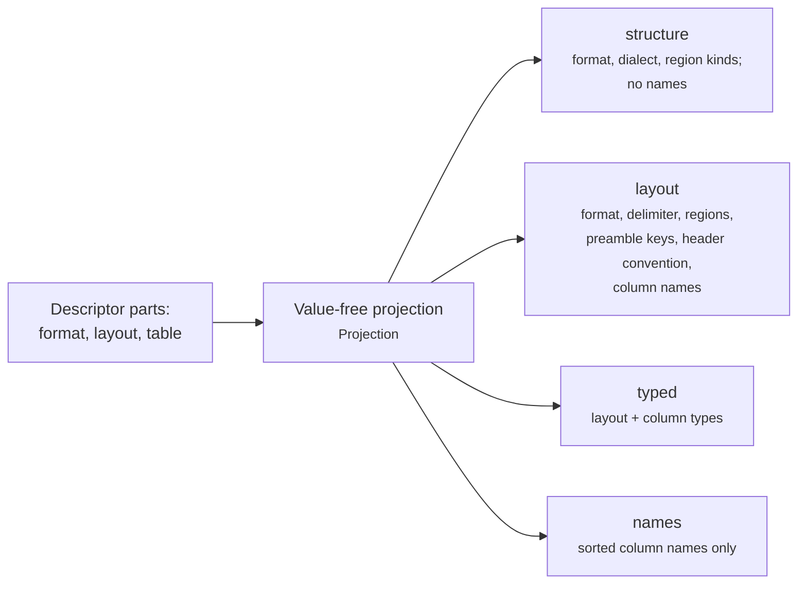

*Source: `Fingerprint/Projection.cs`.*

Names are compared with upper-case ASCII letters folded to lower case and nothing else, never with the system's Unicode tables, so the hashes are the same on every machine. A name with a control character or a replacement character (a stray byte that could not be read as text) would differ from file to file, so it is left out and reported as an issue instead of making every sibling file unique.

```mermaid
flowchart TD
    N["One header name or preamble key"] --> Q{"Has a control character<br/>or a replacement character?<br/><small>Projection.IsExcluded</small>"}
    Q -- "yes" --> X["Left out: column shows as #index,<br/>key is dropped, issue is counted<br/><small>nameExcludedFromFingerprint</small>"]
    Q -- "no" --> F["Fold A to Z to lower case<br/><small>Ordinal.AsciiFold</small>"]
    F --> K["Goes into layout, typed and names<br/><small>fields, preambleKeys</small>"]
```

*Source: `Fingerprint/Projection.cs`, `Fingerprint/DelimitedFingerprint.cs`, `Determinism/Ordinal.cs`.*

Each kind of file adds its own part to the projection through one small interface. Delimited text adds its dialect and preamble keys today (for a file with several blocks, those of the first block, plus the fact that there are several). The other families will add theirs when their profilers arrive.

```mermaid
flowchart TD
    P["Projection<br/><small>Projection</small>"] --> R["Find the family's contributor<br/><small>FingerprintContributors.For</small>"]
    R --> DC["Delimited: dialect,<br/>preamble keys and line kind<br/><small>DelimitedFingerprint</small>"]
    R -. "later slices" .-> OC["Touchstone, key=value, STDF<br/><small>(planned)</small>"]
    DC --> M["Members written right after the family name<br/><small>FingerprintContribution</small>"]
    OC -.-> M
    M --> H["Hash of the compact JSON text<br/><small>SHA-256</small>"]
```

*Source: `Fingerprint/IFingerprintContributor.cs`, `Fingerprint/DelimitedFingerprint.cs`. The Touchstone, key=value and STDF contributors are (planned).*

The **hints** are facts a consumer can turn into match rules: the extension, the named magic bytes with their offset, the header names, the first five names, the columns that had no empty values outside blank separator rows, the delimiter, and the file-name shape. The most useful are the **stable lines**: a regex for the header line, a looser one for just its first five names, and one for each `key=value` line in the preamble. Each regex is built from the real text of the line, so it matches the file as written, including quotes and padding. A comment or free-text line is data, so its regex is written only with `--include-values`, and a line with a stray unreadable byte or a control character gets no regex.

The regexes use a very small part of the regex language, so the same text works in .NET and in other engines. squalify checks every regex against its own line under two engines (the .NET default and its stricter ECMAScript mode) and keeps only the ones that match under both.

```mermaid
flowchart TD
    L["Header and preamble lines<br/>noted while reading<br/><small>DelimitedPass</small>"] --> R["Read those physical lines again<br/>from the file as written<br/><small>LineReader</small>"]
    R --> E["Escape the text, add anchors<br/><small>PortableRegex</small>"]
    E --> C{"Matches its own line<br/>in both engines?<br/><small>PortableRegex.MatchesBoth</small>"}
    C -- "yes" --> K["Kept, sorted by line, then regex<br/><small>hints.stableLines</small>"]
    C -- "no" --> D["Left out"]
```

*Source: `Delimited/DelimitedPass.cs` (`ReadStableLines`), `Text/LineReader.cs`, `Hints/PortableRegex.cs`, `Hints/HintBuilder.cs`.*

## 8. Header-unit conventions and the kind label

Lab exports carry units in many custom ways: `I_Total(A)`, `Pout[dBm]`, `VCC_V`, a units row under the header, or not at all. squalify reports which way each column name does it, and which way the file does it most. It reads the header names only, never the values, so the result is always included in the descriptor.

Each header name is tried against a short list, in this order, and the first match wins. The patterns and the unit table follow DataBall's header parser, so a consumer can map the conventions directly. The one addition is the bracket form, and digits alone in brackets (`Trace[0]`) are an array index, not a unit.

```mermaid
flowchart TD
    N["One header name, trimmed<br/><small>HeaderConventionParser.Parse</small>"] --> P{"Ends with (text) after a name?<br/>Pout(dBm)"}
    P -- "yes" --> Pp["Paren convention: base name + unit text<br/><small>nameParenUnit</small>"]
    P -- "no" --> B{"Ends with [text] after a name,<br/>text not only digits?<br/>Pout[dBm]"}
    B -- "yes" --> Bb["Bracket convention<br/><small>nameBracketUnit</small>"]
    B -- "no" --> U{"Last _ is followed by a unit<br/>from the fixed table?<br/>VCC_V"}
    U -- "yes" --> Uu["Underscore convention<br/><small>nameUnderscoreUnit, UnitTable.IsKnown</small>"]
    U -- "no" --> Nn["Plain name, no unit<br/><small>none</small>"]
    Pp -.-> Fl["Unit text not in the table:<br/>flag unknownUnit, as in Date(date)<br/><small>NameParts.UnknownUnit</small>"]
    Bb -.-> Fl
```

*Source: `Units/HeaderConventionParser.cs`, `Units/UnitTable.cs`.* The parenthesis and bracket forms accept any unit text and flag the ones the table does not know, so `RowID(id)` is split into the base `RowID` and the unit `id`, with the flag. The underscore form needs a known unit, so `I_Total` stays a plain name. The table is fixed and versioned (`limits.unitTable`): V, A, W, Hz, s, Ohm, F, H, dB, dBm, dBc, %, C, K and the angle units `°` and `deg`, with the SI prefixes f to G on the first eight. Matching is case-sensitive, except for a short list of spelled-out aliases such as `ohm` and `degC`. When the file has a units row, every name without a unit of its own gets the convention `unitsRow`, but only when its units cell has a value; the units text itself is a value and stays opt-in.

The file then gets one summary: how many names use each convention, and the most common one. A tie goes to the earlier convention in the list above, with `none` last, so a file with as many unit names as plain names counts as using the unit convention. A table with no header has no names, so it gets no convention.

```mermaid
flowchart LR
    A["Every header name<br/><small>DelimitedPass.Build</small>"] --> C["Count names per convention<br/><small>HeaderConventionParser.Analyze</small>"]
    C --> D["Most common wins;<br/>a tie goes to the earlier convention<br/><small>nameParenUnit first, none last</small>"]
    D --> L["layout.headerConvention:<br/>dominant, share, counts<br/><small>HeaderConventionInfo</small>"]
    D --> H["hints.headerConvention<br/><small>Hints</small>"]
    D --> E["Evidence: one score per convention<br/><small>stage unit</small>"]
```

*Source: `Units/HeaderConventionParser.cs`, `Delimited/DelimitedPass.cs`, `Hints/HintBuilder.cs`.*

A second rule set, the **kind label**, is still planned. It will read the finished descriptor (never the file) and suggest a generic label such as `labSweepTable`, `stdfTestLog` or `touchstoneNetwork`. The first rule in a fixed, ordered list that matches wins, and every rule's result is kept as evidence.

```mermaid
flowchart LR
    D["Finished descriptor<br/><small>including headerConvention</small>"] --> K["Ordered kind rules<br/><small>KindRules</small>"]
    K --> L["kind: labSweepTable<br/><small>+ evidence per rule</small>"]
```

*Source: `Kind/` (planned).*

## 9. Why the output never changes

The same file, options and squalify version always give the same descriptor, byte for byte, on Windows, macOS and Linux, within one .NET runtime major version. (The one runtime-dependent detail is how the JSON writer escapes characters that the runtime's Unicode tables leave unassigned, so a new runtime major can change those bytes; consumers pin the package and the runtime. The fingerprint hashes do not depend on the runtime.) Five guardrails make that true.

```mermaid
flowchart LR
    G1["No time, paths or machine info<br/>in the output"] --> Same
    G2["One thread, input order;<br/>everything sorted before writing<br/><small>Ordinal, CountMap</small>"] --> Same
    G3["Fixed JSON writer: key order,<br/>LF newlines, number format<br/><small>DescriptorWriter, CanonicalNumber</small>"] --> Same
    G4["Platform-independent math and hashing<br/><small>DetMath, XxHash64</small>"] --> Same
    G5["Golden files compared<br/>on all three OSes<br/><small>Golden</small>"] --> Same
    Same["Byte-identical descriptor<br/><small>within one .NET runtime major</small>"]
```

*Source: `Determinism/Ordinal.cs`, `Determinism/DetMath.cs`, `Determinism/XxHash64.cs`, `Descriptor/CountMap.cs`, `Json/DescriptorWriter.cs`, `Json/CanonicalNumber.cs`; `../../tests/squalify.Tests/Golden.cs`.*

Sketches are part of this guarantee: the sketches' hashes, their registers and their summaries use only integers and the same additions, multiplications and divisions, and a golden test pins their output on all three systems.

Logarithms are the one place where platforms can disagree: the system math library may differ by one bit between operating systems. squalify therefore computes them itself, from additions, multiplications and divisions only, which every CPU rounds identically. A reference table made with an arbitrary-precision tool pins the result bit for bit. Hashing uses squalify's own copy of xxHash64, checked against published test vectors.

## 10. Row classes

Some exports mix several kinds of row in one table: measurement rows, setup rows, error rows and empty separator rows, switching kind on almost every line. Regions cannot describe that, because a region is one stretch of lines. squalify groups the data rows by which columns are filled in, and reports each group, how often the kind switches, and how many rows are completely empty. Column null counts are also given without the empty rows, so separators do not look like missing measurements.

```mermaid
flowchart TD
    R["Each data row, in file order<br/><small>DelimitedPass.ProcessData</small>"] --> M["Mark which columns are empty<br/><small>null mask, one array reused</small>"]
    M --> N["Name the group from its filled columns<br/><small>XxHash64, rc:...; a different name from the row before is a switch, counted in transitions</small>"]
    N --> K{"One of the first<br/>64 groups?"}
    K -- "yes" --> C["Count it: rows, first and last line<br/><small>RowClass.Count, FirstLine, LastLine</small>"]
    K -- "no" --> T["Only count it as truncated<br/><small>truncated</small>"]
    M -. "every column empty" .-> E["Also count an empty row, and leave it out<br/>of each column's null count<br/><small>allNullRows, nullsExcludingAllNullRows</small>"]
```

*Source: `Fields/RowClassAccumulator.cs`, `Delimited/DelimitedPass.cs`, `Descriptor/Table.cs`.*

A group's name is a hash of the numbers of its filled columns, and nothing else: not the line, not the order of the rows, not the file. The same kind of row therefore gets the same name wherever it sits, as long as the column order is the same. An empty row is a group too (with no columns), and it is also counted on its own, so a consumer can take the rows of the table minus the empty ones. Rows with the wrong number of columns belong to no group. When a file has several blocks with the same header, a block boundary is never counted as a switch. Memory stays bounded: 64 groups are kept with exact counts, and the rows of any later group are only counted.

## 11. Writing the descriptor

The finished descriptor is a tree of plain model objects. The writer turns it into bytes in one fixed way: it writes each object's keys in the order the schema document lists, and it never sorts, because the model already holds every list and map in order. Numbers and text go through fixed rules, so the same model gives the same bytes on every machine, within one .NET runtime major version (the runtime decides how characters that its Unicode tables leave unassigned are escaped).

```mermaid
flowchart TD
    M["Descriptor model:<br/>lists and maps already sorted<br/><small>Descriptor, CountMap</small>"] --> W["Write every object<br/>in the documented key order<br/><small>DescriptorWriter</small>"]
    W --> N["Numbers: shortest round-trip form,<br/>-0 as 0, NaN and Infinity as strings<br/><small>CanonicalNumber</small>"]
    W --> T["Text and layout: UTF-8, no BOM,<br/>LF newlines, 2-space indent,<br/>one trailing LF<br/><small>DescriptorWriter options</small>"]
    N --> B["Descriptor bytes"]
    T --> B
    B -. "tests compare with" .-> G["Golden file<br/><small>Golden</small>"]
```

*Source: `Descriptor/`, `Json/DescriptorWriter.cs`, `Json/CanonicalNumber.cs`; `../../tests/squalify.Tests/Golden.cs`.* The key order is part of the schema: see [descriptor.md](descriptor.md#canonical-form).

## 12. Text, binary or empty?

The byte pass counts every byte of the file once and then applies seven rules, in order. The first rule that fits decides. A file is never rejected: odd bytes are counted, and invalid UTF-8 in ascii or utf-8 text is also reported as an issue (`invalidUtf8`). Invalid UTF-16 or UTF-32 (a lone surrogate, a stray last byte, an impossible UTF-32 value) is found by a second look at those files, counted in the same invalid-bytes number and reported as `invalidUnicode`; there is no allowance for it, because the byte order mark or the NUL pattern already fixed the encoding. A few stray invalid bytes in an otherwise plain text file do not change its encoding, because a single bad byte in a large log should not turn it into "Latin-1" or "binary"; the allowance is at most 8 per file and at most 1 per 64 KiB.

```mermaid
flowchart LR
    S["Count every byte<br/><small>ByteSniffer</small>"] --> R1["1. No bytes?"]
    R1 --> R2["2. Known magic<br/>such as gzip?"]
    R2 --> R3["3. UTF-16/32<br/>byte order mark?"]
    R3 --> R4["4. NULs in a<br/>UTF-16 pattern?"]
    R4 --> R5["5. Other NULs, or over<br/>5% control bytes?"]
    R5 --> R6["6 and 7. Plain text<br/><small>SniffResult</small>"]
    R1 -. "yes" .-> E["empty"]
    R2 -. "yes" .-> B["binary<br/><small>magic named, not unpacked</small>"]
    R5 -. "yes" .-> B
    R3 -. "yes" .-> T16["text: UTF-16 or UTF-32"]
    R4 -. "yes" .-> T16
    T16 -. "second read" .-> V["Count invalid units into invalidBytes<br/>and the invalidUnicode issue<br/><small>InvalidUnicodeScanner, TextDecoder</small>"]
    R6 --> T["text: ascii, utf-8 or latin-1"]
```

*Source: `Sniff/ByteSniffer.cs`, `Sniff/SniffResult.cs`, `Sniff/MagicTable.cs`, `Text/InvalidUnicodeScanner.cs`, `Text/TextDecoder.cs`.* The exact thresholds and the magic table are in [descriptor.md](descriptor.md#encoding).
