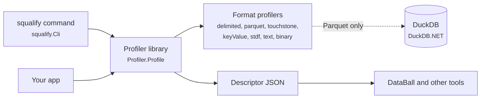
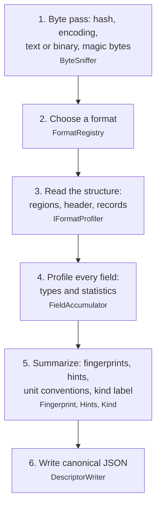
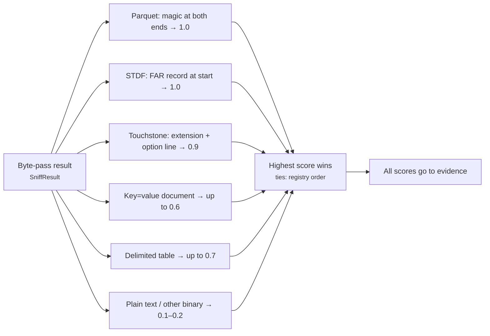
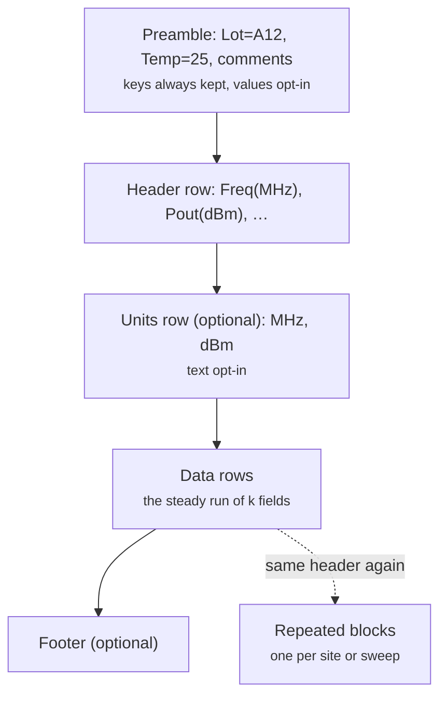
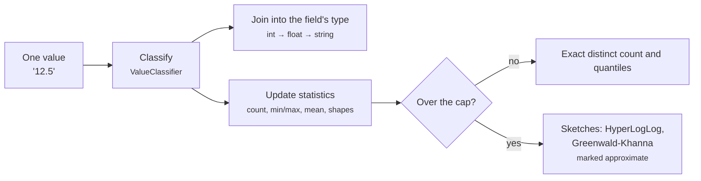
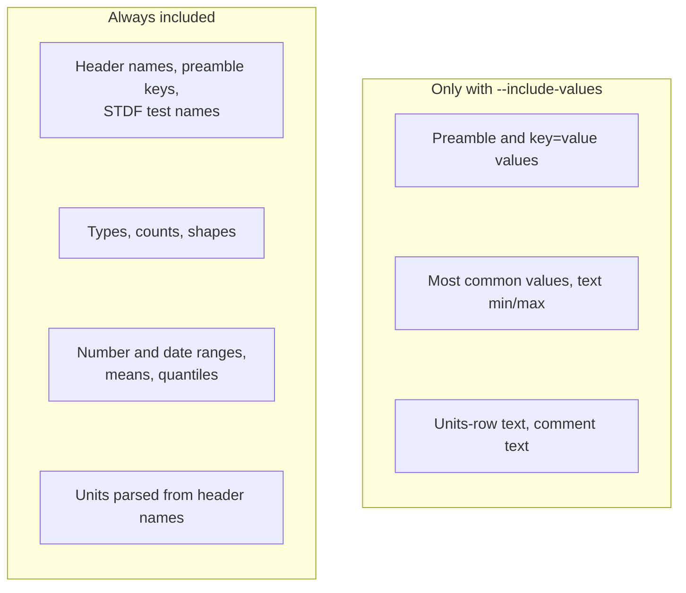
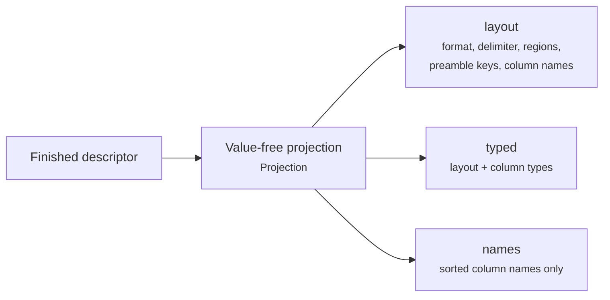
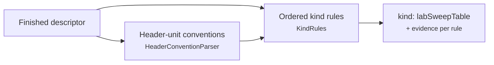
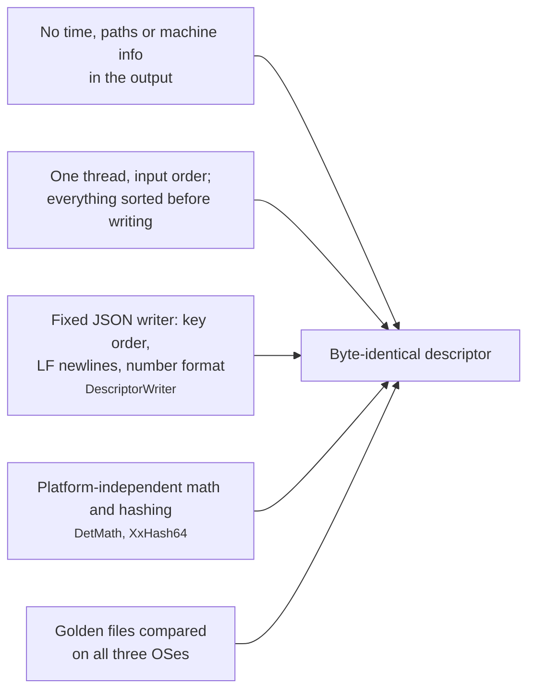

# How squalify works

> **Design stage.** This page describes the agreed design (spec pass, 2026-10-13). No slice has landed yet, so every source file is marked *(planned)*. When an architectural review or a slice changes how squalify works, this page and its diagrams are updated in the same change (see "Docs" in `AGENTS.md`).

squalify reads one data file and writes a **descriptor**: a JSON summary of what the file is and what is inside it. Other tools, such as DataBall, read the descriptor to decide how to handle the file. squalify never changes the file and never needs the network.

Each diagram shows one idea. Labels are in plain language, with the code name in small text. Source paths are relative to `src/squalify/`.

## 1. The pieces

The `squalify` command is a thin shell around the library. Each kind of file has its own profiler. DuckDB is used only to read Parquet. The descriptor is the only thing that leaves the tool.

*Source: `Profiler.cs`, `Formats/` (planned).*

## 2. One profile run

Every file goes through the same steps. A step that reads the file reads all of it, start to end, and keeps only bounded summaries in memory. The file can be far larger than RAM.

*Source: `Profiler.cs`, `Sniff/`, `Json/DescriptorWriter.cs` (planned).*

## 3. Choosing a format

Every profiler looks at the byte-pass result and gives a score from 0 to 1. The highest score wins, and a tie goes to whichever profiler comes first in the registry list. Every score and its reason are kept in the descriptor's evidence, so you can see why a format was chosen.

*Source: `Formats/FormatRegistry.cs` (planned).*

## 4. Reading a delimited file

A lab CSV is often more than a header and rows. squalify splits the file into regions. It tries every common delimiter at the same time and picks the one that gives the longest steady run of rows with the same field count.

*Source: `Delimited/DialectSelector.cs`, `Delimited/HeaderDetector.cs`, `Delimited/BlockDetector.cs` (planned).*

## 5. Profiling one field

Each value is classified on its own: empty, true/false, whole number, decimal number, date, time or text. A field's type is the narrowest type that fits **every** non-empty value. Statistics are exact up to a cap. Past the cap they switch to a fixed approximation that gives the same answer every time, and the descriptor marks them as approximate.

*Source: `Values/ValueClassifier.cs`, `Fields/FieldAccumulator.cs`, `Sketches/` (planned).*

## 6. What is always included, and what needs `--include-values`

By default a descriptor describes the **shape** of the data and its statistics, not its contents. Literal text from the file appears only when you ask for it.

*Source: `ValuesPolicy.cs` (planned).*

## 7. Fingerprints

squalify hashes a stripped-down copy of the descriptor that contains no data values. Two files of the same type therefore get the same fingerprint, even when their data differs. There are three fingerprints at different levels of strictness.

*Source: `Fingerprint/Projection.cs` (planned).*

## 8. Kind label and unit conventions

After profiling, two small rule sets read the finished descriptor. They never read the file.

- **Header-unit conventions.** Every column name is checked for how it carries a unit: `I_Total(A)`, `Pout[dBm]`, `VCC_V`, a units row, or none. The most common convention is reported.
- **Kind label.** A fixed, ordered list of rules suggests a generic label, such as `labSweepTable`, `stdfTestLog` or `touchstoneNetwork`. The first rule that matches wins, and every rule's result is kept as evidence.

*Source: `Units/`, `Kind/` (planned).*

## 9. Why the output never changes

The same file and the same squalify version always give the same descriptor, byte for byte, on Windows, macOS and Linux. Five guardrails make that true.

*Source: `Determinism/`, `Json/` (planned); `tests/squalify.Tests/Golden.cs` (planned).*
